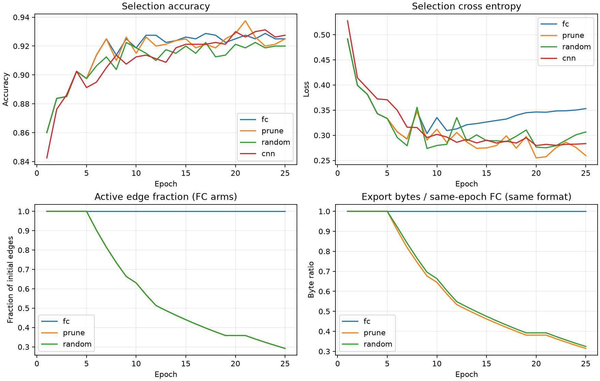

# H1任务保持剪枝：静态MNIST实际报告

20261007；来自实际完成的四臂运行，报告只读取保存预测、模型文件与账本。

实现提交：`7e4523119887774ae4811857748f29709db9a8da`（启动前training_commit.json登记）。配置、源哈希、完整曲线和分项账本见[完整JSON](pruning_v1_mnist_static_20261007.json)。

## 任务、边界与对照

模型根11，数据根20261004；仅授权5000原ID，分为3200参数拟合、800结构选择、1000冻结后探索性确认。原control曾用于历史探索，不是全新独立最终测试；未解封剩余原ID，未访问官方测试。

FC/剪枝/随机臂骨架为784→512→256→10、两层ReLU，同初始化与逐轮批次顺序。CNN为人工预置8通道5×5有效卷积、ReLU、展平线性10输出；容量与执行形式不同，仅作参照。

四臂各25轮，AdamW初始学习率0.001，weight decay=0.0，批量64；前5轮预热，每个主候选使用一个原预算批次适应，最多40次提议。采用最终轮，不根据确认集选择轮次。

prune使用拟合梯度与权重敏感度提议删边，固定256样本筛选集及完整800样本选择集作接受依据，接受还须实际文件缩小。random按主剪枝接受的时间、slot和每层删边数，无条件均匀随机删除；主拒绝slot同样适应后回退，以匹配净保留更新。随机臂的选择评价不决定接受，比较的是相同接受日程下删除连接的身份，不是独立随机搜索方法。

## 实际性能

| 臂 | 集合 | 样本 | 准确率 | 交叉熵 |
| --- | --- | --- | --- | --- |
| fc | 拟合 | 3200 | 100.0000% | 0.001951 |
| fc | 结构选择 | 800 | 92.5000% | 0.353065 |
| fc | 探索确认 | 1000 | 93.6000% | 0.272518 |
| prune | 拟合 | 3200 | 99.8438% | 0.035527 |
| prune | 结构选择 | 800 | 92.5000% | 0.259567 |
| prune | 探索确认 | 1000 | 93.3000% | 0.226738 |
| random | 拟合 | 3200 | 99.0312% | 0.139658 |
| random | 结构选择 | 800 | 92.0000% | 0.306547 |
| random | 探索确认 | 1000 | 92.2000% | 0.273840 |
| cnn | 拟合 | 3200 | 99.9062% | 0.024861 |
| cnn | 结构选择 | 800 | 92.7500% | 0.283444 |
| cnn | 探索确认 | 1000 | 94.1000% | 0.217800 |

混淆矩阵见下方：行是真值、列是预测；所有指标由本次保存logits重算并核对summary。

## 结构与实际文件

| 臂 | 活跃边 | 非零边 | 独立参数含偏置 | 分配参数槽 | 实际导出字节 | 计时边界内墙钟秒 | 接受/slot |
| --- | --- | --- | --- | --- | --- | --- | --- |
| fc | 535040 | 535040 | 535818 | 535818 | 1989967 | 14.096 | 0/0 |
| prune | 156247 | 156247 | 157025 | 535818 | 626300 | 177.273 | 24/40 |
| random | 156247 | 156247 | 157025 | 535818 | 645612 | 152.449 | 24/40 |
| cnn | 人工卷积参照 | 未按展开边计数 | 46298 | 46298 | 187613 | 4.008 | 0/0 |

FC/剪枝/随机臂隐藏单元768、输出10、总计算单元778（不含输入784），本轮不删除单元。

| 臂 | 层 | 活跃边/初始边 | 密度 | 独立参数含偏置 |
| --- | --- | --- | --- | --- |
| fc | 784→512 | 401408/401408 | 100.0000% | 401920 |
| fc | 512→256 | 131072/131072 | 100.0000% | 131328 |
| fc | 256→10 | 2560/2560 | 100.0000% | 2570 |
| prune | 784→512 | 117213/401408 | 29.2005% | 117725 |
| prune | 512→256 | 38279/131072 | 29.2046% | 38535 |
| prune | 256→10 | 755/2560 | 29.4922% | 765 |
| random | 784→512 | 117213/401408 | 29.2005% | 117725 |
| random | 512→256 | 38279/131072 | 29.2046% | 38535 |
| random | 256→10 | 755/2560 | 29.4922% | 765 |

FC/剪枝/随机臂使用同一FP32无损编码，实际字节包含数值、掩码、索引和全部元数据。CNN使用含架构名称的torch state文件，格式不同，不据文件大小直接比较架构效率。theta槽固定分配，前向仍是稠密gather及矩阵乘；存储减少不代表推断加速、内存减少、计算复用或实测能耗下降。



图中准确率/损失展示四臂；边比例/字节比仅展示同骨架同编码的FC臂。字节比参照对应轮FC，CNN未混入该曲线。

## 成本与检查边界

| 臂 | 优化前向样本 | 优化反传样本 | 尝试更新 | 候选适应 | 回退更新 | 净保留更新 | 评价前向样本 |
| --- | --- | --- | --- | --- | --- | --- | --- |
| fc | 80000 | 80000 | 1250 | 0 | 0 | 1250 | 24200 |
| prune | 80000 | 80000 | 1250 | 40 | 16 | 1234 | 58440 |
| random | 80000 | 80000 | 1250 | 40 | 16 | 1234 | 42632 |
| cnn | 80000 | 80000 | 1250 | 0 | 0 | 1250 | 24200 |

合计优化前向/反传样本320000/320000；尝试更新5000，回退32，净保留4968。评价前向合计149472样本。被回退适应仍消耗样本和搜索成本。每种评价用途的调用与样本账本见JSON。

唯一启动检查为8样本前向/8样本反传、0更新，单列且未重复。本报告生成0模型前向/反传/更新，未启动GPU测试或恢复重放。

设备cuda，PyTorch 2.13.0+cu130；FP32、训练批量64、评价批量512、CPU线程2。CUDA峰值分配166780416字节，是整次运行峰值，不能作为逐臂内存比较。

本次会话实际墙钟383.6348150999984秒。臂间墙钟覆盖每轮训练、候选搜索、选择评价和编码，排除checkpoint/预测写入及最终拟合/确认评价；不是完整端到端训练或推断计时，同epoch也不是同计算预算。

## H1判定与随机比较

主剪枝相对FC文件减少68.53%，计时边界内墙钟倍数12.576；FC学会=True，效果保持=True，存储门槛=True，运行成本门槛=False，继续门槛=False。共享不是该H1门槛。

| 集合 | prune−random准确率（百分点） | prune−random交叉熵 |
| --- | --- | --- |
| 拟合 | +0.8125 | -0.104131 |
| 结构选择 | +0.5000 | -0.046980 |
| 探索确认 | +1.1000 | -0.047102 |

本次主剪枝的结构选择准确率和损失均优于匹配随机删除，是任务敏感删边可能有用的单根信号。随机臂依赖主接受日程，选择集被多次用于主剪枝决策，旧control也是探索确认；单一模型根不能证明稳健性、统计显著性或通用性。
本轮未通过预登记扩大门槛，应保留失败项并停止相同条件预算扩大；不以压缩单项宣布成功。
下一步先定位候选编码、状态复制、图编辑及评价的成本；本轮未分别计时，不能断言具体瓶颈。性能保持/存储缩小与搜索效率失败分别记录，不改动原门槛，也不追加训练以改善判定。
不要求形成共享或卷积，也没有空间局部性、卷积计算复用及跨任务普适性证据。

## 证据与恢复

[重要证据索引](pruning_v1_mnist_static_20261007_evidence/README.md)保留四臂最终模型、fit/select/confirm预测和运行登记。所有复制文件SHA256在完整JSON，未复制大型恢复checkpoint。

原运行日志、逐轮预测与resume.pt路径：`E:\project\brain-grow\experiments\runs\pruning_v1\mnist_static`。源码与配置哈希一致时恢复；已完成运行的--resume仅返回完成判定，不重训或重复确认。

```powershell
.venv/Scripts/python.exe -u -B -m tools.train_pruning --task mnist_static --resume
```

## 混淆矩阵

### fc：拟合

| 真值\预测 | 0 | 1 | 2 | 3 | 4 | 5 | 6 | 7 | 8 | 9 |
| --- | --- | --- | --- | --- | --- | --- | --- | --- | --- | --- |
| 0 | 320 | 0 | 0 | 0 | 0 | 0 | 0 | 0 | 0 | 0 |
| 1 | 0 | 320 | 0 | 0 | 0 | 0 | 0 | 0 | 0 | 0 |
| 2 | 0 | 0 | 320 | 0 | 0 | 0 | 0 | 0 | 0 | 0 |
| 3 | 0 | 0 | 0 | 320 | 0 | 0 | 0 | 0 | 0 | 0 |
| 4 | 0 | 0 | 0 | 0 | 320 | 0 | 0 | 0 | 0 | 0 |
| 5 | 0 | 0 | 0 | 0 | 0 | 320 | 0 | 0 | 0 | 0 |
| 6 | 0 | 0 | 0 | 0 | 0 | 0 | 320 | 0 | 0 | 0 |
| 7 | 0 | 0 | 0 | 0 | 0 | 0 | 0 | 320 | 0 | 0 |
| 8 | 0 | 0 | 0 | 0 | 0 | 0 | 0 | 0 | 320 | 0 |
| 9 | 0 | 0 | 0 | 0 | 0 | 0 | 0 | 0 | 0 | 320 |

### fc：结构选择

| 真值\预测 | 0 | 1 | 2 | 3 | 4 | 5 | 6 | 7 | 8 | 9 |
| --- | --- | --- | --- | --- | --- | --- | --- | --- | --- | --- |
| 0 | 75 | 0 | 1 | 0 | 0 | 1 | 0 | 1 | 2 | 0 |
| 1 | 0 | 80 | 0 | 0 | 0 | 0 | 0 | 0 | 0 | 0 |
| 2 | 0 | 0 | 76 | 0 | 2 | 0 | 0 | 0 | 2 | 0 |
| 3 | 0 | 0 | 2 | 73 | 0 | 4 | 1 | 0 | 0 | 0 |
| 4 | 1 | 0 | 0 | 0 | 75 | 0 | 0 | 0 | 0 | 4 |
| 5 | 1 | 0 | 1 | 2 | 0 | 72 | 4 | 0 | 0 | 0 |
| 6 | 2 | 0 | 0 | 0 | 0 | 2 | 72 | 0 | 4 | 0 |
| 7 | 0 | 0 | 1 | 0 | 1 | 1 | 0 | 74 | 1 | 2 |
| 8 | 0 | 1 | 0 | 1 | 2 | 1 | 0 | 0 | 72 | 3 |
| 9 | 0 | 0 | 0 | 2 | 4 | 2 | 1 | 0 | 0 | 71 |

### fc：探索确认

| 真值\预测 | 0 | 1 | 2 | 3 | 4 | 5 | 6 | 7 | 8 | 9 |
| --- | --- | --- | --- | --- | --- | --- | --- | --- | --- | --- |
| 0 | 98 | 0 | 1 | 0 | 0 | 0 | 1 | 0 | 0 | 0 |
| 1 | 0 | 98 | 0 | 0 | 1 | 1 | 0 | 0 | 0 | 0 |
| 2 | 1 | 0 | 94 | 2 | 1 | 0 | 1 | 0 | 1 | 0 |
| 3 | 0 | 0 | 1 | 89 | 0 | 4 | 0 | 2 | 4 | 0 |
| 4 | 0 | 0 | 0 | 0 | 93 | 0 | 1 | 0 | 0 | 6 |
| 5 | 0 | 0 | 0 | 1 | 0 | 93 | 3 | 1 | 0 | 2 |
| 6 | 0 | 0 | 2 | 0 | 1 | 3 | 94 | 0 | 0 | 0 |
| 7 | 1 | 0 | 3 | 0 | 0 | 0 | 0 | 95 | 0 | 1 |
| 8 | 0 | 1 | 1 | 1 | 1 | 3 | 0 | 1 | 91 | 1 |
| 9 | 1 | 0 | 0 | 0 | 5 | 0 | 0 | 3 | 0 | 91 |

### prune：拟合

| 真值\预测 | 0 | 1 | 2 | 3 | 4 | 5 | 6 | 7 | 8 | 9 |
| --- | --- | --- | --- | --- | --- | --- | --- | --- | --- | --- |
| 0 | 320 | 0 | 0 | 0 | 0 | 0 | 0 | 0 | 0 | 0 |
| 1 | 0 | 317 | 0 | 1 | 0 | 0 | 0 | 0 | 1 | 1 |
| 2 | 0 | 0 | 318 | 0 | 0 | 0 | 0 | 2 | 0 | 0 |
| 3 | 0 | 0 | 0 | 320 | 0 | 0 | 0 | 0 | 0 | 0 |
| 4 | 0 | 0 | 0 | 0 | 320 | 0 | 0 | 0 | 0 | 0 |
| 5 | 0 | 0 | 0 | 0 | 0 | 320 | 0 | 0 | 0 | 0 |
| 6 | 0 | 0 | 0 | 0 | 0 | 0 | 320 | 0 | 0 | 0 |
| 7 | 0 | 0 | 0 | 0 | 0 | 0 | 0 | 320 | 0 | 0 |
| 8 | 0 | 0 | 0 | 0 | 0 | 0 | 0 | 0 | 320 | 0 |
| 9 | 0 | 0 | 0 | 0 | 0 | 0 | 0 | 0 | 0 | 320 |

### prune：结构选择

| 真值\预测 | 0 | 1 | 2 | 3 | 4 | 5 | 6 | 7 | 8 | 9 |
| --- | --- | --- | --- | --- | --- | --- | --- | --- | --- | --- |
| 0 | 76 | 0 | 0 | 0 | 0 | 1 | 0 | 1 | 2 | 0 |
| 1 | 0 | 78 | 0 | 0 | 0 | 0 | 0 | 0 | 2 | 0 |
| 2 | 0 | 0 | 73 | 2 | 3 | 0 | 0 | 0 | 2 | 0 |
| 3 | 0 | 0 | 0 | 74 | 0 | 3 | 1 | 1 | 0 | 1 |
| 4 | 1 | 0 | 0 | 0 | 74 | 0 | 1 | 0 | 0 | 4 |
| 5 | 1 | 0 | 1 | 3 | 0 | 69 | 5 | 0 | 1 | 0 |
| 6 | 3 | 0 | 0 | 0 | 0 | 2 | 72 | 0 | 2 | 1 |
| 7 | 0 | 0 | 0 | 0 | 0 | 0 | 0 | 78 | 1 | 1 |
| 8 | 0 | 0 | 0 | 1 | 2 | 0 | 0 | 0 | 73 | 4 |
| 9 | 0 | 0 | 0 | 3 | 3 | 0 | 1 | 0 | 0 | 73 |

### prune：探索确认

| 真值\预测 | 0 | 1 | 2 | 3 | 4 | 5 | 6 | 7 | 8 | 9 |
| --- | --- | --- | --- | --- | --- | --- | --- | --- | --- | --- |
| 0 | 96 | 0 | 1 | 0 | 0 | 0 | 1 | 2 | 0 | 0 |
| 1 | 0 | 97 | 0 | 0 | 1 | 0 | 1 | 0 | 1 | 0 |
| 2 | 1 | 0 | 89 | 3 | 4 | 0 | 1 | 1 | 1 | 0 |
| 3 | 0 | 0 | 1 | 92 | 0 | 1 | 0 | 1 | 4 | 1 |
| 4 | 0 | 0 | 0 | 0 | 93 | 0 | 1 | 0 | 0 | 6 |
| 5 | 0 | 0 | 0 | 3 | 1 | 87 | 4 | 1 | 2 | 2 |
| 6 | 2 | 0 | 0 | 0 | 0 | 1 | 97 | 0 | 0 | 0 |
| 7 | 0 | 0 | 2 | 0 | 0 | 0 | 0 | 97 | 0 | 1 |
| 8 | 0 | 0 | 0 | 1 | 1 | 2 | 0 | 2 | 93 | 1 |
| 9 | 1 | 0 | 0 | 0 | 3 | 0 | 0 | 3 | 1 | 92 |

### random：拟合

| 真值\预测 | 0 | 1 | 2 | 3 | 4 | 5 | 6 | 7 | 8 | 9 |
| --- | --- | --- | --- | --- | --- | --- | --- | --- | --- | --- |
| 0 | 319 | 1 | 0 | 0 | 0 | 0 | 0 | 0 | 0 | 0 |
| 1 | 0 | 317 | 1 | 0 | 0 | 0 | 0 | 0 | 1 | 1 |
| 2 | 0 | 0 | 318 | 0 | 0 | 0 | 1 | 1 | 0 | 0 |
| 3 | 0 | 1 | 0 | 318 | 0 | 0 | 0 | 0 | 0 | 1 |
| 4 | 0 | 0 | 0 | 0 | 314 | 0 | 1 | 0 | 1 | 4 |
| 5 | 1 | 0 | 0 | 0 | 0 | 318 | 1 | 0 | 0 | 0 |
| 6 | 1 | 0 | 0 | 0 | 0 | 0 | 319 | 0 | 0 | 0 |
| 7 | 0 | 2 | 0 | 0 | 0 | 0 | 0 | 317 | 0 | 1 |
| 8 | 0 | 3 | 0 | 0 | 0 | 1 | 2 | 2 | 312 | 0 |
| 9 | 1 | 0 | 0 | 0 | 1 | 0 | 0 | 1 | 0 | 317 |

### random：结构选择

| 真值\预测 | 0 | 1 | 2 | 3 | 4 | 5 | 6 | 7 | 8 | 9 |
| --- | --- | --- | --- | --- | --- | --- | --- | --- | --- | --- |
| 0 | 75 | 0 | 1 | 0 | 0 | 2 | 0 | 0 | 2 | 0 |
| 1 | 0 | 79 | 0 | 0 | 0 | 0 | 0 | 0 | 1 | 0 |
| 2 | 0 | 0 | 76 | 0 | 3 | 0 | 0 | 0 | 1 | 0 |
| 3 | 0 | 0 | 3 | 69 | 0 | 7 | 1 | 0 | 0 | 0 |
| 4 | 1 | 0 | 0 | 0 | 72 | 0 | 0 | 0 | 1 | 6 |
| 5 | 1 | 0 | 1 | 2 | 0 | 73 | 3 | 0 | 0 | 0 |
| 6 | 3 | 0 | 0 | 0 | 1 | 2 | 72 | 0 | 2 | 0 |
| 7 | 0 | 0 | 1 | 0 | 1 | 0 | 0 | 76 | 0 | 2 |
| 8 | 0 | 1 | 2 | 1 | 2 | 1 | 0 | 0 | 71 | 2 |
| 9 | 1 | 0 | 0 | 2 | 1 | 1 | 1 | 1 | 0 | 73 |

### random：探索确认

| 真值\预测 | 0 | 1 | 2 | 3 | 4 | 5 | 6 | 7 | 8 | 9 |
| --- | --- | --- | --- | --- | --- | --- | --- | --- | --- | --- |
| 0 | 97 | 0 | 1 | 0 | 1 | 0 | 1 | 0 | 0 | 0 |
| 1 | 0 | 98 | 0 | 0 | 0 | 0 | 1 | 0 | 0 | 1 |
| 2 | 1 | 0 | 92 | 1 | 2 | 0 | 2 | 1 | 1 | 0 |
| 3 | 0 | 0 | 1 | 85 | 0 | 6 | 0 | 2 | 5 | 1 |
| 4 | 0 | 0 | 0 | 0 | 92 | 0 | 1 | 0 | 0 | 7 |
| 5 | 1 | 0 | 0 | 2 | 0 | 90 | 4 | 1 | 0 | 2 |
| 6 | 0 | 0 | 1 | 0 | 2 | 3 | 94 | 0 | 0 | 0 |
| 7 | 0 | 0 | 3 | 0 | 1 | 0 | 0 | 95 | 0 | 1 |
| 8 | 0 | 4 | 0 | 0 | 1 | 3 | 0 | 1 | 88 | 3 |
| 9 | 1 | 0 | 0 | 0 | 4 | 0 | 0 | 3 | 1 | 91 |

### cnn：拟合

| 真值\预测 | 0 | 1 | 2 | 3 | 4 | 5 | 6 | 7 | 8 | 9 |
| --- | --- | --- | --- | --- | --- | --- | --- | --- | --- | --- |
| 0 | 320 | 0 | 0 | 0 | 0 | 0 | 0 | 0 | 0 | 0 |
| 1 | 0 | 320 | 0 | 0 | 0 | 0 | 0 | 0 | 0 | 0 |
| 2 | 0 | 0 | 320 | 0 | 0 | 0 | 0 | 0 | 0 | 0 |
| 3 | 0 | 0 | 0 | 320 | 0 | 0 | 0 | 0 | 0 | 0 |
| 4 | 0 | 1 | 0 | 0 | 319 | 0 | 0 | 0 | 0 | 0 |
| 5 | 0 | 0 | 0 | 0 | 0 | 320 | 0 | 0 | 0 | 0 |
| 6 | 0 | 0 | 0 | 0 | 0 | 0 | 320 | 0 | 0 | 0 |
| 7 | 0 | 0 | 0 | 0 | 0 | 0 | 0 | 320 | 0 | 0 |
| 8 | 0 | 2 | 0 | 0 | 0 | 0 | 0 | 0 | 318 | 0 |
| 9 | 0 | 0 | 0 | 0 | 0 | 0 | 0 | 0 | 0 | 320 |

### cnn：结构选择

| 真值\预测 | 0 | 1 | 2 | 3 | 4 | 5 | 6 | 7 | 8 | 9 |
| --- | --- | --- | --- | --- | --- | --- | --- | --- | --- | --- |
| 0 | 74 | 0 | 1 | 0 | 0 | 2 | 0 | 0 | 2 | 1 |
| 1 | 0 | 79 | 0 | 0 | 0 | 0 | 0 | 0 | 1 | 0 |
| 2 | 0 | 0 | 78 | 0 | 0 | 0 | 1 | 0 | 1 | 0 |
| 3 | 0 | 0 | 1 | 72 | 0 | 6 | 1 | 0 | 0 | 0 |
| 4 | 1 | 0 | 0 | 0 | 74 | 0 | 0 | 1 | 1 | 3 |
| 5 | 1 | 0 | 0 | 2 | 0 | 74 | 3 | 0 | 0 | 0 |
| 6 | 2 | 0 | 1 | 0 | 0 | 4 | 72 | 0 | 0 | 1 |
| 7 | 0 | 0 | 0 | 0 | 0 | 0 | 0 | 77 | 0 | 3 |
| 8 | 0 | 2 | 2 | 2 | 1 | 0 | 0 | 0 | 70 | 3 |
| 9 | 0 | 0 | 0 | 3 | 1 | 1 | 0 | 1 | 2 | 72 |

### cnn：探索确认

| 真值\预测 | 0 | 1 | 2 | 3 | 4 | 5 | 6 | 7 | 8 | 9 |
| --- | --- | --- | --- | --- | --- | --- | --- | --- | --- | --- |
| 0 | 99 | 0 | 0 | 0 | 0 | 0 | 1 | 0 | 0 | 0 |
| 1 | 0 | 98 | 0 | 0 | 1 | 1 | 0 | 0 | 0 | 0 |
| 2 | 1 | 0 | 97 | 0 | 0 | 0 | 2 | 0 | 0 | 0 |
| 3 | 0 | 0 | 3 | 90 | 0 | 2 | 0 | 1 | 2 | 2 |
| 4 | 0 | 0 | 0 | 0 | 94 | 0 | 1 | 1 | 0 | 4 |
| 5 | 0 | 0 | 0 | 1 | 1 | 95 | 3 | 0 | 0 | 0 |
| 6 | 1 | 0 | 2 | 0 | 1 | 2 | 94 | 0 | 0 | 0 |
| 7 | 1 | 0 | 3 | 1 | 0 | 0 | 0 | 93 | 0 | 2 |
| 8 | 0 | 2 | 3 | 2 | 1 | 3 | 0 | 0 | 87 | 2 |
| 9 | 1 | 0 | 0 | 0 | 2 | 1 | 0 | 2 | 0 | 94 |
