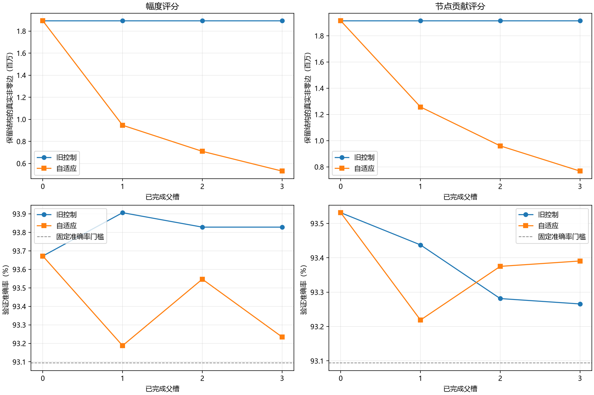
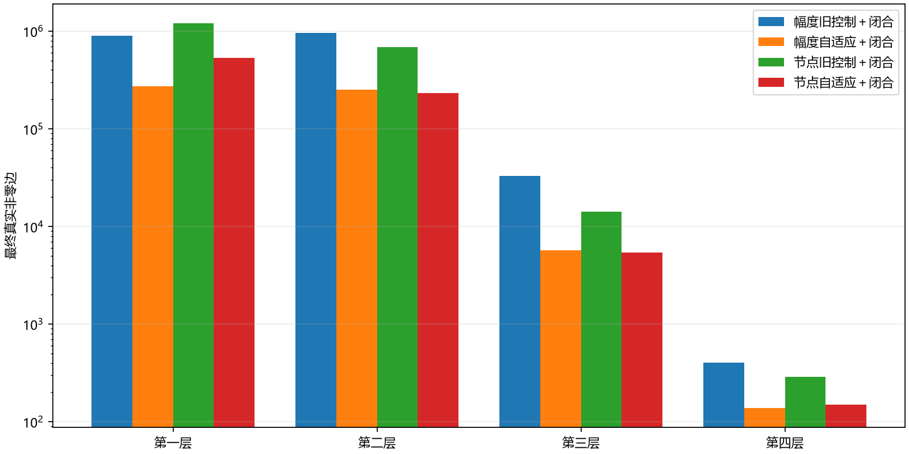
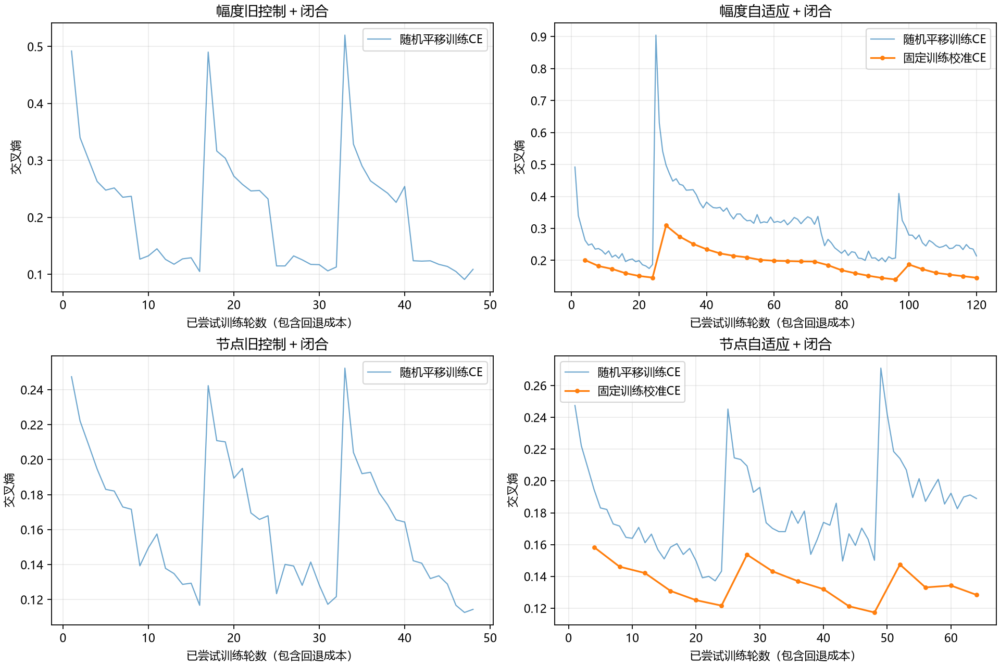

# H1自适应剪边与训练内闭合：本轮报告

2026-10-08。预登记、实现、轻检查和四臂完整实验均已完成。冻结训练提交`9ba14bb295b4d3dd4f72d78ee3fedeb16f369787`；源SHA256`0c61d8390242847609a00593b9119647ef86406a72041790d1415d66662ed8f0`，配置SHA256`c5b7f54242ff8f24e6902dd45f374c7ebed2315834568fb014c4037a8c31bec1`。全量机器证据见[result.json](result.json)，检查见[check.json](check.json)，协议见[执行预登记](../../../h1_adaptive_edges_v1_execution.md)。

## 功能与结构

| 实验臂 | 原真实边 | 初始闭合后边 | 最终真实边 | 验证准确率 | 验证CE | 接受操作数 | 墙钟秒 |
| --- | --- | --- | --- | --- | --- | --- | --- |
| 幅度旧控制＋闭合 | 1,894,464 | 1,892,741 | 1,892,741 | 93.9062% | 0.233503 | 0 | 56.84 |
| 幅度自适应＋闭合 | 1,894,464 | 1,892,741 | 530,455 | 93.2344% | 0.221395 | 3 | 122.99 |
| 节点旧控制＋闭合 | 3,166,655 | 1,913,992 | 1,913,992 | 93.5313% | 0.242727 | 0 | 54.09 |
| 节点自适应＋闭合 | 3,166,655 | 1,913,992 | 767,611 | 93.3906% | 0.230491 | 3 | 67.12 |

幅度：自适应较旧控制最终少1,362,286边，验证准确率差-0.6719个百分点，CE差-0.012108；墙钟比2.16倍。
节点贡献：自适应较旧控制最终少1,146,381边，验证准确率差-0.1406个百分点，CE差-0.012236；墙钟比1.24倍。

固定累计参照为旧循环密集FC94.0937519%/CE0.22852926，合格门槛93.0937519%/CE≤0.28852926。所有结构都只在首次预定验证点功能合格时接受，最后从保留完整状态中选最少边的合格状态；没有遍历48轮挑候选期最佳，没有声称找到最佳参数。操作性平台失败共1次；最大适应预算内优化未完成共0次。仅完成适应且验证也不再显著改善的失败才触发同父完整回退及减半。

两机制各自的旧/自适应首候选前8轮6400验证logits逐值完全相等，证据见[首段匹配](paired_first_segment.json)；延长阶段以后训练更新不等，控制收益与新增训练成本合并解释，不能说是同计算量优势。最终边数仍单独对照阶段520416目标，目标数字不进入剪边评分/步长。

幅度自适应最终530455边比固定静态阶段目标520416多10039（约1.93%），但低于同任务循环CNN456000×1.2=547200的数量参照。两种参照必须区分；没有新探索测试，因此只能确认旧验证上的功能门槛。第一层仍有广域连接，不能以总边数接近CNN说前两层均达到卷积规模。

| 实验臂 | 第一层边 | 相对初始闭合减少 | /循环CNN28224 | 第二层边 | 相对初始闭合减少 | /循环CNN225792 |
| --- | --- | --- | --- | --- | --- | --- |
| 幅度旧控制＋闭合 | 903,439 | 0.00% | 32.01× | 956,039 | 0.00% | 4.23× |
| 幅度自适应＋闭合 | 271,888 | 69.91% | 9.63× | 252,735 | 73.56% | 1.12× |
| 节点旧控制＋闭合 | 1,211,143 | 0.00% | 42.91× | 688,364 | 0.00% | 3.05× |
| 节点自适应＋闭合 | 530,028 | 56.24% | 18.78× | 231,998 | 66.30% | 1.03× |

图中展示逐槽完成路径；最终报告数值来自合格状态回选，因此节点旧控制选起始状态，幅度旧控制选第1槽，可能优于图中最后槽。

## 每臂证据

### 幅度旧控制＋闭合

起始闭合额外删除1,723边；被接受操作直接删边分层为`[0, 0, 0, 0]`，闭合新增删边为`[0, 0, 0, 0]`。最终各层真实边`[903439, 956039, 32859, 404]`；前两层分别903,439/956,039。终止原因`parent_slots_completed`，选中完整状态`slot_1.pt`。

| 父槽/尝试 | 强度 | 适应轮数 | 结论 | 验证准确率 | 验证CE |
| --- | --- | --- | --- | --- | --- |
| 1/1 | 0.5 | 8 | `old_reject` | 92.0781% | 0.259493 |
| 1/1 | 0.5 | 8 | `fallback_complete` | 93.9062% | 0.233503 |
| 2/1 | 0.5 | 8 | `old_reject` | 92.1406% | 0.258394 |
| 2/1 | 0.5 | 8 | `fallback_complete` | 93.8281% | 0.237486 |
| 3/1 | 0.5 | 8 | `old_reject` | 92.1094% | 0.263197 |
| 3/1 | 0.5 | 8 | `fallback_complete` | 93.8281% | 0.244966 |

固定验证点明细（旧候选与回退原图适应分开；同一历史点只列一次）：

| 槽/尝试 | 轮 | 决策 | 准确率 | CE | 训练状态 | 验证仍改善 |
| --- | --- | --- | --- | --- | --- | --- |
| 1/1 | 8 | `old_reject` | 92.0781% | 0.259493 | `insufficient_observations` | False |
| 1/1 | 8 | `fallback_complete` | 93.9062% | 0.233503 | `insufficient_observations` | False |
| 2/1 | 8 | `old_reject` | 92.1406% | 0.258394 | `insufficient_observations` | False |
| 2/1 | 8 | `fallback_complete` | 93.8281% | 0.237486 | `insufficient_observations` | False |
| 3/1 | 8 | `old_reject` | 92.1094% | 0.263197 | `insufficient_observations` | False |
| 3/1 | 8 | `fallback_complete` | 93.8281% | 0.244966 | `insufficient_observations` | False |

最终固定单位置训练校准准确率96.5625%、CE0.107877。尝试更新2,400次，完成路径未回退更新1,200次，最终选中完整状态实际保留本轮400次更新（回选较早状态会舍去后续正常更新）；验证/校准等评价共9次、54,400样本。BGM导出8,537,967字节，独立参数1,897,583；仍无参数共享映射。峰值CUDA已分配显存320,669,184字节。

### 幅度自适应＋闭合

起始闭合额外删除1,723边；被接受操作直接删边分层为`[631499, 701377, 27065, 266]`，闭合新增删边为`[52, 1927, 100, 0]`。最终各层真实边`[271888, 252735, 5694, 138]`；前两层分别271,888/252,735。终止原因`parent_slots_completed`，选中完整状态`slot_3.pt`。

| 父槽/尝试 | 强度 | 适应轮数 | 结论 | 验证准确率 | 验证CE |
| --- | --- | --- | --- | --- | --- |
| 1/1 | 0.5 | 24 | `accept` | 93.1875% | 0.242599 |
| 2/1 | 0.5 | 48 | `completed_failure` | 92.3750% | 0.254030 |
| 2/2 | 0.25 | 24 | `accept` | 93.5469% | 0.226002 |
| 3/1 | 0.25 | 24 | `accept` | 93.2344% | 0.221395 |

固定验证点明细（旧候选与回退原图适应分开；同一历史点只列一次）：

| 槽/尝试 | 轮 | 决策 | 准确率 | CE | 训练状态 | 验证仍改善 |
| --- | --- | --- | --- | --- | --- | --- |
| 1/1 | 8 | `extend` | 92.0781% | 0.259493 | `insufficient_observations` | False |
| 1/1 | 16 | `extend` | 92.5469% | 0.247051 | `improving` | True |
| 1/1 | 24 | `accept` | 93.1875% | 0.242599 | `improving` | True |
| 2/1 | 8 | `extend` | 90.4844% | 0.315691 | `insufficient_observations` | False |
| 2/1 | 16 | `extend` | 91.3750% | 0.284118 | `improving` | True |
| 2/1 | 24 | `extend` | 92.0000% | 0.264408 | `improving` | True |
| 2/1 | 32 | `extend` | 92.1406% | 0.259616 | `improving` | True |
| 2/1 | 40 | `extend` | 92.2813% | 0.255164 | `improving` | True |
| 2/1 | 48 | `completed_failure` | 92.3750% | 0.254030 | `plateau` | False |
| 2/2 | 8 | `extend` | 92.7656% | 0.243997 | `insufficient_observations` | False |
| 2/2 | 16 | `extend` | 92.9219% | 0.241330 | `improving` | True |
| 2/2 | 24 | `accept` | 93.5469% | 0.226002 | `improving` | True |
| 3/1 | 8 | `extend` | 92.5000% | 0.239097 | `insufficient_observations` | False |
| 3/1 | 16 | `extend` | 92.9531% | 0.228744 | `improving` | True |
| 3/1 | 24 | `accept` | 93.2344% | 0.221395 | `improving` | True |

最终固定单位置训练校准准确率94.7187%、CE0.145644。尝试更新6,000次，完成路径未回退更新3,600次，最终选中完整状态实际保留本轮3,600次更新（回选较早状态会舍去后续正常更新）；验证/校准等评价共48次、208,000样本。BGM导出3,088,822字节，独立参数535,297；仍无参数共享映射。峰值CUDA已分配显存320,669,184字节。

### 节点旧控制＋闭合

起始闭合额外删除1,252,663边；被接受操作直接删边分层为`[0, 0, 0, 0]`，闭合新增删边为`[0, 0, 0, 0]`。最终各层真实边`[1211143, 688364, 14197, 288]`；前两层分别1,211,143/688,364。终止原因`parent_slots_completed`，选中完整状态`initial.pt`。

| 父槽/尝试 | 强度 | 适应轮数 | 结论 | 验证准确率 | 验证CE |
| --- | --- | --- | --- | --- | --- |
| 1/1 | 0.05 | 8 | `old_reject` | 92.6562% | 0.248425 |
| 1/1 | 0.05 | 8 | `fallback_complete` | 93.4375% | 0.243616 |
| 2/1 | 0.05 | 8 | `old_reject` | 92.4531% | 0.250284 |
| 2/1 | 0.05 | 8 | `fallback_complete` | 93.2813% | 0.250017 |
| 3/1 | 0.05 | 8 | `old_reject` | 92.7969% | 0.254737 |
| 3/1 | 0.05 | 8 | `fallback_complete` | 93.2656% | 0.248189 |

固定验证点明细（旧候选与回退原图适应分开；同一历史点只列一次）：

| 槽/尝试 | 轮 | 决策 | 准确率 | CE | 训练状态 | 验证仍改善 |
| --- | --- | --- | --- | --- | --- | --- |
| 1/1 | 8 | `old_reject` | 92.6562% | 0.248425 | `insufficient_observations` | False |
| 1/1 | 8 | `fallback_complete` | 93.4375% | 0.243616 | `insufficient_observations` | False |
| 2/1 | 8 | `old_reject` | 92.4531% | 0.250284 | `insufficient_observations` | False |
| 2/1 | 8 | `fallback_complete` | 93.2813% | 0.250017 | `insufficient_observations` | False |
| 3/1 | 8 | `old_reject` | 92.7969% | 0.254737 | `insufficient_observations` | False |
| 3/1 | 8 | `fallback_complete` | 93.2656% | 0.248189 | `insufficient_observations` | False |

最终固定单位置训练校准准确率95.9687%、CE0.117049。尝试更新2,400次，完成路径未回退更新1,200次，最终选中完整状态实际保留本轮0次更新（回选较早状态会舍去后续正常更新）；验证/校准等评价共9次、54,400样本。BGM导出8,622,972字节，独立参数1,918,834；仍无参数共享映射。峰值CUDA已分配显存361,246,208字节。

### 节点自适应＋闭合

起始闭合额外删除1,252,663边；被接受操作直接删边分层为`[608613, 423233, 8344, 139]`，闭合新增删边为`[72502, 33133, 417, 0]`。最终各层真实边`[530028, 231998, 5436, 149]`；前两层分别530,028/231,998。终止原因`parent_slots_completed`，选中完整状态`slot_3.pt`。

| 父槽/尝试 | 强度 | 适应轮数 | 结论 | 验证准确率 | 验证CE |
| --- | --- | --- | --- | --- | --- |
| 1/1 | 0.05 | 24 | `accept` | 93.2187% | 0.238702 |
| 2/1 | 0.05 | 24 | `accept` | 93.3750% | 0.229949 |
| 3/1 | 0.05 | 16 | `accept` | 93.3906% | 0.230491 |

固定验证点明细（旧候选与回退原图适应分开；同一历史点只列一次）：

| 槽/尝试 | 轮 | 决策 | 准确率 | CE | 训练状态 | 验证仍改善 |
| --- | --- | --- | --- | --- | --- | --- |
| 1/1 | 8 | `extend` | 92.6562% | 0.248425 | `insufficient_observations` | False |
| 1/1 | 16 | `extend` | 92.8281% | 0.248136 | `improving` | False |
| 1/1 | 24 | `accept` | 93.2187% | 0.238702 | `improving` | True |
| 2/1 | 8 | `extend` | 92.9062% | 0.239749 | `insufficient_observations` | False |
| 2/1 | 16 | `extend` | 92.8281% | 0.245399 | `improving` | False |
| 2/1 | 24 | `accept` | 93.3750% | 0.229949 | `improving` | True |
| 3/1 | 8 | `extend` | 92.9688% | 0.233873 | `insufficient_observations` | False |
| 3/1 | 16 | `accept` | 93.3906% | 0.230491 | `improving` | True |

最终固定单位置训练校准准确率95.5000%、CE0.128393。尝试更新3,200次，完成路径未回退更新3,200次，最终选中完整状态实际保留本轮3,200次更新（回选较早状态会舍去后续正常更新）；验证/校准等评价共27次、118,400样本。BGM导出4,037,446字节，独立参数772,453；仍无参数共享映射。峰值CUDA已分配显存360,738,304字节。

## 成本、恢复与边界

设备NVIDIA GeForce RTX 5080 Laptop GPU，Torch 2.13.0+cu130，FP32、batch64，评价batch512，CPU线程2；执行为稠密linear加零权重掩码。四臂内部墙钟计时合计301.03秒，包含臂内失败候选、训练和保存等成本；计时起点在各父checkpoint读取/恢复之后，主入口启动、父状态读取、数据核对/准备等未包含，整个进程端到端墙钟未单独实测。900秒/臂及3600秒总额按此臂内口径核算，没有按旧时间倍率否决研究。

| 实验臂 | 训练秒 | 已计时resume保存秒 | 固定验证点秒 | 固定训练校准秒 | 其余未归类秒 |
| --- | --- | --- | --- | --- | --- |
| 幅度旧控制＋闭合 | 22.99 | 25.06 | 0.16 | 0.00 | 6.90 |
| 幅度自适应＋闭合 | 55.23 | 60.57 | 0.42 | 0.50 | 6.15 |
| 节点旧控制＋闭合 | 22.73 | 24.79 | 0.18 | 0.00 | 6.15 |
| 节点自适应＋闭合 | 29.54 | 32.20 | 0.23 | 0.27 | 4.76 |

JSON的评分/闭合分项也有计时。`export_seconds`字段未实际累加，其零值表示未独立测量，不是导出零成本。初始化闭合后的首次评价、候选/阶段/最终checkpoint保存、导出等部分成本留在墙钟残差，不能声称全部成本精确分类。没有为补齐计时重跑训练。无新延迟或能耗实测；边数/参数和掩码执行不能证明加速或节能。

每臂`experiments/runs/h1_adaptive_edges_v1/mnist_circular/<arm>/model_full.pt`保存选中模型的完整权重、mask、Adam、RNG及controller，同时保留被拒绝候选末态checkpoint和逐epoch恢复入口。原归档模型/checkpoint不改。只读一次CPU核对两源模型与stage5状态完全一致；闭合收益与直接剪边分别报告，全部物理节点和bias保留。

仅既有3200训练/800验证原ID，验证每ID8个固定循环位移，不是6400独立笔迹。完全复用旧位置manifest，没有读取探索测试、官方测试、封存ID或CIFAR。验证用于接受及选模，反馈次数完整记录；该旧验证反复使用及单种子限制泛化结论。固定训练单位置CE平台是有限观测下的操作判据，不能证明总体收敛或容量极限。前两层定位只使用本轮逐层曲线，未追加诊断扫描或CNN层配额。

下一方向建议优先第一层多边联合功能重构/补偿的候选机制，并做同父对照；这是下一轮登记建议，尚未实施或运行。本轮不追加第4槽或小调参来追520416。
