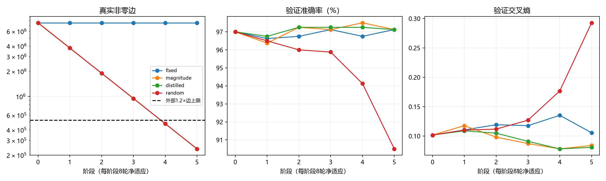

# H1节点对齐FC：全局剪边与充分适应实际报告

幅度主臂最终保留236,808条真实非零边，比新密集起点减少96.875%、是CNN有效展开边的0.5460倍，达到外部≤520416要求；验证97.125%、探索性测试97.300%。蒸馏臂达到同一总边数，但本轮没有显示比硬标签幅度臂全面更好的效果。

本轮四臂已全部冻结；表格给出预登记验证规则选择的阶段。1000历史探索性测试只在全部候选冻结后读取，未用于选择阶段。固定模型根11、数据根20261004、训练/验证/探索性测试3200/800/1000。官方测试与剩余封存ID访问均为False。

| 分支 | 冻结阶段 | 训练准确率 | 验证准确率 / CE | 探索性测试准确率 / CE | 真实非零边 / CNN倍数 | 导出字节 |
| --- | --- | --- | --- | --- | --- | --- |
| baseline | 基线第36轮 | 99.719% | 97.000% / 0.10152 | 96.700% / 0.10232 | 7,577,856 / 17.4734× | 31,278,431 |
| fixed | 5 | 99.781% | 97.125% / 0.10557 | 97.500% / 0.08176 | 7,577,856 / 17.4734× | 31,278,431 |
| magnitude | 5 | 98.844% | 97.125% / 0.08390 | 97.300% / 0.07818 | 236,808 / 0.5460× | 1,914,232 |
| distilled | 5 | 98.844% | 97.125% / 0.08065 | 97.100% / 0.09744 | 236,808 / 0.5460× | 1,914,233 |
| random | 2 | 98.594% | 96.000% / 0.11166 | 96.500% / 0.12354 | 1,894,464 / 4.3683× | 8,544,860 |

复用旧CNN证据：验证97.125%、探索性测试97.000%；排除padding有效展开边433680。新FC节点固定3136/1568/128/10（4842），逐层初始边2458624/4917248/200704/1280。无节点删除、缩宽或物理清理，无权重共享，共享映射none。

## 完整阶段曲线

| 分支/阶段 | 真实非零边 | 逐层边 | 验证准确率 / CE | 候选接受 |
| --- | --- | --- | --- | --- |
| fixed/0 | 7,577,856 | [2458624, 4917248, 200704, 1280] | 97.000% / 0.10152 | True |
| fixed/1 | 7,577,856 | [2458624, 4917248, 200704, 1280] | 96.625% / 0.11032 | True |
| fixed/2 | 7,577,856 | [2458624, 4917248, 200704, 1280] | 96.750% / 0.11914 | True |
| fixed/3 | 7,577,856 | [2458624, 4917248, 200704, 1280] | 97.125% / 0.11756 | True |
| fixed/4 | 7,577,856 | [2458624, 4917248, 200704, 1280] | 96.750% / 0.13519 | True |
| fixed/5 | 7,577,856 | [2458624, 4917248, 200704, 1280] | 97.125% / 0.10557 | True |
| magnitude/0 | 7,577,856 | [2458624, 4917248, 200704, 1280] | 97.000% / 0.10152 | True |
| magnitude/1 | 3,788,928 | [1359371, 2320585, 108140, 832] | 96.375% / 0.11754 | True |
| magnitude/2 | 1,894,464 | [742611, 1098529, 52812, 512] | 97.250% / 0.09804 | True |
| magnitude/3 | 947,232 | [378436, 544185, 24363, 248] | 97.125% / 0.08720 | True |
| magnitude/4 | 473,616 | [190158, 271305, 12019, 134] | 97.500% / 0.07807 | True |
| magnitude/5 | 236,808 | [95602, 135170, 5951, 85] | 97.125% / 0.08390 | True |
| distilled/0 | 7,577,856 | [2458624, 4917248, 200704, 1280] | 97.000% / 0.10152 | True |
| distilled/1 | 3,788,928 | [1359371, 2320585, 108140, 832] | 96.750% / 0.10880 | True |
| distilled/2 | 1,894,464 | [741487, 1099373, 53059, 545] | 97.250% / 0.10479 | True |
| distilled/3 | 947,232 | [378468, 543902, 24575, 287] | 97.250% / 0.09092 | True |
| distilled/4 | 473,616 | [189830, 271465, 12150, 171] | 97.250% / 0.07801 | True |
| distilled/5 | 236,808 | [95177, 135377, 6149, 105] | 97.125% / 0.08065 | True |
| random/0 | 7,577,856 | [2458624, 4917248, 200704, 1280] | 97.000% / 0.10152 | True |
| random/1 | 3,788,928 | [1359371, 2320585, 108140, 832] | 96.500% / 0.10999 | True |
| random/2 | 1,894,464 | [741487, 1099373, 53059, 545] | 96.000% / 0.11166 | True |
| random/3 | 947,232 | [378468, 543902, 24575, 287] | 95.875% / 0.12691 | True |
| random/4 | 473,616 | [189830, 271465, 12150, 171] | 94.125% / 0.17670 | True |
| random/5 | 236,808 | [95177, 135377, 6149, 105] | 90.500% / 0.29269 | True |

同stage5匹配对照：distilled与random逐层边数完全相同，蒸馏教师/净40轮相同，验证97.125%对90.500%，因此单种子下保留连接身份有作用。random冻结stage2来自验证相对容差，不把stage2测试96.5%当作23.7万边随机模型成绩。两主臂5/5接受，未发生实际回退；恢复机制只有必要CPU检查证据。

| 分支 | 非输入节点 | 独立参数含bias | 密集分配参数含bias | 输出0至9真实入边数 |
| --- | --- | --- | --- | --- |
| baseline | [3136, 1568, 128, 10] | 7,582,698 | 7,582,698 | [128, 128, 128, 128, 128, 128, 128, 128, 128, 128] |
| fixed | [3136, 1568, 128, 10] | 7,582,698 | 7,582,698 | [128, 128, 128, 128, 128, 128, 128, 128, 128, 128] |
| magnitude | [3136, 1568, 128, 10] | 241,650 | 7,582,698 | [10, 11, 7, 9, 6, 7, 11, 10, 6, 8] |
| distilled | [3136, 1568, 128, 10] | 241,650 | 7,582,698 | [10, 14, 11, 6, 9, 13, 13, 13, 7, 9] |
| random | [3136, 1568, 128, 10] | 1,899,306 | 7,582,698 | [54, 67, 58, 45, 61, 61, 48, 52, 52, 47] |

主代理只读取BGM文件头、bitmap、FP32值及已保存NPZ，0模型前向，独立核对了逐层真实非零边、节点、输出入度、文件字节、验证/测试准确率/CE/混淆矩阵。按“有非零入边或bias且有非零出边”定义，有效隐藏节点如下；物理节点仍保持4842，不把这些统计记为节点删除。

| 分支 | 有效隐藏节点（逐层） |
| --- | --- |
| baseline | [3136, 1568, 128] |
| fixed | [3136, 1568, 128] |
| magnitude | [2879, 1099, 65] |
| distilled | [2780, 1098, 70] |
| random | [3136, 1568, 127] |

## 成本和实际形式

设备NVIDIA GeForce RTX 5080 Laptop GPU；FP32，训练batch64、评价batch512、CPU2线程，dense Linear+零mask。总墙钟150.331秒，包含基线、搜索、回退、导出、checkpoint和探索性测试；重启8轮余弦学习率。不把稀疏边数/参数数当作速度或能耗测量，本轮没有推断延迟、能耗或CSR部署测量。

| 分支 | 尝试更新 / 净更新 | 训练样本暴露 | 教师样本 | 回退 | 训练秒（其中教师秒） | 验证/提议/快照/导出秒 | CUDA峰字节 |
| --- | --- | --- | --- | --- | --- | --- | --- |
| baseline | 1800 / 1800 | 115200 | 0 | 0 | 24.591（0.000） | 0.132/未分项/未分项/未分项 | 239152128 |
| fixed | 2000 / 2000 | 128000 | 0 | 0 | 8.689（0.000） | 0.017/0.000/0.000/1.208 | 253864448 |
| magnitude | 2000 / 2000 | 128000 | 0 | 0 | 8.436（0.000） | 0.017/0.639/0.249/0.766 | 291733504 |
| distilled | 2000 / 2000 | 128000 | 128000 | 0 | 10.718（0.786） | 0.015/0.036/0.237/0.778 | 329643520 |
| random | 2000 / 2000 | 128000 | 128000 | 0 | 10.662（0.775） | 0.016/0.047/0.000/0.807 | 480184832 |

教师成本是训练时间的子项，不能重复相加。分项costs不覆盖checkpoint序列化和其他开销；总墙钟是全部成本账本。baseline只有逐轮训练/评价计时，未独立拆出提议/快照/导出，不将缺失值记成0。各训练ledger含验证与末态训练评价，不含最后1000测试；实际评价总量在每臂ledger上另加1次/1000样本。随机臂采用与distilled相同教师和删量/时序，因此比较的是保留连接身份；两臂各自按验证冻结阶段可能不同，必须查看同阶段曲线，不能把不同冻结规模称严格同最终边数比较。

## 证据、恢复和结论边界

训练提交`3a6e16b7cf46f829c834f5b48f22c5762b8b0ee3`；[执行登记](../../../h1_aligned_edges_v1_execution.md)、[机器可读报告](h1_aligned_edges_v1_mnist_static_20261008.json)、[证据目录](h1_aligned_edges_v1_mnist_static_20261008_evidence/)。每臂完整checkpoint与每阶段.bgm保留在`experiments/runs/h1_aligned_edges_v1/mnist_static/`。从项目根恢复`.venv/Scripts/python.exe -m tools.train_aligned_edges --resume`，已完成会仅返回summary；源/配置不匹配拒绝接续。

所有混淆矩阵、真实非零与mask边、固定节点、独立参数、导出哈希、接受/回退和曲线保存在JSON及预测证据。当前只能支持这一任务、这一个种子下的连接删减证据，不能推出自主发现卷积规律、跨任务迁移、稀疏加速或首创。蒸馏温度/权重、层RMS评分、半数几何预算和类别连通保护均为先验。
