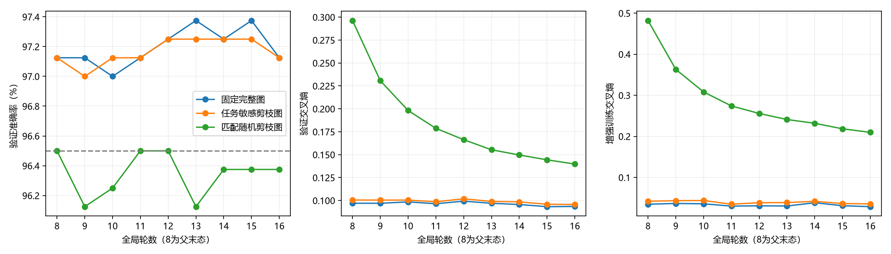

# 扩容FC冻结结构等预算适应实际报告

2026-10-08；训练前登记/实现提交`4e249c0edc6fc69eb20bd2637ebe2ffb0b734ff7`。从前轮三臂第8轮完整模型、Adam、EMA与RNG延续各8轮，固定父末轮学习率1.72314444e-5，未重训前轮、未重置Adam、未新增删边；模型根11、数据20261004。第16轮统一冻结，未按验证集/探索性测试集选最佳轮。

| 臂 | 前轮→末态验证准确率 | 前轮→末态验证CE | 末态探索性测试准确率 / CE | 末态训练准确率 / CE |
| --- | --- | --- | --- | --- |
| 固定完整图 | 97.125%→97.125% | 0.097021→0.093495 | 96.700% / 0.114916 | 99.813% / 0.007609 |
| 任务敏感剪枝图 | 97.125%→97.125% | 0.100536→0.095598 | 96.700% / 0.114742 | 99.844% / 0.008603 |
| 匹配随机剪枝图 | 96.500%→96.375% | 0.296305→0.139785 | 96.100% / 0.140214 | 98.312% / 0.102755 |

随机追上预登记判据（验证准确率距task≤0.5pp且CE≤task+.025）=False；主对fixed效果保持=True。随机相对主验证准确率差-0.750pp、CE差+0.044187；训练CE差+0.094153，帮助判断有限适应后的拟合差距。

随机验证CE与主的差距由0.195769缩为0.044187，其末轮CE0.144383→0.139785仍下降，尚未显示收敛平台。原CE落后包含有限适应因素，本轮不把剩余差距全归于结构容量。

本结果只回答固定父末轮小学习率的额外8轮。未追上不能推出长期容量劣势，追上也不证明随机结构在所有预算都等价。探索性测试集已历史使用，1000样本不是全新独立最终测试；3200训练/800验证原ID隔离，官方MNIST测试集及其余封存ID均未访问。

| 臂 | 是否≥96.5%验证及探索性测试 | 起末mask不变 | 活边 / 含偏置独立参数 | 起末统一导出字节 | 新增更新 / 优化样本 | 峰CUDA字节 | 臂墙钟秒 |
| --- | --- | --- | --- | --- | --- | --- | --- |
| 固定完整图 | True | True | 25391616 / 25401290 | 104779522→104779522 | 400 / 25600 | 778255872 | 34.850 |
| 任务敏感剪枝图 | True | True | 10400411 / 10410085 | 44814701→44814701 | 400 / 25600 | 778255872 | 17.830 |
| 匹配随机剪枝图 | False | True | 10400411 / 10410085 | 44814701→44814701 | 400 / 25600 | 778255872 | 20.270 |

分支准确率失败：匹配随机剪枝图。失败分支停止对应扩展，不改已经通过的CNN/FC基本基线，不据探索性测试成绩追调。三个图的完整位图已与前轮保存证据精确核对一致；权重正常更新，部署结构/真实字节没有新增简化。

新增优化前向/反传各76800样本、1200尝试/净更新，三臂各400；无候选/回退，评价30次/31800样本。完整会话82.848秒，冻结后三臂探索性测试阶段1.342秒（含导出载入/模型构建/保存）；分项训练/验证/导出/checkpoint/训练集评价成本在JSON。表中臂墙钟从加载父完整状态/起点导出后起算，不含装载准备，准备计入会话。

设备NVIDIA GeForce RTX 5080 Laptop GPU，FP32、训练batch64/评价512、CPU线程2、dense Linear+零mask、禁止TF32。训练EMA/mask维护三臂相同，固定完整图首臂含CUDA算子初始化；不能以本轮臂墙钟差称算法加速。宽度/参数槽仍25401290，字节/边数不是实测能耗，无稀疏计算加速证据。

复用前轮已通过真实小CPU导出/完整恢复行为检查，没有重跑测试/GPU诊断/旧训练。新轮只检查父epoch/源码SHA/固定种子、同更新预算及位图不变；保存末态预测的准确率、CE和混淆矩阵逐项核对一致。报告0模型前向，代码不加载模型做评价。

报告生成1.445秒。完整三臂预测与完整位图/头随报告保存；大型部署模型与各轮checkpoint/预测在`history/ann_stages_20261008/experiments/runs/h1_capacity_adaptation_v1/mnist_static/`本地保留，训练入口拒绝覆盖。父checkpoint SHA、源/配置SHA与提交号保存在JSON，不改父证据。

