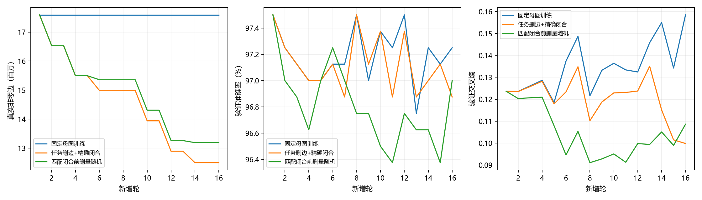

# 自然任务剪边与精确闭合耦合：实际报告

训练前提交`e72cbc9f73d7dbea1bdbae1d7805315959bd4d87`。三臂同一清理后母图17592108真实非零边，宽[784, 6272, 2081, 256, 10]；均新增16轮上限，不设目标边数/必删比例。CNN433680是排除padding及bias的展开有效连接，仅作报告参照。基础CNN/FC约97%已达，不逐候选强守97%；性能完整记录。

## 全臂冻结末态

| 臂 | 真非零边 / 母图下降 / CNN倍数 | 逐层边 | 物理宽度 / 有效隐藏节点 | 训练准确率 / CE | 验证准确率 / CE | 探索性测试准确率 / CE | BGM / BGM+原ID字节 | 独立非零参数 |
| --- | --- | --- | --- | --- | --- | --- | --- | --- |
| 固定母图训练 | 17592108 / 0.000% / 40.565× | [4392960, 12918060, 278528, 2560] | [784, 6272, 2081, 256, 10] / [6272, 2081, 256] | 99.875% / 0.005193 | 97.250% / 0.158460 | 97.100% / 0.175744 | 72716389 / 72826307 | 17600727 |
| 任务删边+精确闭合 | 12498494 / 28.954% / 28.820× | [2295741, 10119809, 81920, 1024] | [784, 5682, 1925, 156, 10] / [5682, 1925, 156] | 99.844% / 0.008258 | 96.875% / 0.099818 | 96.800% / 0.120160 | 51987277 / 52086505 | 12506267 |
| 匹配闭合前删量随机 | 13188734 / 25.030% / 30.411× | [2295808, 10809982, 81920, 1024] | [784, 6272, 2078, 256, 10] / [6272, 2078, 256] | 99.125% / 0.051227 | 97.000% / 0.108608 | 97.000% / 0.104727 | 55100432 / 55210313 | 13197350 |

有效节点只表示图上的非零输入或bias且有出边，不是活动重构证据。无共享映射，独立参数、字节均非成功门槛；精确零权重与位图活槽分别记录。探索性测试为已历史使用的1000样本，不是全新独立最终测试。

## 主候选与闭合实际贡献

| 轮 / 层 | 训练内尝试数 / 合格最大组 | 接受 | 闭合前逐层删除 | 闭合额外逐层删除 | 候选最终逐层净删除 | 原图4批验证准确率 / CE → 候选 |
| --- | --- | --- | --- | --- | --- | --- |
| 18 / 1 | 14 / 1048576 | True | [1048576, 0, 0, 0] | [0, 0, 0, 0] | [1048576, 0, 0, 0] | 97.375% / 0.128524 → 97.375% / 0.128785 |
| 20 / 2 | 14 / 1048576 | True | [0, 1048576, 0, 0] | [0, 0, 0, 0] | [0, 1048576, 0, 0] | 97.125% / 0.118598 → 97.125% / 0.118600 |
| 22 / 3 | 12 / 131072 | True | [0, 0, 131072, 0] | [0, 373542, 0, 0] | [0, 373542, 131072, 0] | 97.000% / 0.117752 → 96.875% / 0.111811 |
| 24 / 4 | 5 / 1024 | True | [0, 0, 0, 1024] | [0, 0, 0, 0] | [0, 0, 0, 1024] | 96.875% / 0.128328 → 96.875% / 0.127769 |
| 26 / 1 | 14 / 1048576 | True | [1048576, 0, 0, 0] | [0, 0, 0, 0] | [1048576, 0, 0, 0] | 97.625% / 0.110903 → 97.250% / 0.117108 |
| 28 / 2 | 14 / 1048576 | True | [0, 1048576, 0, 0] | [67, 0, 0, 0] | [67, 1048576, 0, 0] | 96.625% / 0.117219 → 96.625% / 0.117312 |
| 30 / 3 | 11 / 65536 | True | [0, 0, 65536, 0] | [0, 327557, 0, 0] | [0, 327557, 65536, 0] | 96.875% / 0.141812 → 96.375% / 0.126782 |
| 32 / 4 | 4 / 512 | True | [0, 0, 0, 512] | [0, 0, 0, 0] | [0, 0, 0, 512] | 97.000% / 0.105667 → 97.000% / 0.091140 |

只把接受事务计入最终收益；拒绝恢复原图同4批完整状态，候选尝试与闭合成本保留。候选起组128、上限1048576、14级仅工程域，首次训练内损伤失败停止扩组；0合格/0接受允许发生。到工程上限不说明自然极限。训练内640功能检验并非参数学习独立留出，因为参数/EMA使用所有3200训练样本。

## 清理证书与随机比较

| 臂 / 轮 | 直接 / 间接不可达节点（逐隐藏层） | 删除非零bias（逐层） | 闭合前后最大logit差 / 容差比例 | 全640同argmax | 闭合额外真边 |
| --- | --- | --- | --- | --- | --- |
| 任务删边+精确闭合 / 18 | [0, 0, 0] / [0, 0, 0] | [0, 0, 0] | 0 / 0.000000 | 640/640 | 0 |
| 任务删边+精确闭合 / 20 | [0, 0, 0] / [0, 0, 0] | [0, 0, 0] | 0 / 0.000000 | 640/640 | 0 |
| 任务删边+精确闭合 / 22 | [0, 75, 0] / [0, 0, 0] | [0, 75, 0] | 7.62939453e-06 / 0.016207 | 640/640 | 373542 |
| 任务删边+精确闭合 / 24 | [0, 0, 90] / [0, 0, 0] | [0, 0, 90] | 1.14440918e-05 / 0.023668 | 640/640 | 0 |
| 任务删边+精确闭合 / 26 | [0, 0, 0] / [0, 0, 0] | [0, 0, 0] | 0 / 0.000000 | 640/640 | 0 |
| 任务删边+精确闭合 / 28 | [590, 0, 0] / [0, 0, 0] | [590, 0, 0] | 3.81469727e-06 / 0.013934 | 640/640 | 67 |
| 任务删边+精确闭合 / 30 | [0, 81, 0] / [0, 0, 0] | [0, 81, 0] | 3.81469727e-06 / 0.014093 | 640/640 | 327557 |
| 任务删边+精确闭合 / 32 | [0, 0, 10] / [0, 0, 0] | [0, 0, 10] | 4.76837158e-06 / 0.022417 | 640/640 | 0 |
| 匹配闭合前删量随机 / 18 | [0, 0, 0] / [0, 0, 0] | [0, 0, 0] | 0 / 0.000000 | 640/640 | 0 |
| 匹配闭合前删量随机 / 20 | [0, 0, 0] / [0, 0, 0] | [0, 0, 0] | 0 / 0.000000 | 640/640 | 0 |
| 匹配闭合前删量随机 / 22 | [0, 1, 0] / [0, 0, 0] | [0, 1, 0] | 3.81469727e-06 / 0.012697 | 640/640 | 5722 |
| 匹配闭合前删量随机 / 24 | [0, 0, 0] / [0, 0, 0] | [0, 0, 0] | 0 / 0.000000 | 640/640 | 0 |
| 匹配闭合前删量随机 / 26 | [0, 0, 0] / [0, 0, 0] | [0, 0, 0] | 0 / 0.000000 | 640/640 | 0 |
| 匹配闭合前删量随机 / 28 | [0, 0, 0] / [0, 0, 0] | [0, 0, 0] | 0 / 0.000000 | 640/640 | 0 |
| 匹配闭合前删量随机 / 30 | [0, 2, 0] / [0, 0, 0] | [0, 2, 0] | 9.53674316e-07 / 0.005802 | 640/640 | 5204 |
| 匹配闭合前删量随机 / 32 | [0, 0, 0] / [0, 0, 0] | [0, 0, 0] | 0 / 0.000000 | 640/640 | 0 |

主接受8/8槽。接受的直接删边合计4392448，闭合额外删边701166；随机匹配同槽/同闭合前逐层删量，随后独立闭合额外10926边。最终边数允许不同，不称同最终边数随机。净更新主/随机800/800；随机可比标记True。

直接不可达是没有向下一层任何非零出边；间接不可达仍有出边但全部通向下游不可达节点。非零bias也无法经不存在的输出路径影响logits，可同时删除。存活原ID/权重/掩码保持，每次闭合用同权重训练内640逐样本核验：abs差≤1e-4+1e-5·abs(前)，argmax全同；切维可能改变FP32求和，容差只为实现核验，未据标签选节点。闭合后短适应属于新参数变化，不冒称整个训练输出严格不变。

## 对照、成本与有限结论

全臂同新增批次/增强/原ID dropout，batch64、AdamW lr0.0001、weight_decay0.0001；8编辑槽全臂统一fresh Adam，EMA保留，切维后的fresh Adam与槽开头空状态一致。固定臂同头4批提供累计参照，主候选另4批产生额外成本。局部验证CE+.01/准确率−.5pp及相对固定CE+.05/准确率−2pp为任务保护；没有边数目标。完整回退含图/ID/权重/梯度/Adam/EMA/RNG/mode。

| 臂 | 净 / 尝试更新 | 优化样本 | 常规评价调用 / 样本 | 功能提议样本 | 闭合评价调用 / 样本 | 回退 | 训练 / 常规评价 / 提议 / 闭合秒 | 臂墙钟秒 | CUDA峰字节 | 工作集 / 进程累计峰字节 |
| --- | --- | --- | --- | --- | --- | --- | --- | --- | --- | --- |
| 固定母图训练 | 800 / 800 | 51200 | 41 / 71400 | 0 | 0 / 0 | 0 | 8.543 / 0.376 / 0.000 / 0.000 | 30.222 | 600505344 | 1994158080 / 2154221568 |
| 任务删边+精确闭合 | 800 / 832 | 53248 | 49 / 77800 | 61440 | 16 / 10240 | 0 | 7.706 / 0.375 / 1.174 / 4.790 | 34.686 | 600505344 | 2228170752 / 2922311680 |
| 匹配闭合前删量随机 | 800 / 800 | 51200 | 33 / 65000 | 0 | 16 / 10240 | 0 | 7.483 / 0.306 / 0.187 / 5.340 | 31.117 | 998389760 | 2266374144 / 2922311680 |

会话115.520秒，设备NVIDIA GeForce RTX 5080 Laptop GPU、FP32、TF32关闭、CPU线程2、评价batch512。执行仍dense零mask，但不可达节点被物理slice。BGM编码字节、进程工作集累计峰与CUDA分配峰区分报告；候选/闭合/保存均纳入实际墙钟，计时栏目非严格可加成本分解。未登记延迟/能耗测量，不能由边数或墙钟推断推断加速。

3200训练/800验证，额外验证每有候选主槽2次（原图4批与候选4批），固定每槽1次参照；常规逐轮训练/验证反馈另如实记录。三臂全部冻结后最末探索性测试各一次，未据其追调；官方及剩余封存访问False，不扩数据/种子、不据验证选末态。保存逐轮混淆/CE、每槽图位图及原ID、删除身份和闭合前后logits，完整最新resume及BGM本地保留。唯一新增CPU事务/闭合检查一次通过7.884秒；报告仅已存证据核验，0新模型前向。

本轮主相对母图真实边下降28.954%，仍28.820倍CNN参照。四个前两层候选均到1048576工程上限，两个第三层与两个输出层候选在更大组训练功能检验失败，不把末态称自然极限。正式主8/8接受、0验证回退；小CPU拒绝恢复已验证，不冒称正式发生拒绝。三臂停止均finite_budget，无严重崩溃/闭合不等价/不可比触发。任务验证CE低于随机，随机探索性测试准确率/CE更好，不宣称任务排序有全面性能优势；最终规模差反映剪边身份与图闭合共同作用，不等同同规模任务优势。

下一独立优先检验活动多节点重构，明确排除静默目标及基列；不继续扩大同一候选上限以追CNN数量。旧自然节点主所删256目标均静默，不能作为活动重构成功证据；只读旧随机证据有24列非零多基补偿但缺完整激活残差。当前没有混入此机制，下一须另预登记训练内激活范数/多系数/重构残差和功能筛选、物理净边收益、完整回退及随机补偿对照，不设边数目标。

