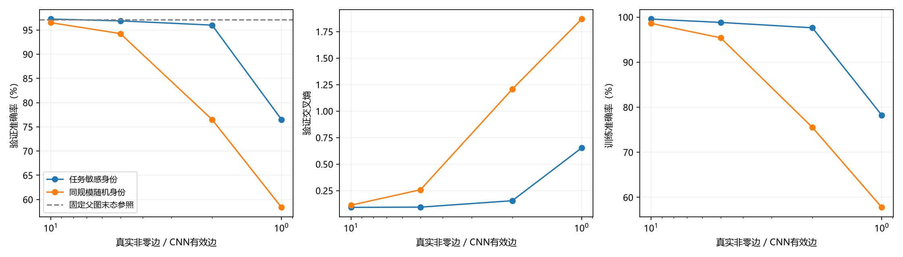

# 扩容FC有效非零连接多档压缩实际报告

2026-10-08；训练前实现/登记提交`f15073f0769789de1b3fbe9f7d3f22fe82065cf0`。用户最新主目标为有效非零边接近CNN，基本CNN/FC约97%已通过，后续每档准确率不作硬否决；完整报告任务损伤，独立参数/字节不作主目标。CNN433680是展开后的有效连接，排除padding/偏置，不是206922独立参数。

三臂从同task16完整模型/mask/Adam/EMA/RNG开始，fixed指保持10400411边的父剪枝图，不是原25.39m完整FC。四档按初始层比例整数最大余数固定配额，保留所有bias及固定784→6272→3136→256→10宽度；不引入像素/局部/共享先验。每档首轮剪至配额，最多8轮参数适应，lr固定.0001，Adam继承不重置，同全局批次/仿射增强/dropout流。

| 档 / 臂 | 目标边 | 逐层真实非零边 | 总非零 / 目标误差 | 验证准确率 / CE | 训练准确率 / CE | 适应轮 | 实际字节 |
| --- | --- | --- | --- | --- | --- | --- | --- |
| 10× / 任务敏感身份 | 4336800 | 839849 / 3359394 / 137119 / 438 | 4336800 / 0 | 97.250% / 0.091678 | 99.563% / 0.022879 | 8 | 20560255 |
| 10× / 同规模随机身份 | 4336800 | 839849 / 3359394 / 137119 / 438 | 4336800 / 0 | 96.500% / 0.112309 | 98.594% / 0.067850 | 8 | 20560255 |
| 10× / 固定父剪枝图 | 固定父图 | 2014106 / 8056420 / 328835 / 1050 | 10400411 / — | 97.000% / 0.096973 | 99.844% / 0.006220 | 8 | 44814701 |
| 5× / 任务敏感身份 | 2168400 | 419925 / 1679697 / 68559 / 219 | 2168400 / 0 | 96.875% / 0.093924 | 98.813% / 0.050639 | 8 | 11886654 |
| 5× / 同规模随机身份 | 2168400 | 419925 / 1679697 / 68559 / 219 | 2168400 / 0 | 94.250% / 0.257978 | 95.406% / 0.232291 | 8 | 11886654 |
| 5× / 固定父剪枝图 | 固定父图 | 2014106 / 8056420 / 328835 / 1050 | 10400411 / — | 96.875% / 0.110636 | 99.937% / 0.004623 | 8 | 44814701 |
| 2× / 任务敏感身份 | 867360 | 167970 / 671879 / 27424 / 87 | 867360 / 0 | 96.000% / 0.154197 | 97.625% / 0.129952 | 8 | 6682492 |
| 2× / 同规模随机身份 | 867360 | 167970 / 671879 / 27424 / 87 | 867360 / 0 | 76.500% / 1.206424 | 75.531% / 1.208353 | 8 | 6682492 |
| 2× / 固定父剪枝图 | 固定父图 | 2014106 / 8056420 / 328835 / 1050 | 10400411 / — | 96.875% / 0.106349 | 99.937% / 0.004725 | 8 | 44814701 |
| 1× / 任务敏感身份 | 433680 | 83985 / 335939 / 13712 / 44 | 433680 / 0 | 76.500% / 0.652523 | 78.219% / 0.627581 | 8 | 4947771 |
| 1× / 同规模随机身份 | 433680 | 83985 / 335939 / 13712 / 44 | 433680 / 0 | 58.375% / 1.868285 | 57.781% / 1.879066 | 8 | 4947771 |
| 1× / 固定父剪枝图 | 固定父图 | 2014106 / 8056420 / 328835 / 1050 | 10400411 / — | 97.125% / 0.096963 | 99.937% / 0.004434 | 8 | 44814701 |

主已到达4/4档；停止原因`registered_curve_complete`，全部预定档位到达=True。主mask总边各档精确等于目标、真实非零≤目标，各层配额与随机删量/时序完全匹配。若主严重崩溃提前停，后续未到达档不称完成；fixed/random只匹配实际主净轮数。

| 最末冻结臂 | 探索性测试准确率 / CE | 净 / 尝试更新 | 优化样本 | 评价调用 / 样本 | 臂墙钟秒 | GPU峰分配字节 |
| --- | --- | --- | --- | --- | --- | --- |
| 任务敏感身份 | 77.100% / 0.660299 | 1600 / 1600 | 102400 | 65 / 129000 | 40.361 | 795869696 |
| 同规模随机身份 | 55.500% / 1.877017 | 1600 / 1600 | 102400 | 65 / 129000 | 23.392 | 978938880 |
| 固定父剪枝图 | 96.900% / 0.119517 | 1600 / 1600 | 102400 | 65 / 129000 | 21.726 | 794452480 |

末态主输出类0—9入度=[2, 0, 3, 7, 0, 7, 7, 6, 6, 6]；无输入边类别=[1, 4]。验证各类正确数=[78, 0, 78, 73, 0, 78, 74, 78, 79, 74]（每类80），训练各类正确数=[315, 0, 311, 307, 3, 317, 317, 314, 308, 311]（每类320）。bias仍存在，无输入类输出只剩常数；1×边数达到但任务效果严重下降，不能称保持原任务效果的成功。固定比例配额的输出断连伴随类别识别丧失，是下一轮分层配额诊断的具体依据；不证明433680总边必然不足，也不证明保留输出边一定解决所有问题。此分析来自保存位图与训练/验证混淆，未根据探索性测试制定规则。

新增优化前向/反传各307200样本，评价195次/387000样本；完整会话92.495秒，三臂完全冻结后探索性测试阶段1.014秒。逐项训练/排序/评价/编码/checkpoint成本见JSON，数据装载准备计入会话；首次task臂含CUDA算子初始化，不能以臂计时差称算法加速。设备NVIDIA GeForce RTX 5080 Laptop GPU，FP32/batch64/评价512/CPU线程2，仍dense Linear+零mask。未测能耗/稀疏计算加速。

主严重崩溃预登记为训练<80%且验证<75%连续两轮；随机崩溃只记录并在有限同轮数预算中保留对照。没有97%/损失/文件接受或回退，不挑最佳点掩盖损伤；每档完整准确率/CE/混淆矩阵和结构保存。偏置共9674，含偏置独立参数=活边+9674，仅附带信息；未物理清理静默节点，训练参数槽仍25401290。

中间档只评价训练集/验证集，全曲线全部三臂冻结后各最末态1000探索性测试一次；该集合已历史探索，不能称全新独立最终测试。未根据测试改配额/lr/轮数，官方MNIST测试集及剩余封存ID未访问，种子11/数据20261004不变。

唯一新增小CPU配额/真实删边行为检查通过0.038秒，复用旧导出/事务/数据证据，没有额外GPU诊断或旧训练/测试重跑。报告读取每档保存预测/位图/活值核验完整混淆、CE与真实非零边，0模型前向。所有已到达档位模型/完整状态及随机身份在本地`history/ann_stages_20261008/experiments/runs/h1_capacity_edge_curve_v1/mnist_static/`保留；报告附每档两划分预测/完整位图和最末探索性测试预测，源码/配置/父SHA在JSON，入口拒绝覆盖。

报告生成4.772秒；单根曲线支持该机制本预算下性能/有效边权衡，不称跨任务普适或统计显著。

