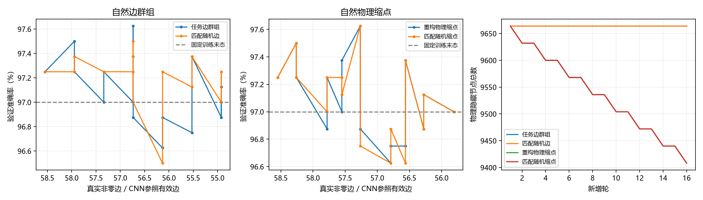

# 扩容FC自然任务驱动结构诊断实际报告

训练前提交`889f1ef95c0b6cc1f8c32ef307f36b94dc6ceb70`；配置/源/未剪FC28父权重SHA见JSON。所有五臂从同FC28未剪枝基线权重出发，784→6272→3136→256→10，未继承旧强制配额图。基本CNN/FC约97%已通过；此次边数只作结果，不设CNN倍数目标或必须删除比例。CNN433680有效连接排除padding/偏置，独立参数与文件不作目标。

## 最末冻结结果

| 臂 | 真实非零总边 / CNN倍数 | 逐层非零边 | 物理宽度 | 有效隐藏节点 | 验证准确率 / CE | 训练准确率 / CE | 探索性测试准确率 / CE | 实际BGM字节 |
| --- | --- | --- | --- | --- | --- | --- | --- | --- |
| 固定训练 | 25391616 / 58.549 | [4917248, 19668992, 802816, 2560] | [784, 6272, 3136, 256, 10] | [6272, 3136, 256] | 97.000% / 0.115453 | 99.781% / 0.007031 | 97.300% / 0.143654 | 104779522 |
| 任务边群组 | 23818752 / 54.922 | [4392960, 19144704, 278528, 2560] | [784, 6272, 3136, 256, 10] | [6272, 2081, 256] | 96.875% / 0.116000 | 99.781% / 0.006946 | 97.300% / 0.143222 | 98488066 |
| 匹配随机边 | 23818752 / 54.922 | [4392960, 19144704, 278528, 2560] | [784, 6272, 3136, 256, 10] | [6272, 3136, 256] | 97.000% / 0.086619 | 99.563% / 0.014752 | 97.100% / 0.101176 | 98488066 |
| 重构物理缩点 | 24202624 / 55.808 | [4841984, 18775040, 583680, 1920] | [784, 6176, 3040, 192, 10] | [6176, 3040, 192] | 97.000% / 0.116370 | 99.781% / 0.007008 | 97.300% / 0.143227 | 99873905 |
| 匹配随机缩点 | 24202624 / 55.808 | [4841984, 18775040, 583680, 1920] | [784, 6176, 3040, 192, 10] | [6176, 3040, 192] | 97.000% / 0.112836 | 99.781% / 0.007118 | 97.200% / 0.143951 | 99873905 |

有效隐藏节点按非零输入或bias且有非零下一层出边定义，仅图上的潜在有效性，不等于训练集激活非零。真实独立参数=非零权重+bias；BGM位图活槽可能保存精确零值，导出槽数与真实非零分别记录，均无共享。

节点主删除256个节点中256个在2560拟合样本上静默，系数为零；本轮没有进入活动多基列重构检验，不能据此认定非零线性相关补偿有效。训练样本静默不代表全输入域无效。随机节点同样从低残差128候选池抽样，比较的是该受限候选域内身份，不是所有节点的均匀随机删除。

## 主机制逐槽与接受/回退

| 主臂 / 轮 | 试探组数量序列 | 训练内合格候选数 | 接受 | 操作后每层净删边 | 补偿新增 / 归零存活边 | 原图同4批验证 / 候选验证 |
| --- | --- | --- | --- | --- | --- | --- |
| 任务边群组 / 2 | 2048:过, 4096:过, 8192:过, 16384:过, 32768:过, 65536:过, 131072:过, 262144:过 | 262144 | True | [262144, 0, 0, 0] | 0 / 0 | 96.750%/96.750% |
| 任务边群组 / 4 | 2048:过, 4096:过, 8192:过, 16384:过, 32768:过, 65536:过, 131072:过, 262144:过 | 262144 | True | [0, 262144, 0, 0] | 0 / 0 | 96.875%/96.875% |
| 任务边群组 / 6 | 2048:过, 4096:过, 8192:过, 16384:过, 32768:过, 65536:过, 131072:过, 262144:过 | 262144 | True | [0, 0, 262144, 0] | 0 / 0 | 97.125%/97.125% |
| 任务边群组 / 8 | 2048:拒 | 0 | False | — | 0 / 0 | 无候选，不访问额外验证 |
| 任务边群组 / 10 | 2048:过, 4096:过, 8192:过, 16384:过, 32768:过, 65536:过, 131072:过, 262144:过 | 262144 | True | [262144, 0, 0, 0] | 0 / 0 | 97.000%/97.000% |
| 任务边群组 / 12 | 2048:过, 4096:过, 8192:过, 16384:过, 32768:过, 65536:过, 131072:过, 262144:过 | 262144 | True | [0, 262144, 0, 0] | 0 / 0 | 96.875%/96.875% |
| 任务边群组 / 14 | 2048:过, 4096:过, 8192:过, 16384:过, 32768:过, 65536:过, 131072:过, 262144:过 | 262144 | True | [0, 0, 262144, 0] | 0 / 0 | 97.125%/97.000% |
| 任务边群组 / 16 | 2048:拒 | 0 | False | — | 0 / 0 | 无候选，不访问额外验证 |

任务边群组接受6/8槽，真实边减少6.194%；停止`finite_budget`。没有为凑删除数补无候选槽。节点物理缩宽及补偿新增/归零边按实际记录，有限样本重构不保证全域等价。
| 重构物理缩点 / 2 | 1:过, 2:过, 4:过, 8:过, 16:过, 32:过 | 32 | True | [25088, 100352, 0, 0] | 0 / 0 | 96.750%/96.750% |
| 重构物理缩点 / 4 | 1:过, 2:过, 4:过, 8:过, 16:过, 32:过 | 32 | True | [0, 199680, 8192, 0] | 0 / 0 | 96.875%/96.875% |
| 重构物理缩点 / 6 | 1:过, 2:过, 4:过, 8:过, 16:过, 32:过 | 32 | True | [0, 0, 99328, 320] | 0 / 0 | 97.250%/97.250% |
| 重构物理缩点 / 8 | 1:过, 2:过, 4:过, 8:过, 16:过, 32:过 | 32 | True | [25088, 99328, 0, 0] | 0 / 0 | 97.250%/97.250% |
| 重构物理缩点 / 10 | 1:过, 2:过, 4:过, 8:过, 16:过, 32:过 | 32 | True | [0, 198656, 7168, 0] | 0 / 0 | 96.875%/96.875% |
| 重构物理缩点 / 12 | 1:过, 2:过, 4:过, 8:过, 16:过, 32:过 | 32 | True | [0, 0, 98304, 320] | 0 / 0 | 96.875%/96.875% |
| 重构物理缩点 / 14 | 1:过, 2:过, 4:过, 8:过, 16:过, 32:过 | 32 | True | [25088, 98304, 0, 0] | 0 / 0 | 97.125%/97.125% |
| 重构物理缩点 / 16 | 1:过, 2:过, 4:过, 8:过, 16:过, 32:过 | 32 | True | [0, 197632, 6144, 0] | 0 / 0 | 97.250%/97.250% |

重构物理缩点接受8/8槽，真实边减少4.683%；停止`finite_budget`。没有为凑删除数补无候选槽。节点物理缩宽及补偿新增/归零边按实际记录，有限样本重构不保证全域等价。

边主6/8槽接受的6组均达到262144边工程上限；两个输出层槽首组在训练内功能检验失败，0候选。节点主8/8均到32节点工程上限。因此边数减少是自然功能筛选/接受的结果，但本预算限制了合格群组大小，不能把末态视为自然压缩极限。随机边验证CE0.086619优于主0.116000；随机节点0.112836也低于主0.116370，不声称任务身份选择优势。

边主第二隐藏层已有1055节点无任何下一层出边（有效2081/物理3136），随机同规模边仍3136有效。这是后续精确物理清理的具体入口：另登记从输出反向可达性，删除不能影响输出的隐藏节点及其入边/出边/bias，先同权重eval输出一致性核验，再登记自然编辑耦合。当前轮未实施这项清理，不能把潜在净收益计入已报告边数。

## 对照与成本

五臂16轮上限、同batch64/增强/根RNG、固定lr0.0001及基线weight_decay0.0001；8槽开头全臂fresh AdamW，EMA保留，槽间保留矩。重构时优化器已统一重置，不声称等价迁移Adam。原节点ID产生canonical dropout掩码使存活单元对应，补偿不保证带dropout训练函数等价。

主候选由训练内2560拟合/640留出真实CE+.01、准确率−.5pp、KL≤.002生成；边排序仅短名单，节点32基列/128候选与FP64窄gelsd系数为披露先验。最多群组量只是工程上限；验证局部CE+.01/准确率−.5pp、相对fixed累计CE+.05/准确率−2pp是任务保护。拒绝恢复原图同4批末完整图/权重/Adam/EMA/梯度/RNG，候选额外尝试不回退账本。随机继承实际接受时序/删量及同补偿规则，无法匹配真实逐层净删量如实标不可比，不据随机验证重选。

| 臂 | 净 / 尝试更新 | 优化样本 | 验证及训练评价调用 / 样本 | 提议功能 / 激活样本 | 训练 / 评价 / 提议秒 | 臂墙钟秒 | CUDA峰分配字节 | 随机净删量可比 |
| --- | --- | --- | --- | --- | --- | --- | --- | --- |
| 固定训练 | 800 / 800 | 51200 | 41 / 71400 | 0 / 0 | 9.295 / 0.486 / 0.000 | 37.432 | 816974848 | None |
| 任务边群组 | 800 / 824 | 52736 | 45 / 74600 | 37120 / 0 | 9.261 / 0.430 / 1.236 | 40.110 | 816974848 | None |
| 匹配随机边 | 800 / 800 | 51200 | 33 / 65000 | 0 / 0 | 8.977 / 0.375 / 0.096 | 38.023 | 1516927488 | True |
| 重构物理缩点 | 800 / 832 | 53248 | 49 / 77800 | 35840 / 20480 | 8.797 / 0.449 / 5.724 | 39.889 | 816974848 | None |
| 匹配随机缩点 | 800 / 800 | 51200 | 33 / 65000 | 0 / 20480 | 8.487 / 0.389 / 5.413 | 35.687 | 816974848 | True |

会话211.730秒，新增优化前向/反传259584样本；初始化/候选缓存/事务/保存/导出开销包含臂墙钟，训练/评价/提议计时单列且非全部成本相加等式。设备NVIDIA GeForce RTX 5080 Laptop GPU、FP32、CPU线程2、评价512。CUDA峰是Torch分配，不是设备全部驻留；CPU工作集峰未实测，登记缓存量级不能当实测。边支路仍dense零mask，节点支路物理缩宽dense；未实测本轮推断/能耗，不从删边或墙钟差推断加速。

3200训练集、800验证集与旧1000探索性测试集；主每槽最多2次额外验证反馈，完整反馈实际数见账本。全臂冻结后各最末探索性测试一次，未据测试选模/调阈值；官方测试及剩余封存访问False，不扩数据/种子。旧探索性测试不是全新独立最终测试。

## 证据与下一轮优先级

此次有限诊断只能回答固定候选域、功能阈值和预算下自然编辑是否成立；不能把组规模上限附近停留解释为自然可压极限，也不能因零接受宣称冗余不存在。若自然删边/缩点有收益但距离CNN边数仍大，应先扩大或改进任务候选生成机制并另行登记有限预算，避免回到强制目标配额。若节点候选不足或回退，应以已保存训练内功能扰动与基组残差区分候选质量、短适应与任务损伤。

本轮节点主接受8槽。逐轮准确率/CE/混淆、逐槽完整位图/节点ID、候选系数与接受/拒绝细节、源/配置/父SHA见JSON及evidence；大型BGM/完整最新resume本地保留。只有已有保存预测/位图核验，报告模型前向0，不重复GPU诊断。唯一小CPU机制项通过6.188秒；首次工具未保留完成输出，第二次同项保存日志，共2调用。

边删除身份完整保存为evidence内int32 NPZ，JSON只引用数量/文件/SHA；这只是无损报告编码，未修改训练配置、源、运行summary或删除历史证据。
