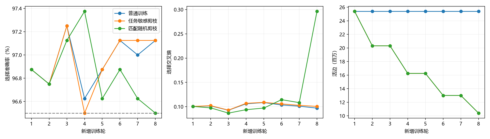

# 扩容FC任务敏感剪枝实际报告

2026-10-08；模型根11、数据20261004，同第28轮冻结FC权重。旧CNN/FC均97%基线已通过后新增本轮预算。训练前提交`d9aef443c5627ef419a40716d7b2ef29ac57c55b`；固定8轮/臂，无结果驱动追调。

| 臂 | 选择准确率 / CE | 旧control重复探索 / CE | 活边 | 独立参数含偏置 | 实际部署字节 |
| --- | --- | --- | --- | --- | --- |
| 普通训练 | 97.125% / 0.097021 | 96.600% / 0.120302 | 25391616 | 25401290 | 104779522 |
| 任务敏感剪枝 | 97.125% / 0.100536 | 96.600% / 0.126464 | 10400411 | 10410085 | 44814701 |
| 匹配随机剪枝 | 96.500% / 0.296305 | 96.100% / 0.300868 | 10400411 | 10410085 | 44814701 |

主接受4/4次，实际文件减少57.230%；效果门槛True、20%实际字节门槛True，本轮判定`pass`。完整选择反馈参与逐候选接受；不是最终独立测试。主相对随机选择差+0.625pp、重复探索差+0.500pp；同时对照交叉熵，单根结果不称统计显著。

位图+活FP32+偏置是无损导出，实际文件删除了被剪权重，不使用标量量化或zip权重压缩。完整位图与架构头随报告保存，共享映射为none，独立参数=活边+偏置。隐藏节点6272/3136/256及训练参数槽25401290不变；训练及推断仍dense Linear，权重/梯度/Adam矩在删边位置归零。尚无稀疏计算执行、推断加速或能耗证据；文件缩小不能推断GPU内存减少。

| 臂 | 尝试 / 净更新 | 优化样本 | 评价调用 / 样本 | 回退 / fallback轮 | 墙钟秒 | 峰CUDA字节 |
| --- | --- | --- | --- | --- | --- | --- |
| 普通训练 | 400 / 400 | 25600 | 10 / 10600 | 0 / 0 | 34.734 | 777555456 |
| 任务敏感剪枝 | 400 / 400 | 25600 | 10 / 10600 | 0 / 0 | 30.911 | 777555456 |
| 匹配随机剪枝 | 400 / 400 | 25600 | 10 / 10600 | 0 / 0 | 22.295 | 1731863552 |

新增优化前向/反传各76800样本、1200尝试更新。净更新三臂各400，同增强/批次/dropout流；主拒绝后的额外适应独立计账，random只继承主接受的逐层数量/时序，未按随机效果重选。会话完整墙钟96.494秒含最终旧control；表中臂墙钟含训练/选择/候选/CPU事务/编码/checkpoint与fit，最终control在会话层另计。分项costs保存于JSON，checkpoint/最终fit的耗时未独立计入分项，不把分项之和称全会话。

三个臂统一计算EMA和mask维护作共同记账；fixed的EMA不驱动结构，仅作测量开销，因此这里的fixed耗时不是去掉测量的纯普通训练。fixed是本进程首臂，包含首次CUDA算子初始化；主墙钟比fixed短不构成算法训练加速证据。random的大层randperm导致更高峰内存，各峰仅是对应臂本次执行的分配统计。

设备NVIDIA GeForce RTX 5080 Laptop GPU，FP32、训练batch64、评价512、CPU线程2，禁止TF32，dense执行。文件写入、排序/候选与全状态CPU复制均计入墙钟；不是参数或FLOPs换算的资源。

唯一新增CPU行为检查通过（导出输出精确相等、固定零权重/Adam矩、拒绝全模型/Adam/EMA/RNG恢复），首跑因项目tmp目录缺失失败，创建后仅重跑该项；无GPU诊断/旧检查/恢复重放。workspace轻量链接/语法检查另记。

三臂冻结后才对已探索的1000 control各评价一次；官方测试和剩余封存ID访问False。新用户基本97%左右门槛操作化为≥96.5%，当前判定保留在完整JSON；不把旧control称独立未见测试。

保存预测三臂三个划分与完整结构位图均已从本地真实产物核对。报告生成耗时1.368秒，模型前向/训练0。部署模型与完整轮恢复在`history/ann_stages_20261008/experiments/runs/h1_capacity_pruning_v1/mnist_static/`（本地大型生成物），源码/配置/父权重SHA见JSON；拒绝覆盖的训练入口不会自动重复运行。

