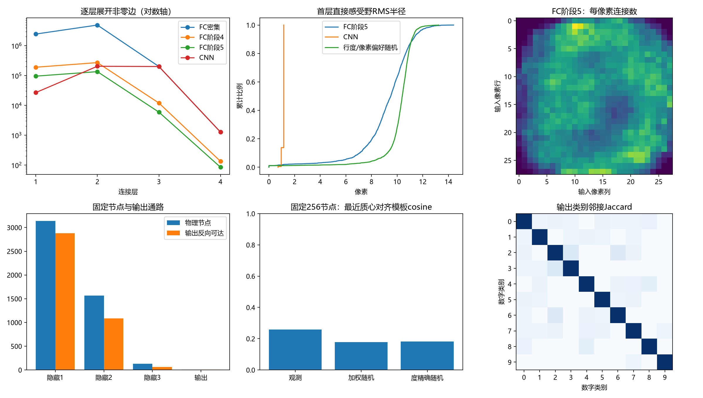
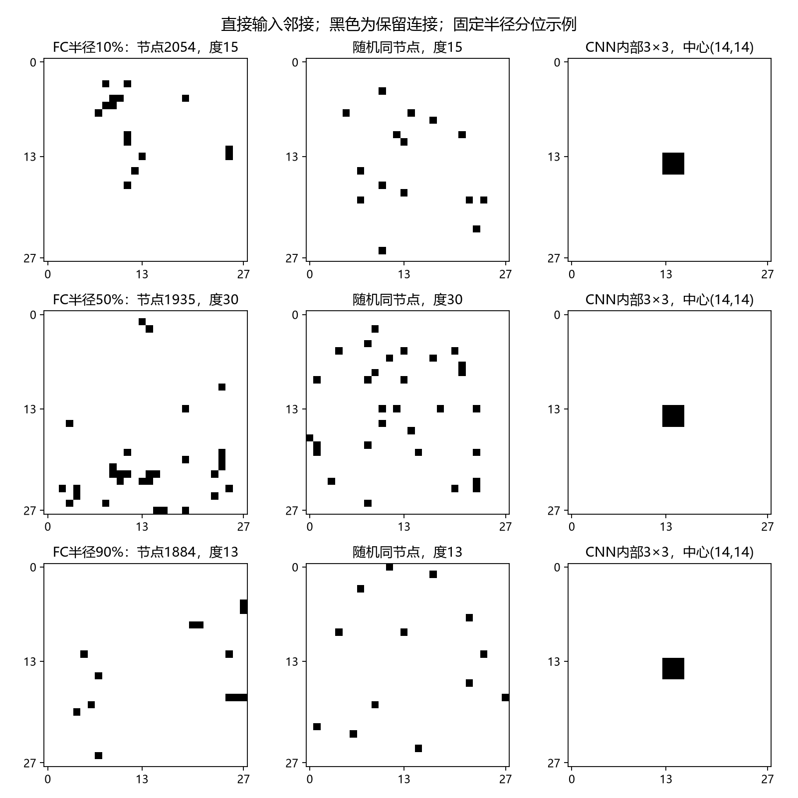

# FC剪枝与CNN连接结构离线比较

当前剪后FC较匹配行列度随机图有适度局部和二值模板偏向，但首层直接连接仍覆盖广、没有跨位置严格参数绑定；目前不能称发现卷积。

2026-10-08。本报告只读取保存模型，不训练、不实例化模型、不前向、不读取任何数据集。分析前已冻结[指标及对照](../../../../history/ann_stages_20261008/docs/h1_connectivity_analysis_v1.md)。

## 连接规模与节点

|模型|第一层|第二层|第三层|输出层|合计|
|---|---:|---:|---:|---:|---:|
|FC密集|2458624|4917248|200704|1280|7577856|
|FC阶段4|190158|271305|12019|134|473616|
|FC阶段5|95602|135170|5951|85|236808|
|CNN|26896|204800|200704|1280|433680|

FC第一、第二隐藏层没有预先位置坐标；各层节点数与CNN相同是人为容量先验，不代表节点能一一对应CNN的通道/位置。FC首层95602边仍是CNN首层26896边的3.55倍；总边更少主要来自第三层和末层的强稀疏化，不能只据总边数称连接方式接近卷积。

|FC阶段5节点层|物理节点|入度均值/中位数|出度均值/中位数|输出反向可达|潜在功能且反向可达|
|---|---:|---|---|---:|---:|
|0|784|—|121.941/131.0|758|758|
|1|3136|30.485/28.0|43.103/29.0|2878|2878|
|2|1568|86.205/92.0|3.795/3.0|1083|1083|
|3|128|46.492/44.5|0.664/1.0|65|65|
|4|10|8.500/8.5|—|10|10|

指向输出反向不可达节点的非零边逐层为[174, 4653, 904, 0]，合计5731（2.42%）。这里只给图统计，全部4842个非输入物理节点保持。潜在功能从输入符号或非零bias前向传播，不等于验证样本实际激活；反向可达也不保证节点对分类有必要。

## 首层直接像素感受野

|图|RMS均值/中位数（像素）|包围盒中位面积|包围盒密度中位数|质心半径3内边比例均值|中心14×14边占比|
|---|---:|---:|---:|---:|---:|
|FC密集|11.424/11.424|784|1.000|0.041|0.250|
|FC阶段4|9.936/10.017|702|0.092|0.069|0.267|
|FC阶段5|9.170/9.503|594|0.055|0.112|0.268|
|CNN|1.126/1.155|9|1.000|1.000|0.262|

行度与像素偏好近似4图的rms_radius_pixels均值范围：10.1212–10.1450。

行度与像素偏好近似4图的bbox_area_pixels均值范围：618.7709–620.0034。

行度与像素偏好近似4图的fraction_edges_within_radius3_centroid均值范围：0.0528–0.0536。

行列度精确交换4图的rms_radius_pixels均值范围：10.1151–10.1343。

行列度精确交换4图的bbox_area_pixels均值范围：618.5587–620.6397。

行列度精确交换4图的fraction_edges_within_radius3_centroid均值范围：0.0540–0.0565。

FC阶段5全局像素列度归一化熵0.9830，连接最多的79像素占15.96%。中心偏好来自已训练模型的连接统计；本分析没有读取像素内容。仅比均匀随机更集中可能是全局中心偏好，故主要对照保留全局列度。

CNN首层内部核最多9个输入，padding边界4或6个；核内局部邻接是人工架构。感受野图固定展示中心(14,14)附近一个真实3×3内部窗口；相同二值窗口遍及各空间位置，步长2移动，并在边界裁掉padding。FC的包围盒、RMS均在真实28×28输入位置计算，首层直接感受野与经多层路径形成的几何感受野不同。本轮不将FC第二层序号重塑成空间，也不报告第二层像素距离。

## 有限重复模板诊断

|图|平均两两cosine|最近模板cosine中位数|对齐完全重复节点比例|
|---|---:|---:|---:|
|观测FC|0.0503|0.2593|0.0117|
|CNN前256节点（含边界，仅描述）|0.9397|1.0000|1.0000|
|行度与像素偏好近似4图范围|0.0409–0.0411|0.1775–0.1792|0.0117–0.0195|
|行列度精确交换4图范围|0.0410–0.0414|0.1819–0.1829|0.0117–0.0117|

256节点按入度固定等分位抽样，不按模板相似度挑节点；随机图使用同节点/同入度。对齐只平移四舍五入质心，没有转动、缩放、非线性匹配。相似度只看二值邻接，不能证明功能相同、带符号权重核相同或卷积计算复用。CNN内部节点的二值模板全是3×3，即使不同通道的权重核数值不同。

固定样本含3个仅1输入节点，它们质心对齐后必然全等；观测完全重复节点比例3/256=1.171875%恰由这些退化单点模板构成，没有观察到额外非单点完全重复模板。因此这里的NN相似度差是有限部分重叠信号，完全重复比例不是卷积模板发现证据。

精确行列度交换每图956020次尝试，接受率分别为[0.8647, 0.8656, 0.8654, 0.8657]，所有行列度逐项一致。4图是同一交换链的连续检查点，未证明充分混合，结果为描述性范围，不作p值或独立重复结论。加权随机只近似保持列度，其最大列度差见JSON。

## 共享与输出连接

FC保存格式sharing=none，每条存活权重独立训练；没有跨节点/位置的参数绑定。CNN conv1的144个、conv2的4608个核权重在多个位置严格复用，分别展开26896/204800条非零边。首层局部性、邻接模板相似或浮点值碰巧相等，均不构成严格共享证据。FC仍dense零mask执行，CNN核复用由Conv2d执行；本轮没有测推断时延、内存或能耗。

十输出类别入度为[10, 11, 7, 9, 6, 7, 11, 10, 6, 8]，共同使用65个末隐藏节点，其中18个连向多个类别。完整类别Jaccard和逐层分位数保存在JSON。仅拓扑重叠不代表类别特征相同。

## 结论边界与证据

剪后FC的首层相对精确保行列度随机图，平均半径约短9.4%，质心半径3内连接均值11.16%对随机5.40%–5.65%；这支持当前图有一定局部组织偏向，且不能完全由全局像素偏好解释。但中位包围盒594/784像素、RMS9.50像素仍呈广域稀疏连接，与CNN固定紧密3×3不同。stage4→stage5半径和包围盒继续降低是两个保存阶段的描述，未据它选择新剪边强度。

固定模板最近相似度0.259对随机0.182，提示部分重复邻接偏向；其绝对相似度较低，没有非单点完全重复模板证据，更没有跨位置严格绑定权重。当前更合适的描述是“保持任务效果的广域稀疏FC，带有一定局部/部分模式偏向”，不称已经恢复卷积。

已完成真实稀疏性、图可达性、首层直接局部性与有限二值模板诊断。结构差别必须分别看：局部邻接、重复模板、严格参数绑定、计算复用；本轮未评价平移等变、深层功能、跨种子/任务稳健性。验证97.125%/历史探索性测试97.3%来自既有训练报告，未重评；历史探索性测试不能称独立最终测试。

实际CPU分析墙钟15.01秒；读取FP32权重，numpy统计为float64、模板cosine为float32，线程2、0模型前向/反传/更新、0数据读取、0GPU使用。该时间是分析成本，不是推断速度。分析源码与源模型SHA保存在JSON。

[结构总图](h1_connectivity_analysis_v1_20261008_structure.png) · [固定分位感受野](h1_connectivity_analysis_v1_20261008_receptive_fields.png) · [完整JSON](h1_connectivity_analysis_v1_20261008.json) · [分析源码](../../../../tools/analyze_connectivity.py)

