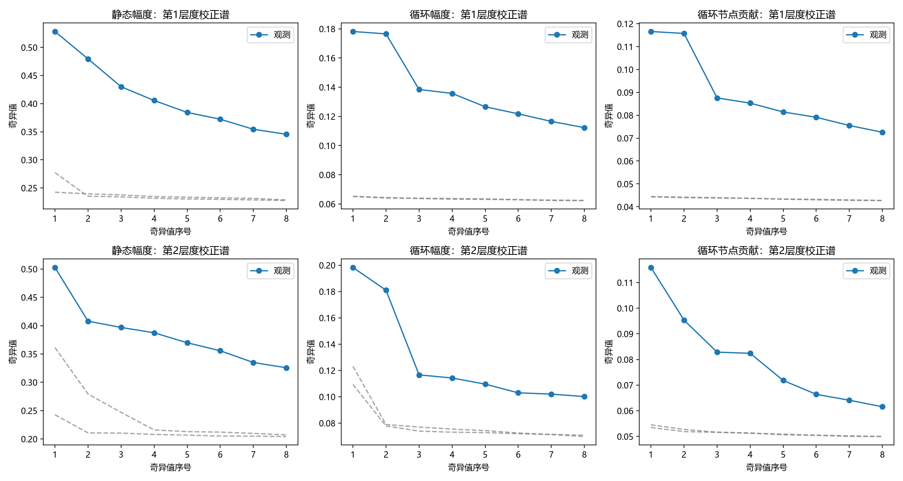
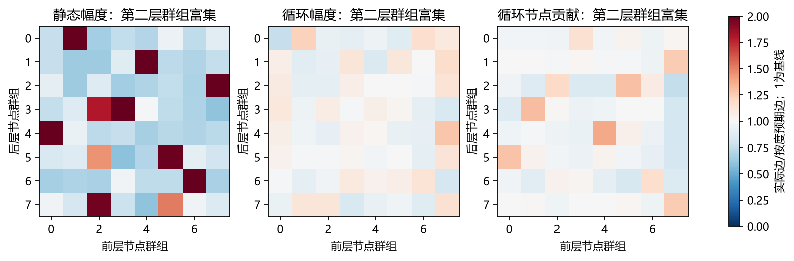
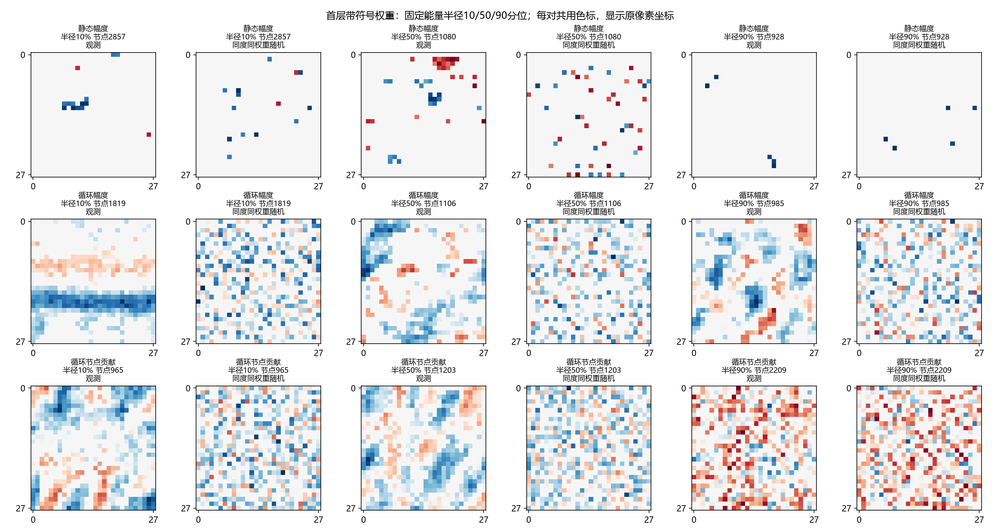

# 前两层是否仍有规律：冻结权重与连接的只读分析

前两层存在清楚可测的组织：首层保留了成片、带状的带符号权重分布，第二层存在超出节点度差异的连接群组。这些模式在三个冻结FC中均高于本轮匹配入出度及逐行权重的随机参照。循环任务首层每个节点仍连接数百像素，能量分布横跨约10像素半径，因此现有证据支持“广域空间权重模式与部分群组组织”。尚无紧凑3×3窗口或严格跨位置参数绑定的证据。

2026-10-08。按[预登记](../../../h1_front_layers_patterns_v1.md)读取三份冻结BGM；不读取数据、不训练、不前向。所有随机图精确保留每个节点的入出度，每行权重多重集保持。2个独立启发随机参照不提供显著性检验，群组结果为探索性描述。

预运行登记与实现冻结提交`b6c3cad`；正式运行未修改分析算法、控制数量或阈值。

## 首层空间组织

|模型|平均入度 / 中位数|二值RMS：观测 / null范围|能量RMS：观测 / null范围|最佳3×3能量：观测 / null范围|能量有效支撑中位数|去DC低频能量：观测 / null范围|
|---|---:|---:|---:|---:|---:|---:|---:|
|静态幅度|30.49 / 28|9.1696 / 10.1180—10.1321|8.9506 / 10.0676—10.0932|0.2804 / 0.1593—0.1596|25.49|0.2314 / 0.0620—0.0624|
|循环幅度|288.12 / 310|10.2587 / 10.9667—10.9691|9.5664 / 10.8244—10.8283|0.0971 / 0.0512—0.0514|180.02|0.5239 / 0.0613—0.0614|
|循环节点贡献|433.27 / 435|10.7794 / 11.1907—11.1917|9.9037 / 11.0132—11.0136|0.0765 / 0.0370—0.0372|217.86|0.5652 / 0.0613—0.0614|

最清楚的证据在带符号权重的空间分布：循环幅度52.39%、循环节点贡献56.52%的去DC能量落在固定低频范围，随机参照均约6.13%，为其约8.5—9.2倍；静态幅度亦为23.14%，随机约6.2%。固定分位图中循环幅度的条带和色块与对应随机点状分布一致支持这一量化差异。该结果说明相邻及大范围像素的权重有相关组织；仅凭权重图不能给这些模式指定笔画、方向或类别语义。

循环幅度与节点贡献的最佳3×3仅承载平均9.71%与7.65%的权重能量，虽然高于同度同权重随机的约5.1%与3.7%，但大量能量仍分散在窗口外。两者的能量有效支撑中位数为180和218个像素，二值真实入度中位数为310.5和435；局部偏向与宽广覆盖同时存在。

静态使用平面距离，循环任务使用环面最短距离，跨模型的半径不可直接当作相同任务成绩。半径只对非空首层节点平均；最佳3×3为逐节点搜索所有窗口后的最大值，对随机图同样搜索。完整3×3均匀卷积窗口的二值RMS为1.155像素；宽广且较随机更集中的连接仍不能叫3×3卷积。W²衡量权重能量分布，不等于实际任务贡献。

傅里叶指标对完整28×28带符号权重场（包括零边）逐节点减均值去DC，低频固定为|kx|≤3且|ky|≤3、排除DC，共48/783个频率。它描述广域平滑/纹理的空间相关；静态图的FFT也使用周期展开，因此只与同任务同处理null比较。该分析阈值是外部评价先验，没有送入优化器。

## 重复与第二层群组

|模型/层|二值最近残差cos：观测 / null|带符号最近cos：观测 / null|第一度校正奇异值：观测 / null|8簇块偏差χ²/E：观测 / null|
|---|---:|---:|---:|---:|
|静态幅度/1|0.2189 / 0.1502—0.1598|0.2051 / 0.1105—0.1146|0.5283 / 0.2425—0.2771|0.4243 / 0.0389—0.0409|
|静态幅度/2|0.2150 / 0.1075—0.1107|0.2650 / 0.0681—0.0707|0.5026 / 0.2427—0.3612|0.3366 / 0.0284—0.0287|
|循环幅度/1|0.1903 / 0.0943—0.0997|0.4137 / 0.2025—0.2054|0.1781 / 0.0652—0.0652|0.0281 / 0.0027—0.0032|
|循环幅度/2|0.1502 / 0.1088—0.1096|0.3937 / 0.0675—0.0729|0.1982 / 0.1093—0.1231|0.0111 / 0.0017—0.0019|
|循环节点贡献/1|0.1569 / 0.0969—0.0981|0.4010 / 0.2218—0.2222|0.1166 / 0.0444—0.0444|0.0095 / 0.0014—0.0014|
|循环节点贡献/2|0.3064 / 0.2964—0.2974|0.1911 / 0.1491—0.1517|0.1159 / 0.0535—0.0545|0.0106 / 0.0012—0.0013|

二值和带符号重复指标有不同强弱：循环幅度首层对齐后带符号最近cosine中位数0.414，对照约0.204；节点贡献0.401，对照约0.222。它们支持若干近似重复权重形状；固定128个节点样本均未出现完全相同的二值模板。第二层循环幅度带符号最近cosine0.394明显高于随机约0.070，而节点贡献仅0.191对约0.150；后者的二值重叠0.306对约0.297，额外重叠相当有限，不能将高重叠绝对值直接说成强重复。

第二层群组偏差在循环幅度约为null的5.9—6.4倍，节点贡献约8.1—8.9倍。但χ²/E的绝对值仅约0.01，度校正第一分量占完整残差能量分别1.63%与0.89%（null约0.52—0.66%与0.19%）；因此存在群组倾向，现阶段仍有大量不被首要组织解释的连接。静态幅度第二层块偏差0.337、null约0.029，群组分化比循环任务更突出。任务条件、稀疏度和剪枝程度不同，这不是单因素因果比较。

首层模板分别按二值中心与能量中心平移对齐；二值先去掉行均值，排除高密度的共同背景。第二层保留原节点身份，不作空间对齐。抽样固定最多128个、入度至少9且至少9条空缺；最近cosine是同一个样本集合中找最相似邻居。观测与null均重新对齐及寻找最近邻，因此数值较高本身不证明重复模板。没有精确跨位置权重绑定，signed cosine也不等于参数共享。

第二层8个群组来自度校正后的连接谱，群组编号任意，不代表空间位置、数字类别或生物功能。块偏差是在同一图上拟合和计量，因此只用同流程null排除拟合噪声；未证明唯一模块划分。度校正奇异值与群组富集仅证明连接的相关组织，不能说明其分类作用。

## 容量分布及输出通路

|模型/层|边数|入度10/50/90分位|入度CV|出度CV|入度最高10%边占比|无入边节点|无出边前层节点|指向输出不可达边|
|---|---:|---:|---:|---:|---:|---:|---:|---:|
|静态幅度/1|95602|3/28/61|0.748|0.412|24.93%|233|26|174|
|静态幅度/2|135170|0/92/180|0.832|1.010|24.68%|424|257|4653|
|循环幅度/1|903533|158/310/368|0.312|0.027|13.54%|25|0|94|
|循环幅度/2|956051|0/68/1541|1.128|0.292|26.55%|532|52|12|
|循环节点贡献/1|1358741|406/435/459|0.056|0.022|10.89%|0|0|147598|
|循环节点贡献/2|1769792|915/1170/1279|0.129|0.662|11.56%|0|271|1081428|

这些度差异说明容量分配不均；随机对照保留它们，所以不能把该项本身当作额外模板或群组。所有物理节点保留；反向可达仅表示存在路径，未使用激活验证必要性。完整逐层图、bias潜在前向通路及不可达节点统计在JSON。

循环幅度第二层容量分配尤其悬殊：本轮实际无入边节点为532/1568，入度中位数67.5，而75%分位1413.25、90%分位1541.3，表现为一批低容量或空节点与一批高容量节点并存。循环节点贡献第二层全部节点有入边，入度中位数1170，但只有586/1568节点能沿非零边到达输出；其第一、第二层分别有147,598和1,081,428条边指向输出不可达节点，第二层占61.11%。整个网络共有1,252,663条这类边，占39.56%；循环幅度对应全部只有1,723条、0.091%。这些边不可能通过本轮冻结非零连接图影响输出，属于保留物理骨架下的结构冗余。本轮仅统计、未删除；谱、模板和空间指标覆盖全图有边节点，包含这些不可达部分，所以不能自动把所有观测模式称作承担任务功能的模式。

后续可将空间权重模式与群组证据用作候选机制的评价依据，或研究多节点/多边联合重构；核心结构优化规则仍不得接收这里的像素距离、频率阈值或8簇目标。本轮没有启动下一轮训练或验证图组织的因果作用。

|模型|冻结总非零边|指向无输出路径节点的边|有潜在输出路径的边|
|---|---:|---:|---:|
|静态幅度|236,808|5,731（2.42%）|231,077|
|循环幅度|1,894,464|1,723（0.091%）|1,892,741|
|循环节点贡献|3,166,655|1,252,663（39.56%）|1,913,992|

循环两模型有潜在输出路径的边数仅相差21,251、约1.12%；节点贡献总边多主要由保留大量无输出路径支路解释。两模型有路径的前两层边数仍分配不同：幅度903,439/956,039，节点贡献1,211,143/688,364。因此“节点贡献的原导出模型压缩更少”是总边事实，不能进一步据此说它需要更多必要连接来执行任务。以上有路径边只是图上存在输出路线，不保证输入实际激活、边有必要或任务无损；原模型没有被实际清理、修改或压缩。

## 输出可达子图的事后补充

看到不可达支路后，为解决“全图模式是否只是无输出路径部分造成”的具体混杂，在登记中追加探索性补充，经实现/登记提交`d1f580b`后执行。原主分析工具与JSON保持不变；[补充机器报告](reachable_addendum.json)记录新工具SHA、主工具SHA、主JSON SHA、所有保留/剔除节点ID、逐层边数和null度保持核验。这是事后验证，不能冒充原预登记指标结论。

仅分析两个循环模型，从四层连接图的输出反向遍历裁出有潜在输出路径的子图：幅度第一/第二层保留3,084/1,538个节点，节点贡献保留2,808/586个；两模型都保留784输入像素。第二层同时按首层可达列裁出。数值只沿用首层低频和第二层度校正谱/8簇，不新增指标；每个子图各2条独立同度curveball链，每链8×实际行数交易，首层权重多重集保持。

|有潜在输出路径子图|首层低频：观测 / null|第二层σ1：观测 / null|第二层σ1²/完整残差能量：观测 / null|第二层8簇χ²/E：观测 / null|
|---|---:|---:|---:|---:|
|循环幅度|52.835% / 6.117%—6.155%|0.19825 / 0.07323—0.07788|1.650% / 0.238%—0.269%|0.012652 / 0.001526—0.001573|
|循环节点贡献|59.814% / 6.132%—6.135%|0.13478 / 0.06753—0.06817|1.315% / 0.329%—0.335%|0.017781 / 0.002283—0.002323|

两种循环模型在有输出路径的部分仍有高于null的广域权重模式和第二层群组偏向，因而全图规律并非仅由不可达支路造成。节点贡献首层低频占比从全图56.52%增至子图59.81%，第二层群组偏差亦保留；这仍只是路径与连接组织的证据，未验证实际激活、语义或联删后的功能。第一分量只解释约1.3%—1.7%完整度校正残差能量，也不支持一个简单模块能概括整个网络。

补充CPU墙钟8.036秒、峰工作集247.1MiB；主运行与补充合计32.492秒，两个进程最大工作集289.1MiB，均在登记预算内。0训练/模型前向/GPU/数据读取。原模型、宽度和非零连接未实际修改；所有主分析科学图显示完整冻结图，须结合本小节理解可达子图的验证范围。

## 来源、成本与限制

正式CPU分析墙钟24.456秒，2线程；峰值进程工作集289.1MiB。读取FP32权重，统计/谱计算float64；网络batch不适用，执行为离线NumPy/SciPy图分析。0模型前向、0训练更新、0GPU、0数据或测试集访问；未测模型延迟、能耗或准确率。源模型及分析源SHA在[机器报告](analysis.json)，固定样本和图度校验也在其中。

每条curveball链8×行数交易，从观测图独立开始，未证明充分混合；两个参照只能显示本轮差异的量级。模型只有一个既有种子，分析超参数和外部像素几何均在登记中披露。谱是固定随机低秩近似，不能作为精确谱定理。没有观察到所测偏差不能推出完全无规律；观察到偏差也不能推出卷积结构、语义模块、严格共享、因果重要性或跨任务能力。

|模型/层|观测与null边重叠率范围|两个独立null之间重叠率|
|---|---:|---:|
|静态幅度/1|7.64%—7.74%|7.19%|
|静态幅度/2|10.08%—10.09%|9.27%|
|循环幅度/1|40.42%—40.42%|40.30%|
|循环幅度/2|49.32%—49.33%|47.92%|
|循环节点贡献/1|55.48%—55.53%|55.49%|
|循环节点贡献/2|52.50%—52.50%|52.49%|

稠密图在匹配度数下本来就保留较多共同边；原图/null与null/null的重叠量级接近只说明已作明显扰动，不构成充分混合证明。其权重值在每行另行随机映射，故带符号空间比较同时控制权重多重集。图已目视核对中文文字、固定分位节点及共用色标。

