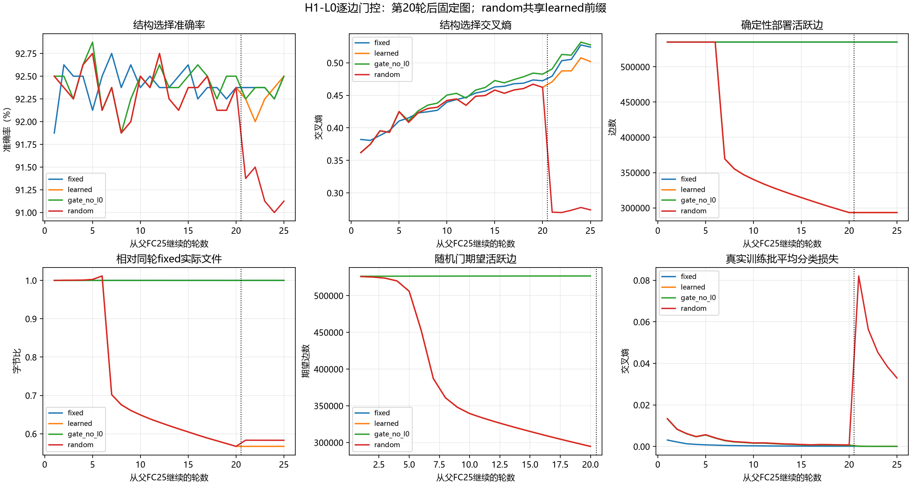

# H1-L0逐边可训练门控：实际报告

20261008；启动前实现提交`3952d9ba92b568dad4ae111de3b22af3ebd872d9`。

[完整JSON](h1_l0_gates_v1_mnist_static_20261008.json)、[证据索引](h1_l0_gates_v1_mnist_static_20261008_evidence/README.md)保存曲线、门统计、真实预测、成本和来源。

## 固定机制与公平边界

从旧未剪枝FC25延续，模型根11/数据20261004，784→512→256→10，3200fit/800select；四臂冻结并完成接受决定后各重复探索旧1000control一次。官方测试及剩余封存ID未访问。

Louizos等既有hard-concrete L0机制的逐边应用，不称首创；作者Dense按输入单元门，本轮每边门、bias独立。β2/3、γ-.1、ζ1.1、a初值2.5；训练随机门，评价使用不除β的z_det。CE+λ·sum(p_open)/3200，λ前5轮线性至.001并保持至20轮；门lr.02、θlr.00025第16轮减半、AdamW eps1e-8、wd0，无扫描。

p_open是理想未截断Uniform(0,1)解析期望；实际Uniform端点保护后仅作为近似统计/惩罚。累计1800秒在新轮开始前及轮末检查，单个已开始轮可跨过阈值，实际成本照记。

fixed/learned/gate_no_l0三个实际20轮前缀；random复用learned20母态。四最终分支各5轮，同批次/Adamreset，固定掩码CE训练。random逐层置乱完整z_det（含零），冻结同theta×z_perm；主为theta×z_det。位置及衰减幅度对应联合身份是归因对象，不能称纯二值身份或独立随机训练全过程。gate_no_l0的门仍接受CE梯度，控制显式L0项，不能称固定dropout。

冻结仅折入确定性门并删除精确零门，无额外阈值、排序强剪或最佳轮选择。训练a/Adam和门采样成本单报；部署文件删除门元数据、保留无损FP32有效权重、偏置和掩码。原槽/节点维度保持，稠密gather执行不意味着推断加速或能耗收益。

## 完整预算末态成绩

| 臂 | 集合 | 样本 | 准确率 | 交叉熵 |
| --- | --- | --- | --- | --- |
| fixed | 拟合 | 3200 | 100.000% | 0.000039 |
| fixed | 结构选择 | 800 | 92.500% | 0.524157 |
| fixed | 重复探索 | 1000 | 93.700% | 0.396019 |
| learned | 拟合 | 3200 | 100.000% | 0.000038 |
| learned | 结构选择 | 800 | 92.500% | 0.501848 |
| learned | 重复探索 | 1000 | 93.900% | 0.389214 |
| gate_no_l0 | 拟合 | 3200 | 100.000% | 0.000030 |
| gate_no_l0 | 结构选择 | 800 | 92.500% | 0.527555 |
| gate_no_l0 | 重复探索 | 1000 | 93.700% | 0.407254 |
| random | 拟合 | 3200 | 100.000% | 0.028669 |
| random | 结构选择 | 800 | 91.125% | 0.273947 |
| random | 重复探索 | 1000 | 93.100% | 0.213634 |

## 确定性图与真实大小

| 臂 | 活跃边 | FP32非零边 | 独立参数含偏置 | 原分配槽 | 真实字节 | 相对fixed减少 |
| --- | --- | --- | --- | --- | --- | --- |
| fixed | 535040 | 535040 | 535818 | 535818 | 1989684 | 0.000% |
| learned | 293372 | 293372 | 294150 | 535818 | 1128676 | 43.274% |
| gate_no_l0 | 535040 | 535040 | 535818 | 535818 | 1990076 | -0.020% |
| random | 293372 | 293372 | 294150 | 535818 | 1160279 | 41.685% |

每层门值（含零）多重集、保存置乱索引、活跃位置已只读核对；活跃代表可为零，与非零边数分开。实际文件长度含权重、bias、宽度、掩码/索引及压缩元数据，不用期望L0代替实际大小。

| 层 | 期望边（learned20） | 主随机共同活跃位置 | 零门 | 分数门 |
| --- | --- | --- | --- | --- |
| 0 | 193930.11 | 191223 | 210185 | 108193 |
| 1 | 98640.58 | 99975 | 31097 | 44905 |
| 2 | 2165.27 | 2174 | 386 | 213 |



random前20轮曲线是共享learned母态，不是重复训练。虚线处冻结，之后没有期望门指标；训练批CE与确定性评价CE不同。

## 实际成本

| 实际执行段 | 优化样本前向/反传 | 更新 | 评价调用/样本 | Adam重置轮 | 段计时秒 | 编码构图秒 |
| --- | --- | --- | --- | --- | --- | --- |
| 前缀:fixed | 64000/64000 | 1000 | 20/16000 | [] | 29.187 | 6.067 |
| 前缀:learned | 64000/64000 | 1000 | 20/16000 | [] | 33.755 | 24.312 |
| 前缀:gate_no_l0 | 64000/64000 | 1000 | 20/16000 | [] | 15.018 | 5.807 |
| 分支:fixed | 16000/16000 | 250 | 7/8200 | [21] | 3.149 | 1.361 |
| 分支:learned | 16000/16000 | 250 | 7/8200 | [21] | 13.459 | 7.764 |
| 分支:gate_no_l0 | 16000/16000 | 250 | 7/8200 | [21] | 3.361 | 1.518 |
| 分支:random | 16000/16000 | 250 | 8/9000 | [21] | 15.336 | 9.356 |

新增实际4000更新，优化前向/反传各256000样本，评价89次/81600样本。random逻辑前20轮64000样本共享，不重复算实际成本。主/λ0/random后5轮均250适应更新；失败适应不退成本、不补fallback。没有新增激活拟合、模型检查或GPU诊断。

会话139.657秒，累计139.657秒，设备NVIDIA GeForce RTX 5080 Laptop GPU（cuda）、FP32、训练batch64/评价512、CPU线程2；整次CUDA峰分配173224448字节。段计时排除checkpoint/预测写入及末态fit/探索，编码构图是段计时子集不能重复相加。前缀checkpoint字节完整JSON列明；训练额外535040门参数及Adam矩不能省略。没有实测推断速度或能耗。

## 一次接受判定与机制归因

最终accepted=True；任务保持=True；真实文件减少43.274%，20%阶段信号=True。判据为相对fixed25选择1pp/.05、fit≥90%且真实文件更小，旧control不参与。

| 集合 | learned−random准确率百分点 | learned−random交叉熵 |
| --- | --- | --- |
| 拟合 | +0.000 | -0.028630 |
| 结构选择 | +1.375 | +0.227902 |
| 重复探索 | +0.800 | +0.175580 |

单根、反复使用的select与旧control不足以称显著性/稳健性/跨任务发现。主随机差只能解释同theta下完整门值分配；λ0比较显式L0增量，普通FC比较整套门训练代价和效果。期望L0下降、确定性零门、真实导出、任务保持及身份优势分别判定。

本轮已获得真实主动稀疏化：learned删除241668条边、文件减少43.274%，fit100%，选择准确率与fixed同为92.5%、选择CE略低；λ0门控没有确定性删边，部署文件未减少。这支持固定L0项对本轮稀疏形成的增量，不等于已有L0机制的新颖性或所有任务上的最优方案；原机制参见[原论文](https://arxiv.org/abs/1712.01312)与[作者实现](https://github.com/AMLab-Amsterdam/L0_regularization/blob/master/l0_layers.py)。

learned相对同层同规模random选择高1.375pp、重复探索高0.8pp，但CE分别高0.227902/0.175580，随机在损失上明显更好。准确率身份信号与概率损失权衡并存，不能称主臂全面胜过随机、提高全部泛化指标或纯二值边身份更好。random从同learned母态换门值位置，因此控制的是零门及非零幅度与权重的对应，未隔离整个预冻结参数学习过程。

random末态fit虽100%，CE0.028669仍高于主0.000038，且后5轮训练损失还在下降；身份差异是在固定短适应预算下观察，可能包含门值与已优化权重匹配后的再适应难度，不能直接认定随机图长期容量更差。没有因这项结果额外延长适应或查看新数据。

门控20轮理想期望294735.96边与确定性活跃293372边分开；224508个a触固定下限，记录饱和而不临时放宽约束。三个完整前缀checkpoint分别15040197/21474449/21474321字节（fixed/learned/gate_no_l0），是含训练状态的保存成本，不与部署BGS字节混称。最终session_cost记录139.674850秒；summary在末态保存前记录139.656661秒，二者计时边界相差0.018189秒，最终累计采用session_cost。报告生成自身计时约2.730977秒，0模型前向；中文图已一次查看，未重新生成或评价。

若接受失败，25轮失败候选预测、大小和全部预算仍保留；仅恢复20轮母态完整状态作后续入口，不把恢复态冒充公平25轮模型。原母态参数/Adam/日程/RNG/门流checkpoint未受分支改写，未追加训练、改λ/门阈值或扫描种子。

## 证据与恢复

完整checkpoint与逐轮日志留原运行目录；证据包括四候选真实模型/预测、初始冻结模型、完整门值与置乱、20轮确定性母模型及预测、训练提交、源配置哈希和接受账本。报告不加载checkpoint/模型，0前向。

```powershell
.venv/Scripts/python.exe -u -B -m tools.train_l0_gates --resume
```

完成summary的恢复入口直接返回，不复跑训练或评价；失败母态继续需另登记新轮。

## 混淆矩阵

### fixed：拟合

| 真值\预测 | 0 | 1 | 2 | 3 | 4 | 5 | 6 | 7 | 8 | 9 |
| --- | --- | --- | --- | --- | --- | --- | --- | --- | --- | --- |
| 0 | 320 | 0 | 0 | 0 | 0 | 0 | 0 | 0 | 0 | 0 |
| 1 | 0 | 320 | 0 | 0 | 0 | 0 | 0 | 0 | 0 | 0 |
| 2 | 0 | 0 | 320 | 0 | 0 | 0 | 0 | 0 | 0 | 0 |
| 3 | 0 | 0 | 0 | 320 | 0 | 0 | 0 | 0 | 0 | 0 |
| 4 | 0 | 0 | 0 | 0 | 320 | 0 | 0 | 0 | 0 | 0 |
| 5 | 0 | 0 | 0 | 0 | 0 | 320 | 0 | 0 | 0 | 0 |
| 6 | 0 | 0 | 0 | 0 | 0 | 0 | 320 | 0 | 0 | 0 |
| 7 | 0 | 0 | 0 | 0 | 0 | 0 | 0 | 320 | 0 | 0 |
| 8 | 0 | 0 | 0 | 0 | 0 | 0 | 0 | 0 | 320 | 0 |
| 9 | 0 | 0 | 0 | 0 | 0 | 0 | 0 | 0 | 0 | 320 |

### fixed：结构选择

| 真值\预测 | 0 | 1 | 2 | 3 | 4 | 5 | 6 | 7 | 8 | 9 |
| --- | --- | --- | --- | --- | --- | --- | --- | --- | --- | --- |
| 0 | 75 | 0 | 1 | 0 | 0 | 1 | 0 | 1 | 2 | 0 |
| 1 | 0 | 80 | 0 | 0 | 0 | 0 | 0 | 0 | 0 | 0 |
| 2 | 0 | 0 | 76 | 0 | 2 | 0 | 0 | 0 | 2 | 0 |
| 3 | 0 | 0 | 2 | 73 | 0 | 4 | 1 | 0 | 0 | 0 |
| 4 | 1 | 0 | 0 | 0 | 75 | 0 | 0 | 0 | 0 | 4 |
| 5 | 1 | 0 | 1 | 2 | 0 | 72 | 3 | 0 | 1 | 0 |
| 6 | 2 | 0 | 0 | 0 | 0 | 3 | 72 | 0 | 3 | 0 |
| 7 | 0 | 0 | 1 | 0 | 1 | 1 | 0 | 74 | 1 | 2 |
| 8 | 0 | 1 | 0 | 2 | 2 | 0 | 0 | 0 | 72 | 3 |
| 9 | 0 | 0 | 0 | 2 | 4 | 2 | 1 | 0 | 0 | 71 |

### fixed：重复探索

| 真值\预测 | 0 | 1 | 2 | 3 | 4 | 5 | 6 | 7 | 8 | 9 |
| --- | --- | --- | --- | --- | --- | --- | --- | --- | --- | --- |
| 0 | 98 | 0 | 1 | 0 | 0 | 0 | 1 | 0 | 0 | 0 |
| 1 | 0 | 98 | 0 | 0 | 1 | 1 | 0 | 0 | 0 | 0 |
| 2 | 1 | 0 | 94 | 2 | 1 | 0 | 1 | 0 | 1 | 0 |
| 3 | 0 | 0 | 1 | 87 | 0 | 4 | 0 | 2 | 5 | 1 |
| 4 | 0 | 0 | 0 | 0 | 93 | 0 | 1 | 0 | 0 | 6 |
| 5 | 0 | 0 | 0 | 1 | 0 | 93 | 3 | 1 | 0 | 2 |
| 6 | 0 | 0 | 2 | 0 | 1 | 3 | 94 | 0 | 0 | 0 |
| 7 | 0 | 0 | 3 | 0 | 0 | 0 | 0 | 96 | 0 | 1 |
| 8 | 0 | 1 | 1 | 1 | 1 | 2 | 0 | 1 | 92 | 1 |
| 9 | 1 | 0 | 0 | 0 | 5 | 0 | 0 | 2 | 0 | 92 |

### learned：拟合

| 真值\预测 | 0 | 1 | 2 | 3 | 4 | 5 | 6 | 7 | 8 | 9 |
| --- | --- | --- | --- | --- | --- | --- | --- | --- | --- | --- |
| 0 | 320 | 0 | 0 | 0 | 0 | 0 | 0 | 0 | 0 | 0 |
| 1 | 0 | 320 | 0 | 0 | 0 | 0 | 0 | 0 | 0 | 0 |
| 2 | 0 | 0 | 320 | 0 | 0 | 0 | 0 | 0 | 0 | 0 |
| 3 | 0 | 0 | 0 | 320 | 0 | 0 | 0 | 0 | 0 | 0 |
| 4 | 0 | 0 | 0 | 0 | 320 | 0 | 0 | 0 | 0 | 0 |
| 5 | 0 | 0 | 0 | 0 | 0 | 320 | 0 | 0 | 0 | 0 |
| 6 | 0 | 0 | 0 | 0 | 0 | 0 | 320 | 0 | 0 | 0 |
| 7 | 0 | 0 | 0 | 0 | 0 | 0 | 0 | 320 | 0 | 0 |
| 8 | 0 | 0 | 0 | 0 | 0 | 0 | 0 | 0 | 320 | 0 |
| 9 | 0 | 0 | 0 | 0 | 0 | 0 | 0 | 0 | 0 | 320 |

### learned：结构选择

| 真值\预测 | 0 | 1 | 2 | 3 | 4 | 5 | 6 | 7 | 8 | 9 |
| --- | --- | --- | --- | --- | --- | --- | --- | --- | --- | --- |
| 0 | 75 | 0 | 1 | 0 | 0 | 1 | 0 | 1 | 2 | 0 |
| 1 | 0 | 80 | 0 | 0 | 0 | 0 | 0 | 0 | 0 | 0 |
| 2 | 0 | 0 | 76 | 0 | 2 | 0 | 0 | 0 | 2 | 0 |
| 3 | 0 | 0 | 2 | 72 | 0 | 4 | 1 | 0 | 0 | 1 |
| 4 | 2 | 0 | 0 | 0 | 74 | 0 | 0 | 0 | 0 | 4 |
| 5 | 1 | 0 | 1 | 2 | 0 | 72 | 3 | 0 | 1 | 0 |
| 6 | 2 | 0 | 0 | 0 | 0 | 3 | 72 | 0 | 2 | 1 |
| 7 | 0 | 0 | 1 | 0 | 0 | 1 | 0 | 75 | 1 | 2 |
| 8 | 0 | 1 | 0 | 2 | 2 | 0 | 0 | 0 | 72 | 3 |
| 9 | 0 | 0 | 0 | 2 | 3 | 2 | 1 | 0 | 0 | 72 |

### learned：重复探索

| 真值\预测 | 0 | 1 | 2 | 3 | 4 | 5 | 6 | 7 | 8 | 9 |
| --- | --- | --- | --- | --- | --- | --- | --- | --- | --- | --- |
| 0 | 98 | 0 | 1 | 0 | 0 | 0 | 1 | 0 | 0 | 0 |
| 1 | 0 | 98 | 0 | 0 | 1 | 1 | 0 | 0 | 0 | 0 |
| 2 | 1 | 0 | 95 | 2 | 0 | 0 | 1 | 0 | 1 | 0 |
| 3 | 0 | 0 | 1 | 88 | 0 | 4 | 0 | 1 | 5 | 1 |
| 4 | 0 | 0 | 0 | 0 | 93 | 0 | 1 | 0 | 0 | 6 |
| 5 | 0 | 0 | 0 | 1 | 0 | 92 | 4 | 1 | 0 | 2 |
| 6 | 0 | 0 | 2 | 0 | 1 | 3 | 94 | 0 | 0 | 0 |
| 7 | 0 | 0 | 3 | 0 | 0 | 0 | 0 | 96 | 0 | 1 |
| 8 | 0 | 1 | 1 | 1 | 1 | 2 | 0 | 1 | 92 | 1 |
| 9 | 1 | 0 | 0 | 0 | 4 | 0 | 0 | 2 | 0 | 93 |

### gate_no_l0：拟合

| 真值\预测 | 0 | 1 | 2 | 3 | 4 | 5 | 6 | 7 | 8 | 9 |
| --- | --- | --- | --- | --- | --- | --- | --- | --- | --- | --- |
| 0 | 320 | 0 | 0 | 0 | 0 | 0 | 0 | 0 | 0 | 0 |
| 1 | 0 | 320 | 0 | 0 | 0 | 0 | 0 | 0 | 0 | 0 |
| 2 | 0 | 0 | 320 | 0 | 0 | 0 | 0 | 0 | 0 | 0 |
| 3 | 0 | 0 | 0 | 320 | 0 | 0 | 0 | 0 | 0 | 0 |
| 4 | 0 | 0 | 0 | 0 | 320 | 0 | 0 | 0 | 0 | 0 |
| 5 | 0 | 0 | 0 | 0 | 0 | 320 | 0 | 0 | 0 | 0 |
| 6 | 0 | 0 | 0 | 0 | 0 | 0 | 320 | 0 | 0 | 0 |
| 7 | 0 | 0 | 0 | 0 | 0 | 0 | 0 | 320 | 0 | 0 |
| 8 | 0 | 0 | 0 | 0 | 0 | 0 | 0 | 0 | 320 | 0 |
| 9 | 0 | 0 | 0 | 0 | 0 | 0 | 0 | 0 | 0 | 320 |

### gate_no_l0：结构选择

| 真值\预测 | 0 | 1 | 2 | 3 | 4 | 5 | 6 | 7 | 8 | 9 |
| --- | --- | --- | --- | --- | --- | --- | --- | --- | --- | --- |
| 0 | 75 | 0 | 1 | 0 | 0 | 1 | 0 | 1 | 2 | 0 |
| 1 | 0 | 80 | 0 | 0 | 0 | 0 | 0 | 0 | 0 | 0 |
| 2 | 1 | 0 | 75 | 0 | 2 | 0 | 0 | 0 | 2 | 0 |
| 3 | 0 | 0 | 2 | 72 | 0 | 4 | 1 | 0 | 0 | 1 |
| 4 | 1 | 0 | 0 | 0 | 75 | 0 | 0 | 0 | 0 | 4 |
| 5 | 1 | 0 | 1 | 2 | 0 | 72 | 3 | 0 | 1 | 0 |
| 6 | 2 | 0 | 0 | 0 | 0 | 3 | 73 | 0 | 2 | 0 |
| 7 | 0 | 0 | 1 | 0 | 1 | 1 | 0 | 74 | 1 | 2 |
| 8 | 0 | 1 | 0 | 1 | 2 | 0 | 0 | 0 | 73 | 3 |
| 9 | 0 | 0 | 0 | 2 | 4 | 2 | 1 | 0 | 0 | 71 |

### gate_no_l0：重复探索

| 真值\预测 | 0 | 1 | 2 | 3 | 4 | 5 | 6 | 7 | 8 | 9 |
| --- | --- | --- | --- | --- | --- | --- | --- | --- | --- | --- |
| 0 | 98 | 0 | 1 | 0 | 0 | 0 | 1 | 0 | 0 | 0 |
| 1 | 0 | 98 | 0 | 0 | 1 | 1 | 0 | 0 | 0 | 0 |
| 2 | 1 | 0 | 94 | 2 | 1 | 0 | 1 | 0 | 1 | 0 |
| 3 | 0 | 0 | 1 | 88 | 0 | 4 | 0 | 1 | 5 | 1 |
| 4 | 0 | 0 | 0 | 0 | 93 | 0 | 1 | 0 | 0 | 6 |
| 5 | 0 | 0 | 0 | 1 | 0 | 93 | 3 | 1 | 0 | 2 |
| 6 | 0 | 0 | 2 | 0 | 1 | 3 | 94 | 0 | 0 | 0 |
| 7 | 0 | 0 | 3 | 0 | 0 | 0 | 0 | 96 | 0 | 1 |
| 8 | 0 | 1 | 1 | 1 | 1 | 3 | 0 | 1 | 91 | 1 |
| 9 | 1 | 0 | 0 | 0 | 5 | 0 | 0 | 2 | 0 | 92 |

### random：拟合

| 真值\预测 | 0 | 1 | 2 | 3 | 4 | 5 | 6 | 7 | 8 | 9 |
| --- | --- | --- | --- | --- | --- | --- | --- | --- | --- | --- |
| 0 | 320 | 0 | 0 | 0 | 0 | 0 | 0 | 0 | 0 | 0 |
| 1 | 0 | 320 | 0 | 0 | 0 | 0 | 0 | 0 | 0 | 0 |
| 2 | 0 | 0 | 320 | 0 | 0 | 0 | 0 | 0 | 0 | 0 |
| 3 | 0 | 0 | 0 | 320 | 0 | 0 | 0 | 0 | 0 | 0 |
| 4 | 0 | 0 | 0 | 0 | 320 | 0 | 0 | 0 | 0 | 0 |
| 5 | 0 | 0 | 0 | 0 | 0 | 320 | 0 | 0 | 0 | 0 |
| 6 | 0 | 0 | 0 | 0 | 0 | 0 | 320 | 0 | 0 | 0 |
| 7 | 0 | 0 | 0 | 0 | 0 | 0 | 0 | 320 | 0 | 0 |
| 8 | 0 | 0 | 0 | 0 | 0 | 0 | 0 | 0 | 320 | 0 |
| 9 | 0 | 0 | 0 | 0 | 0 | 0 | 0 | 0 | 0 | 320 |

### random：结构选择

| 真值\预测 | 0 | 1 | 2 | 3 | 4 | 5 | 6 | 7 | 8 | 9 |
| --- | --- | --- | --- | --- | --- | --- | --- | --- | --- | --- |
| 0 | 75 | 0 | 1 | 0 | 0 | 1 | 0 | 1 | 2 | 0 |
| 1 | 0 | 78 | 0 | 0 | 0 | 0 | 0 | 0 | 2 | 0 |
| 2 | 0 | 0 | 75 | 2 | 1 | 0 | 0 | 0 | 2 | 0 |
| 3 | 0 | 0 | 2 | 69 | 0 | 7 | 1 | 0 | 1 | 0 |
| 4 | 2 | 0 | 0 | 0 | 74 | 0 | 0 | 0 | 1 | 3 |
| 5 | 1 | 0 | 1 | 2 | 0 | 72 | 3 | 0 | 1 | 0 |
| 6 | 2 | 0 | 0 | 0 | 0 | 3 | 72 | 0 | 3 | 0 |
| 7 | 0 | 0 | 1 | 0 | 1 | 1 | 0 | 74 | 1 | 2 |
| 8 | 0 | 2 | 0 | 2 | 1 | 1 | 1 | 0 | 70 | 3 |
| 9 | 0 | 0 | 0 | 4 | 3 | 2 | 1 | 0 | 0 | 70 |

### random：重复探索

| 真值\预测 | 0 | 1 | 2 | 3 | 4 | 5 | 6 | 7 | 8 | 9 |
| --- | --- | --- | --- | --- | --- | --- | --- | --- | --- | --- |
| 0 | 98 | 0 | 1 | 0 | 0 | 0 | 1 | 0 | 0 | 0 |
| 1 | 0 | 97 | 0 | 0 | 1 | 0 | 1 | 0 | 1 | 0 |
| 2 | 1 | 0 | 92 | 3 | 0 | 0 | 2 | 1 | 1 | 0 |
| 3 | 0 | 0 | 1 | 88 | 0 | 4 | 0 | 1 | 5 | 1 |
| 4 | 0 | 0 | 0 | 0 | 93 | 0 | 1 | 0 | 0 | 6 |
| 5 | 0 | 0 | 0 | 1 | 0 | 92 | 4 | 1 | 0 | 2 |
| 6 | 0 | 0 | 2 | 0 | 1 | 3 | 94 | 0 | 0 | 0 |
| 7 | 0 | 0 | 3 | 0 | 0 | 0 | 0 | 96 | 0 | 1 |
| 8 | 0 | 1 | 1 | 1 | 1 | 3 | 0 | 1 | 91 | 1 |
| 9 | 1 | 0 | 0 | 0 | 5 | 0 | 0 | 3 | 1 | 90 |

