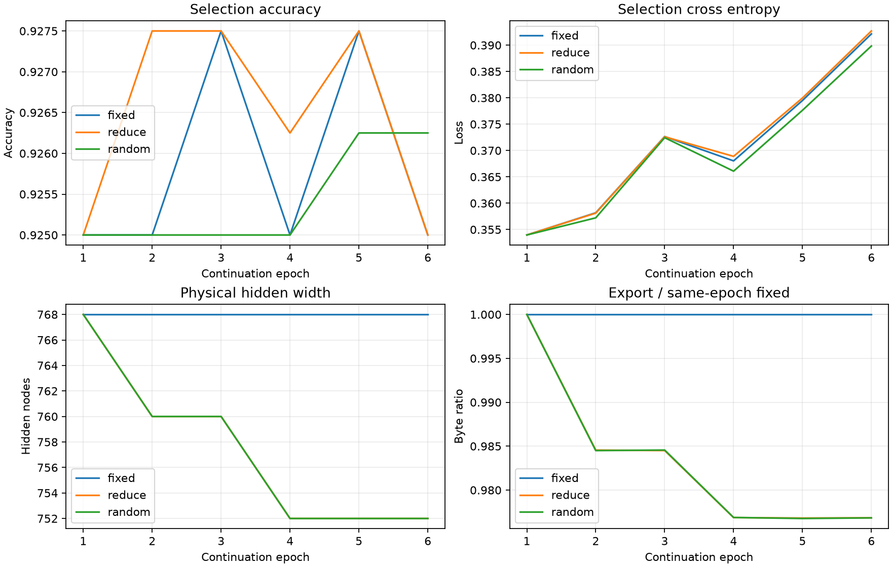

# H1非零多节点激活基组简化：实际报告

20261008；真实结果来自本阶段保存预测、事件和模型文件。启动前实现提交`7dde5980dfeca13d6f922ada914d04c1aeb0a970`，不使用报告生成时HEAD。

[完整JSON](h1_nodes_nonzero_v1_mnist_static_20261008.json)保留曲线、事件、系数、成本与文件哈希。

## 任务与方法边界

从`history/ann_stages_20261008/experiments/runs/pruning_v1/mnist_static/fc/resume.pt`的普通FC末态延续，非剪枝末态；初始784→512→256→10，模型根11、数据根20261004。fixed/reduce/random各6轮，同父权重/Adam/RNG及逐轮批次；不重训父25轮。

3200授权fit内每数字前256样本用于系数拟合、后64留出，合计2560/640，索引在登记及数据清单；640留出只验证固定系数、不重新求解。800结构选择反复用于接受，1000旧control已有探索反馈，全部臂末轮冻结后仅重复探索；官方测试与其他封存ID未解封，无新增种子。

reduce在ReLU激活上用CPU float64贪心选择基列、无截距lstsq估计多节点重构；拟合后一次固定为C32，出边补偿与640留出残差均使用固定C32。矩阵存为float64仅保存这些FP32值，不表示重新高精度拟合。不是严格极大线性无关组，也不证明全输入域等价。

本轮主提议要求拟合激活L2范数严格大于0，原float64及固定C32每个删除列至少2个abs>1e-8；固定阈值不扫描，不清理零拟合激活，不强制填满删除预算。实际拟合激活范数和系数支持已保存并由报告核对。

fixed从旧FC25重复6轮是常规对照成本，全部计入本轮账本，不冒充新增机制效果。

random继承reduce接受slot、层及实际删除数，无条件均匀选择节点身份；使用所有保留列进行自己的lstsq拟合补偿，不采用主臂贪心基组限制，留出残差只报告。这是带拟合补偿的随机身份对照，求解空间与主臂不同；不能将差异单独归因于节点选择，更不能称无补偿随机删节点。

拟合与固定C32留出相对残差阈值0.05；每slot最多8节点。主候选需物理缩宽、完整实际文件减少、同轮fixed效果容差保持；不要求优于fixed。新尺寸图使用新Adam，三臂同候选轮统一重置；已适应拒绝再原图fallback，额外成本不回退。

## 真实任务成绩

| 臂 | 集合 | 样本 | 准确率 | 交叉熵 |
| --- | --- | --- | --- | --- |
| fixed | 拟合 | 3200 | 100.0000% | 0.000855 |
| fixed | 结构选择 | 800 | 92.5000% | 0.392133 |
| fixed | 重复探索 | 1000 | 93.5000% | 0.301229 |
| reduce | 拟合 | 3200 | 100.0000% | 0.000848 |
| reduce | 结构选择 | 800 | 92.5000% | 0.392697 |
| reduce | 重复探索 | 1000 | 93.5000% | 0.300668 |
| random | 拟合 | 3200 | 100.0000% | 0.000864 |
| random | 结构选择 | 800 | 92.6250% | 0.389840 |
| random | 重复探索 | 1000 | 93.5000% | 0.301083 |

所有准确率、损失、混淆矩阵由保存logits重算并核对summary，采用登记末轮，不按探索成绩挑轮。

## 物理宽度、节点与实际文件

| 臂 | 实际导出宽度 | 隐藏/输出/总计算节点 | 删除隐藏节点 | 自由参数含偏置 | 分配参数槽 | 文件字节 | 相对fixed文件减少 |
| --- | --- | --- | --- | --- | --- | --- | --- |
| fixed | 784→512→256→10 | 768/10/778 | 0 | 535818 | 535818 | 1989935 | 0.000% |
| reduce | 784→504→248→10 | 752/10/762 | 16 | 523370 | 523370 | 1943855 | 2.316% |
| random | 784→504→248→10 | 752/10/762 | 16 | 523370 | 523370 | 1943835 | 2.317% |

已读取真实BGS1文件架构头核对物理宽度与槽数；没有构造模型或运行前向。同为FP32无损编码，字节含参数、映射、索引与元数据，文件长度来自实际文件。

| 臂 | 层 | 输入→输出 | 活跃边 | 非零边 | 活跃/非零密度 | 自由参数含偏置 | 分配槽 | 非零共享组 |
| --- | --- | --- | --- | --- | --- | --- | --- | --- |
| fixed | 1 | 784→512 | 401408 | 401408 | 100.000%/100.000% | 401920 | 401920 | 0 |
| fixed | 2 | 512→256 | 131072 | 131072 | 100.000%/100.000% | 131328 | 131328 | 0 |
| fixed | 3 | 256→10 | 2560 | 2560 | 100.000%/100.000% | 2570 | 2570 | 0 |
| reduce | 1 | 784→504 | 395136 | 395136 | 100.000%/100.000% | 395640 | 395640 | 0 |
| reduce | 2 | 504→248 | 124992 | 124992 | 100.000%/100.000% | 125240 | 125240 | 0 |
| reduce | 3 | 248→10 | 2480 | 2480 | 100.000%/100.000% | 2490 | 2490 | 0 |
| random | 1 | 784→504 | 395136 | 395136 | 100.000%/100.000% | 395640 | 395640 | 0 |
| random | 2 | 504→248 | 124992 | 124992 | 100.000%/100.000% | 125240 | 125240 | 0 |
| random | 3 | 248→10 | 2480 | 2480 | 100.000%/100.000% | 2490 | 2490 | 0 |

补偿可能新增或归零出边，事件中的compensation记录具体变化；删除节点与减少边数分别报告。物理宽度/参数槽缩小仍使用稠密gather矩阵乘，本轮没有实测推断延迟或能耗，不能将参数数、边数当作速度/能耗收益。

## 多节点重构还是零激活删除

| 臂 | 已接受slot | 删除系数列 | ≥2非零系数列 | ≥2个abs>1e-8系数列 | 全零系数列 | 640留出确认零激活列 |
| --- | --- | --- | --- | --- | --- | --- |
| fixed | 0 | 0 | 0 | 0 | 0 | 0 |
| reduce | 2 | 16 | 16 | 16 | 0 | 0 |
| random | 2 | 16 | 15 | 15 | 1 | 1 |

每个dropped列按固定C32的coef!=0统计；主提议及固定C32要求至少2个abs>1e-8，random不筛选，不能证明秩或功能独立。C32全零且640留出绝对残差为0，可确认该留出上的零激活；单凭全零系数不能证明全域死节点。原拟合残差为float64求解结果，留出残差则来自固定C32，两者不能混写。

| 臂 | 轮/slot | 层 | 接受 | 基列/保留/删除数 | dropped节点 | 非零coef数 | 拟合相对残差64 | 留出相对残差C32 | 留出绝对残差 |
| --- | --- | --- | --- | --- | --- | --- | --- | --- | --- |
| reduce | 2/1 | 0 | True | 460/504/8 | 128 | 460 | 0.03304016991776576 | 0.04222803600524557 | 1.4010508230519496 |
| reduce | 2/1 | 0 | True | 460/504/8 | 189 | 460 | 0.03368192165975435 | 0.043846791112898506 | 1.465875541988589 |
| reduce | 2/1 | 0 | True | 460/504/8 | 193 | 460 | 0.03362170912529576 | 0.04392621697137915 | 1.5117927380375749 |
| reduce | 2/1 | 0 | True | 460/504/8 | 282 | 460 | 0.02479499333644037 | 0.030075445400261275 | 1.504357259996301 |
| reduce | 2/1 | 0 | True | 460/504/8 | 338 | 460 | 0.03532601200387373 | 0.04598868071205583 | 1.6124975255044056 |
| reduce | 2/1 | 0 | True | 460/504/8 | 356 | 460 | 0.03866552910112062 | 0.04887797919190146 | 1.5528922185573357 |
| reduce | 2/1 | 0 | True | 460/504/8 | 379 | 460 | 0.03864830021759827 | 0.047903170172538076 | 1.5871761968314166 |
| reduce | 2/1 | 0 | True | 460/504/8 | 399 | 460 | 0.03721679660261685 | 0.04368849195726211 | 1.5690469130964573 |
| reduce | 4/2 | 1 | True | 119/248/8 | 58 | 119 | 0.030947900255016474 | 0.03348305644404608 | 3.2395770201236194 |
| reduce | 4/2 | 1 | True | 119/248/8 | 66 | 119 | 0.028585001508077964 | 0.029174542014975175 | 3.222305867842369 |
| reduce | 4/2 | 1 | True | 119/248/8 | 97 | 119 | 0.031719878677921635 | 0.034772625235117975 | 3.1133212351707518 |
| reduce | 4/2 | 1 | True | 119/248/8 | 109 | 119 | 0.03393724347711604 | 0.03462325147898638 | 3.333596870391512 |
| reduce | 4/2 | 1 | True | 119/248/8 | 127 | 119 | 0.032132048434462934 | 0.03534697012330185 | 3.155527210063225 |
| reduce | 4/2 | 1 | True | 119/248/8 | 149 | 119 | 0.03409891837069528 | 0.036210245611440386 | 3.1591188507485017 |
| reduce | 4/2 | 1 | True | 119/248/8 | 207 | 119 | 0.028817791178163993 | 0.031590543911359216 | 3.029199830392138 |
| reduce | 4/2 | 1 | True | 119/248/8 | 248 | 119 | 0.02957987398969797 | 0.0288846749513181 | 3.3521636464292284 |
| reduce | 6/3 | 0 | False | 458/496/8 | 34 | 458 | 0.0378163055804219 | 0.04792669149379702 | 1.5613245336674346 |
| reduce | 6/3 | 0 | False | 458/496/8 | 54 | 458 | 0.03987861222110937 | 0.0478970194938242 | 1.508807099288254 |
| reduce | 6/3 | 0 | False | 458/496/8 | 64 | 458 | 0.04041648095775291 | 0.048092860822330066 | 1.4154900925980147 |
| reduce | 6/3 | 0 | False | 458/496/8 | 116 | 458 | 0.041359696183892826 | 0.05207727685268744 | 1.6538434111165128 |
| reduce | 6/3 | 0 | False | 458/496/8 | 182 | 458 | 0.04158214301058155 | 0.05213399781276107 | 1.589454898684442 |
| reduce | 6/3 | 0 | False | 458/496/8 | 274 | 458 | 0.04025459003370779 | 0.05054019137167271 | 1.6089183861177856 |
| reduce | 6/3 | 0 | False | 458/496/8 | 282 | 458 | 0.04009609056199915 | 0.05137241335602227 | 1.560760328658624 |
| reduce | 6/3 | 0 | False | 458/496/8 | 393 | 458 | 0.03984533511418702 | 0.05126109370574053 | 1.5094213179624156 |
| random | 2/1 | 0 | True | 504/504/8 | 201 | 502 | 0.04822135704376161 | 0.06118462774406346 | 1.4598160516112648 |
| random | 2/1 | 0 | True | 504/504/8 | 225 | 503 | 0.07572451155070259 | 0.0950157083484488 | 1.8026712886861433 |
| random | 2/1 | 0 | True | 504/504/8 | 250 | 504 | 0.055873442719807424 | 0.06796080498222581 | 1.6200998223151404 |
| random | 2/1 | 0 | True | 504/504/8 | 292 | 504 | 0.18494509735569034 | 0.22133945561509438 | 2.7246229301451357 |
| random | 2/1 | 0 | True | 504/504/8 | 350 | 503 | 0.1131839598062478 | 0.13417141322556475 | 2.1269999185417365 |
| random | 2/1 | 0 | True | 504/504/8 | 359 | 504 | 0.066833536283874 | 0.08016770698977746 | 1.7010581001963898 |
| random | 2/1 | 0 | True | 504/504/8 | 420 | 504 | 0.08834303870268556 | 0.10930239819471774 | 2.473209125737525 |
| random | 2/1 | 0 | True | 504/504/8 | 457 | 503 | 0.039481025491832966 | 0.05111429466299066 | 1.4641020896203103 |
| random | 4/2 | 1 | True | 248/248/8 | 33 | 243 | 0.028469858246654437 | 0.03458243567697437 | 3.4701207727200276 |
| random | 4/2 | 1 | True | 248/248/8 | 45 | 243 | 0.02910460086985973 | 0.03115169886207539 | 2.4596747791536027 |
| random | 4/2 | 1 | True | 248/248/8 | 122 | 241 | 0.04358310163628093 | 0.04509950539345836 | 3.2248254117378656 |
| random | 4/2 | 1 | True | 248/248/8 | 139 | 242 | 0.04810933992449043 | 0.05791504497613148 | 3.5971225260205544 |
| random | 4/2 | 1 | True | 248/248/8 | 173 | 239 | 0.035656998298283234 | 0.04305203895575469 | 3.5756959696549186 |
| random | 4/2 | 1 | True | 248/248/8 | 187 | 239 | 0.04888322444612282 | 0.05239398109899014 | 2.8331511145908905 |
| random | 4/2 | 1 | True | 248/248/8 | 188 | 0 | 0.0 | 0.0 | 0.0 |
| random | 4/2 | 1 | True | 248/248/8 | 216 | 243 | 0.03593485168833239 | 0.03824663615159802 | 2.9444747974922683 |

完整实际系数矩阵、逐列保留节点ID、绝对残差、系数范数与补偿新增边都保留JSON；未接受提议单列，不能当有效简化。



曲线为本阶段选择准确率/损失、物理隐藏节点及对应轮fixed文件比，未混入父25轮。

## 实际成本与状态匹配

| 臂 | 优化前向/反传样本 | 尝试/候选/回退/fallback | 净更新/额外尝试 | 激活提取次数/样本 | 评价次数/样本 | Adam重置轮 | 臂计时秒 |
| --- | --- | --- | --- | --- | --- | --- | --- |
| fixed | 19200/19200 | 300/0/0/0 | 300/0 | 0/0 | 8/9000 | [2, 4, 6] | 19.466 |
| reduce | 19200/19200 | 300/2/0/0 | 300/0 | 6/9600 | 12/11112 | [2, 4, 6] | 11.861 |
| random | 19200/19200 | 300/2/0/0 | 300/0 | 4/6400 | 8/9000 | [2, 4, 6] | 4.539 |

总新增优化前向/反传57600/57600样本，尝试900、回退0、fallback 0、净更新900。激活提取10次/16000样本，评价28次/29112样本。激活提取只运行到目标隐藏层，与完整分类评价分别计数；已回退尝试仍是实际成本。

random真实逐轮物理宽度、尝试/候选/回退/fallback及Adam重置时序已与reduce记录核对一致；正常净更新预算亦由账本核对。

| 臂 | 提取/评价 | 用途 | 调用次数 | 样本 |
| --- | --- | --- | --- | --- |
| fixed | 分类评价 | epoch_select | 6 | 4800 |
| fixed | 分类评价 | frozen_fit | 1 | 3200 |
| fixed | 分类评价 | repeated_exploration | 1 | 1000 |
| reduce | 分类评价 | epoch_select | 6 | 4800 |
| reduce | 分类评价 | node_candidate_screen | 2 | 512 |
| reduce | 分类评价 | node_candidate_full | 2 | 1600 |
| reduce | 分类评价 | frozen_fit | 1 | 3200 |
| reduce | 分类评价 | repeated_exploration | 1 | 1000 |
| reduce | 隐藏激活 | task_basis_fit | 3 | 7680 |
| reduce | 隐藏激活 | task_fixed_C32_residual_holdout | 3 | 1920 |
| random | 分类评价 | epoch_select | 6 | 4800 |
| random | 分类评价 | frozen_fit | 1 | 3200 |
| random | 分类评价 | repeated_exploration | 1 | 1000 |
| random | 隐藏激活 | random_coefficient_fit | 2 | 5120 |
| random | 隐藏激活 | random_fixed_C32_residual_holdout_report_only | 2 | 1280 |

| 臂 | 搜索wall秒 | 搜索CPU process秒 | 留出wall秒 | 构造编码解码wall秒 | 候选适应评价wall秒 |
| --- | --- | --- | --- | --- | --- |
| fixed | 0.000000 | 0.000000 | 0.000000 | 0.000000 | 0.000000 |
| reduce | 6.019581 | 11.843750 | 0.018691 | 1.639289 | 0.568104 |
| random | 0.146585 | 0.281250 | 0.000000 | 0.000000 | 0.000000 |

搜索wall包括激活提取/传输及CPU求解，不能称纯CPU墙钟；CPU process另外报告。未记录字段的汇总0只表示无已记录该项，不保证物理成本为0；这些计时已包含于臂计时，不能再相加作为总墙钟。

实际完成会话墙钟47.214秒；跨恢复会话累计墙钟47.214秒。臂计时排除checkpoint/预测写入及末态拟合/探索评价；累计墙钟为本阶段，不含父25轮。运行时间倍率不是否决门槛。

设备cuda，PyTorch 2.13.0+cu130，FP32，batch64、评价batch512、CPU线程2；整次CUDA峰值分配159335424字节，不是逐臂内存比较。

启动证据复用：新增前向0、反传0、更新0。报告0模型前向/反传/更新，未加载checkpoint，未运行GPU诊断或测试。

## 效果与结论边界

| 臂 | 集合 | 相对fixed准确率（百分点） | 相对fixed交叉熵 |
| --- | --- | --- | --- |
| fixed | 拟合 | +0.0000 | +0.000000 |
| fixed | 结构选择 | +0.0000 | +0.000000 |
| fixed | 重复探索 | +0.0000 | +0.000000 |
| reduce | 拟合 | +0.0000 | -0.000007 |
| reduce | 结构选择 | +0.0000 | +0.000564 |
| reduce | 重复探索 | +0.0000 | -0.000561 |
| random | 拟合 | +0.0000 | +0.000010 |
| random | 结构选择 | +0.1250 | -0.002293 |
| random | 重复探索 | +0.0000 | -0.000146 |

| 集合 | reduce−random准确率（百分点） | reduce−random交叉熵 |
| --- | --- | --- |
| 拟合 | +0.0000 | -0.000016 |
| 结构选择 | -0.1250 | +0.002857 |
| 重复探索 | +0.0000 | -0.000415 |

本轮主臂实际物理缩宽、减少参数槽与完整文件，并在登记选择容差内保持效果。已接受删除列中16列使用至少两个非零固定系数，支持本轮确有多列重构操作；这不等于严格线性独立基或全域等价。

唯一模型根、反复使用的选择集与旧control探索不足以声称显著性、稳健性或跨任务通用性；主/随机求解空间差别限制归因。没有卷积发现、全域函数等价、推断速度或能耗收益证据。

## 证据与恢复

[证据索引](h1_nodes_nonzero_v1_mnist_static_20261008_evidence/README.md)保存真实末态模型、fit/select/confirm预测、training_commit、registration、startup、freeze与manifest，文件哈希见JSON。完整节点系数与事件保留在报告JSON。

原逐轮日志/预测及完整动态宽度恢复checkpoint保留于`E:\project\brain-grow\experiments\runs\h1_nodes_nonzero_v1\mnist_static`，未复制大型checkpoint。

```powershell
.venv/Scripts/python.exe -u -B -m tools.train_nodes_nonzero --resume
```

## 混淆矩阵

### fixed：拟合

| 真值\预测 | 0 | 1 | 2 | 3 | 4 | 5 | 6 | 7 | 8 | 9 |
| --- | --- | --- | --- | --- | --- | --- | --- | --- | --- | --- |
| 0 | 320 | 0 | 0 | 0 | 0 | 0 | 0 | 0 | 0 | 0 |
| 1 | 0 | 320 | 0 | 0 | 0 | 0 | 0 | 0 | 0 | 0 |
| 2 | 0 | 0 | 320 | 0 | 0 | 0 | 0 | 0 | 0 | 0 |
| 3 | 0 | 0 | 0 | 320 | 0 | 0 | 0 | 0 | 0 | 0 |
| 4 | 0 | 0 | 0 | 0 | 320 | 0 | 0 | 0 | 0 | 0 |
| 5 | 0 | 0 | 0 | 0 | 0 | 320 | 0 | 0 | 0 | 0 |
| 6 | 0 | 0 | 0 | 0 | 0 | 0 | 320 | 0 | 0 | 0 |
| 7 | 0 | 0 | 0 | 0 | 0 | 0 | 0 | 320 | 0 | 0 |
| 8 | 0 | 0 | 0 | 0 | 0 | 0 | 0 | 0 | 320 | 0 |
| 9 | 0 | 0 | 0 | 0 | 0 | 0 | 0 | 0 | 0 | 320 |

### fixed：结构选择

| 真值\预测 | 0 | 1 | 2 | 3 | 4 | 5 | 6 | 7 | 8 | 9 |
| --- | --- | --- | --- | --- | --- | --- | --- | --- | --- | --- |
| 0 | 75 | 0 | 1 | 0 | 0 | 1 | 0 | 1 | 2 | 0 |
| 1 | 0 | 80 | 0 | 0 | 0 | 0 | 0 | 0 | 0 | 0 |
| 2 | 0 | 0 | 77 | 0 | 2 | 0 | 0 | 0 | 1 | 0 |
| 3 | 0 | 0 | 2 | 72 | 0 | 3 | 1 | 1 | 0 | 1 |
| 4 | 1 | 0 | 0 | 0 | 75 | 0 | 0 | 0 | 0 | 4 |
| 5 | 1 | 0 | 1 | 2 | 0 | 72 | 4 | 0 | 0 | 0 |
| 6 | 2 | 0 | 0 | 0 | 0 | 2 | 72 | 0 | 3 | 1 |
| 7 | 0 | 0 | 1 | 0 | 1 | 0 | 0 | 75 | 1 | 2 |
| 8 | 0 | 1 | 0 | 2 | 2 | 1 | 0 | 0 | 71 | 3 |
| 9 | 0 | 0 | 0 | 2 | 4 | 2 | 1 | 0 | 0 | 71 |

### fixed：重复探索

| 真值\预测 | 0 | 1 | 2 | 3 | 4 | 5 | 6 | 7 | 8 | 9 |
| --- | --- | --- | --- | --- | --- | --- | --- | --- | --- | --- |
| 0 | 98 | 0 | 1 | 0 | 0 | 0 | 1 | 0 | 0 | 0 |
| 1 | 0 | 98 | 0 | 0 | 1 | 1 | 0 | 0 | 0 | 0 |
| 2 | 1 | 0 | 94 | 2 | 1 | 0 | 1 | 0 | 1 | 0 |
| 3 | 0 | 0 | 1 | 87 | 0 | 4 | 0 | 2 | 5 | 1 |
| 4 | 0 | 0 | 0 | 0 | 94 | 0 | 1 | 0 | 0 | 5 |
| 5 | 0 | 0 | 0 | 1 | 0 | 93 | 3 | 1 | 0 | 2 |
| 6 | 0 | 0 | 2 | 0 | 1 | 3 | 94 | 0 | 0 | 0 |
| 7 | 0 | 0 | 3 | 0 | 1 | 0 | 0 | 95 | 0 | 1 |
| 8 | 0 | 1 | 1 | 1 | 1 | 3 | 0 | 1 | 91 | 1 |
| 9 | 1 | 0 | 0 | 0 | 5 | 0 | 0 | 3 | 0 | 91 |

### reduce：拟合

| 真值\预测 | 0 | 1 | 2 | 3 | 4 | 5 | 6 | 7 | 8 | 9 |
| --- | --- | --- | --- | --- | --- | --- | --- | --- | --- | --- |
| 0 | 320 | 0 | 0 | 0 | 0 | 0 | 0 | 0 | 0 | 0 |
| 1 | 0 | 320 | 0 | 0 | 0 | 0 | 0 | 0 | 0 | 0 |
| 2 | 0 | 0 | 320 | 0 | 0 | 0 | 0 | 0 | 0 | 0 |
| 3 | 0 | 0 | 0 | 320 | 0 | 0 | 0 | 0 | 0 | 0 |
| 4 | 0 | 0 | 0 | 0 | 320 | 0 | 0 | 0 | 0 | 0 |
| 5 | 0 | 0 | 0 | 0 | 0 | 320 | 0 | 0 | 0 | 0 |
| 6 | 0 | 0 | 0 | 0 | 0 | 0 | 320 | 0 | 0 | 0 |
| 7 | 0 | 0 | 0 | 0 | 0 | 0 | 0 | 320 | 0 | 0 |
| 8 | 0 | 0 | 0 | 0 | 0 | 0 | 0 | 0 | 320 | 0 |
| 9 | 0 | 0 | 0 | 0 | 0 | 0 | 0 | 0 | 0 | 320 |

### reduce：结构选择

| 真值\预测 | 0 | 1 | 2 | 3 | 4 | 5 | 6 | 7 | 8 | 9 |
| --- | --- | --- | --- | --- | --- | --- | --- | --- | --- | --- |
| 0 | 75 | 0 | 1 | 0 | 0 | 1 | 0 | 1 | 2 | 0 |
| 1 | 0 | 80 | 0 | 0 | 0 | 0 | 0 | 0 | 0 | 0 |
| 2 | 0 | 0 | 77 | 0 | 2 | 0 | 0 | 0 | 1 | 0 |
| 3 | 0 | 0 | 2 | 72 | 0 | 3 | 1 | 1 | 0 | 1 |
| 4 | 1 | 0 | 0 | 0 | 75 | 0 | 0 | 0 | 0 | 4 |
| 5 | 1 | 0 | 1 | 2 | 0 | 72 | 4 | 0 | 0 | 0 |
| 6 | 2 | 0 | 0 | 0 | 0 | 2 | 72 | 0 | 3 | 1 |
| 7 | 0 | 0 | 1 | 0 | 1 | 0 | 0 | 75 | 1 | 2 |
| 8 | 0 | 1 | 0 | 2 | 2 | 1 | 0 | 0 | 71 | 3 |
| 9 | 0 | 0 | 0 | 2 | 4 | 2 | 1 | 0 | 0 | 71 |

### reduce：重复探索

| 真值\预测 | 0 | 1 | 2 | 3 | 4 | 5 | 6 | 7 | 8 | 9 |
| --- | --- | --- | --- | --- | --- | --- | --- | --- | --- | --- |
| 0 | 98 | 0 | 1 | 0 | 0 | 0 | 1 | 0 | 0 | 0 |
| 1 | 0 | 98 | 0 | 0 | 1 | 1 | 0 | 0 | 0 | 0 |
| 2 | 1 | 0 | 94 | 2 | 1 | 0 | 1 | 0 | 1 | 0 |
| 3 | 0 | 0 | 1 | 87 | 0 | 4 | 0 | 2 | 5 | 1 |
| 4 | 0 | 0 | 0 | 0 | 94 | 0 | 1 | 0 | 0 | 5 |
| 5 | 0 | 0 | 0 | 1 | 0 | 93 | 3 | 1 | 0 | 2 |
| 6 | 0 | 0 | 2 | 0 | 1 | 3 | 94 | 0 | 0 | 0 |
| 7 | 0 | 0 | 3 | 0 | 1 | 0 | 0 | 95 | 0 | 1 |
| 8 | 0 | 1 | 1 | 1 | 1 | 3 | 0 | 1 | 91 | 1 |
| 9 | 1 | 0 | 0 | 0 | 5 | 0 | 0 | 3 | 0 | 91 |

### random：拟合

| 真值\预测 | 0 | 1 | 2 | 3 | 4 | 5 | 6 | 7 | 8 | 9 |
| --- | --- | --- | --- | --- | --- | --- | --- | --- | --- | --- |
| 0 | 320 | 0 | 0 | 0 | 0 | 0 | 0 | 0 | 0 | 0 |
| 1 | 0 | 320 | 0 | 0 | 0 | 0 | 0 | 0 | 0 | 0 |
| 2 | 0 | 0 | 320 | 0 | 0 | 0 | 0 | 0 | 0 | 0 |
| 3 | 0 | 0 | 0 | 320 | 0 | 0 | 0 | 0 | 0 | 0 |
| 4 | 0 | 0 | 0 | 0 | 320 | 0 | 0 | 0 | 0 | 0 |
| 5 | 0 | 0 | 0 | 0 | 0 | 320 | 0 | 0 | 0 | 0 |
| 6 | 0 | 0 | 0 | 0 | 0 | 0 | 320 | 0 | 0 | 0 |
| 7 | 0 | 0 | 0 | 0 | 0 | 0 | 0 | 320 | 0 | 0 |
| 8 | 0 | 0 | 0 | 0 | 0 | 0 | 0 | 0 | 320 | 0 |
| 9 | 0 | 0 | 0 | 0 | 0 | 0 | 0 | 0 | 0 | 320 |

### random：结构选择

| 真值\预测 | 0 | 1 | 2 | 3 | 4 | 5 | 6 | 7 | 8 | 9 |
| --- | --- | --- | --- | --- | --- | --- | --- | --- | --- | --- |
| 0 | 75 | 0 | 1 | 0 | 0 | 1 | 0 | 1 | 2 | 0 |
| 1 | 0 | 80 | 0 | 0 | 0 | 0 | 0 | 0 | 0 | 0 |
| 2 | 0 | 0 | 77 | 0 | 2 | 0 | 0 | 0 | 1 | 0 |
| 3 | 0 | 0 | 2 | 72 | 0 | 3 | 1 | 1 | 0 | 1 |
| 4 | 1 | 0 | 0 | 0 | 75 | 0 | 0 | 0 | 0 | 4 |
| 5 | 1 | 0 | 1 | 2 | 0 | 72 | 4 | 0 | 0 | 0 |
| 6 | 2 | 0 | 0 | 0 | 0 | 2 | 72 | 0 | 3 | 1 |
| 7 | 0 | 0 | 1 | 0 | 1 | 0 | 0 | 75 | 1 | 2 |
| 8 | 0 | 1 | 0 | 2 | 2 | 0 | 0 | 0 | 72 | 3 |
| 9 | 0 | 0 | 0 | 2 | 4 | 2 | 1 | 0 | 0 | 71 |

### random：重复探索

| 真值\预测 | 0 | 1 | 2 | 3 | 4 | 5 | 6 | 7 | 8 | 9 |
| --- | --- | --- | --- | --- | --- | --- | --- | --- | --- | --- |
| 0 | 98 | 0 | 1 | 0 | 0 | 0 | 1 | 0 | 0 | 0 |
| 1 | 0 | 98 | 0 | 0 | 1 | 1 | 0 | 0 | 0 | 0 |
| 2 | 1 | 0 | 94 | 2 | 1 | 0 | 1 | 0 | 1 | 0 |
| 3 | 0 | 0 | 1 | 87 | 0 | 4 | 0 | 2 | 5 | 1 |
| 4 | 0 | 0 | 0 | 0 | 94 | 0 | 1 | 0 | 0 | 5 |
| 5 | 0 | 0 | 0 | 1 | 0 | 93 | 3 | 1 | 0 | 2 |
| 6 | 0 | 0 | 2 | 0 | 1 | 3 | 94 | 0 | 0 | 0 |
| 7 | 0 | 0 | 3 | 0 | 1 | 0 | 0 | 95 | 0 | 1 |
| 8 | 0 | 1 | 1 | 1 | 1 | 3 | 0 | 1 | 91 | 1 |
| 9 | 1 | 0 | 0 | 0 | 5 | 0 | 0 | 3 | 0 | 91 |
