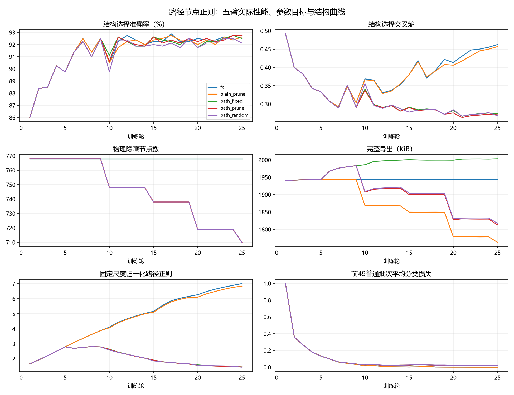

# H1完整路径节点正则：实际五臂结果

本报告仅复核已保存logits与结构，不产生模型前向或训练。




| 臂 | 拟合准确率 | 选择准确率 | 选择CE | 重复探索准确率 | 探索CE | 隐藏宽度 | 参数槽 | 实际字节 | 接受 |
| --- | ---: | ---: | ---: | ---: | ---: | --- | ---: | ---: | ---: |
| fc | 100.00% | 92.62% | 0.462507 | 93.70% | 0.355050 | [512, 256] | 535818 | 1989805 | 0/0 |
| plain_prune | 100.00% | 92.62% | 0.456909 | 93.80% | 0.348876 | [473, 237] | 486023 | 1804915 | 4/4 |
| path_fixed | 100.00% | 92.50% | 0.273183 | 93.50% | 0.212799 | [512, 256] | 535818 | 2051453 | 0/0 |
| path_prune | 100.00% | 92.75% | 0.270307 | 93.50% | 0.211213 | [473, 237] | 486023 | 1856611 | 4/4 |
| path_random | 100.00% | 92.12% | 0.267753 | 93.30% | 0.210226 | [473, 237] | 486023 | 1861110 | 4/4 |

登记主判断：success=True；FC学会=True，效果保持=True，物理缩宽=True，实际文件减少6.69%。

**本轮证明路径正则方案可安全剪宽，但没有证明正则促进可剪性。**plain_prune也4/4接受，与path_prune同样物理删58节点、宽512/256→473/237、535818→486023参数槽；无正则方案文件减少9.29%，超过路径方案的6.69%。因此不能把主门槛通过解释为新增正则优于普通剪节点。两者均4/4接受，固定4%×4slot的删除预算未必触及任一模型的简化极限；本轮既未证明正则增加可剪性，也不能判定它对最终可剪上限没有帮助。

固定图path_fixed与fc宽度/槽数完全相同，选择CE0.273183比0.462507低，但准确率92.50%比92.625%略低。它的真实文件为2051453字节，比fc 1989805大3.10%。相同物理规模仍有不同无损FP32压缩字节，不能把文件变化全归因于节点数量或宣称量化。

path_prune与path_random逐轮同宽度/接受slot/净更新，末态选择准确率主+0.625pp、旧control主+0.2pp；随机臂选择/探索CE反而略低，方向不一致，只能记为小幅单根身份信号，不声称统计显著。plain与path最终规模恰好相同，但训练目标、参数与接受参考不同，亦非多根配对优势。

纯分类损失、正则和总目标分别保存在逐轮rows中；路径分数分位数/数组仅为机制诊断，不是L0或剪枝成功。1000control已反复探索，只在全部末态冻结后记录一次；官方测试与剩余原ID未解封。

## 实际成本

```json
{
  "optimization_forward_samples": 400000,
  "optimization_backward_samples": 400000,
  "attempted_updates": 6250,
  "candidate_updates": 12,
  "rolled_back_updates": 0,
  "fallback_updates": 0,
  "evaluation_forward_samples": 129448,
  "regularizer_backprop_calls": 3000,
  "net_updates": 6250
}
```

session_cost最终跨会话墙钟127.85秒（summary写入时127.83秒）；设备cuda、FP32、batch64/评价512、线程2。CUDA整会话峰值137065472字节，未作逐臂内存/推断延迟/能耗测量。参数槽和真实文件减少仍配合稠密gather执行，不能据此宣称加速或节能。

训练前实现提交574295083e6b16f93768c5bad4fc67b034bb2cf9；[末态模型、预测与元数据](h1_path_sparsity_v1_mnist_static_20261008_evidence/registration.json)保存来源/配置哈希与各臂真实无损FP32文件。

每完整轮保存图/参数/Adam/梯度/RNG与账本；预测缓存和末态评价账本已协调。完全未落盘的中途成本不能完整追溯。额外GPU检查0；本轮仅复用已有模型证据并新增一次路径机制CPU检查。

## 下一项机制建议（未训练）

候选方向为任务敏感多节点基组简化，不用纯激活残差单独决定哪些节点可替代。对重构误差ΔH，记录真实下游扰动ΔZ=ΔH·W_droppedᵀ，并以逐样本拟合CE对下一层预激活的导数G_Z衡量mean_n Σ_k |G_Z,nk ΔZ_nk|；这个乘积在ReLU节点入/出正缩放下保持尺度一致，无需假定二阶。同时记录下游扰动的按输出通道固定尺度归一化RMS，防止一阶符号抵消或零梯度把明显误差藏掉。优先考虑在同一冻结FC快照上并行生成残差/任务/随机群组并给同等适应，以隔离一次群组选择。若后续各臂累计延续，候选与系数仅使用相同生成规则，不能称不同轨迹的池完全相同。系数仍只拟合训练子集，内部留出只验证固定C32，结构选择继续检验纯任务损失和真实缩宽/bytes。快照/累计比较方式、归一化常数和容差须在新轮前登记，不扫描阈值；本报告不实现或启动新训练。

## 候选记录

### plain_prune

| 轮 | 层 | 提议/实际删节点 | 接受 | 原因 |
| --- | --- | --- | --- | --- |
| 10 | 0 | 20/20 | True | real_width_storage_and_task_preservation |
| 15 | 1 | 10/10 | True | real_width_storage_and_task_preservation |
| 20 | 0 | 19/19 | True | real_width_storage_and_task_preservation |
| 25 | 1 | 9/9 | True | real_width_storage_and_task_preservation |

### path_prune

| 轮 | 层 | 提议/实际删节点 | 接受 | 原因 |
| --- | --- | --- | --- | --- |
| 10 | 0 | 20/20 | True | real_width_storage_and_task_preservation |
| 15 | 1 | 10/10 | True | real_width_storage_and_task_preservation |
| 20 | 0 | 19/19 | True | real_width_storage_and_task_preservation |
| 25 | 1 | 9/9 | True | real_width_storage_and_task_preservation |

### path_random

| 轮 | 层 | 提议/实际删节点 | 接受 | 原因 |
| --- | --- | --- | --- | --- |
| 10 | 0 | 20/20 | True | unconditional_same_regularizer_matched_random_nodes |
| 15 | 1 | 10/10 | True | unconditional_same_regularizer_matched_random_nodes |
| 20 | 0 | 19/19 | True | unconditional_same_regularizer_matched_random_nodes |
| 25 | 1 | 9/9 | True | unconditional_same_regularizer_matched_random_nodes |

