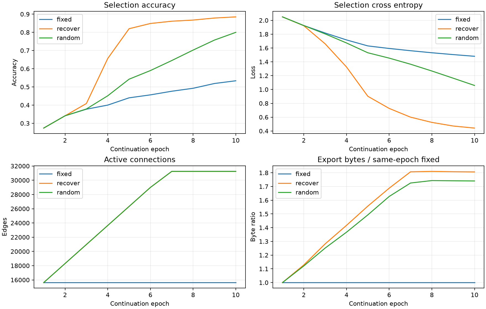

# H1固定剪枝压力下的边恢复：实际报告

20261008；全部指标来自已完成运行与保存logits。实现提交：`4ccaca82f9d61287a58c58ac6b8747810daa8c5b`，来源为启动前training_commit.json，不使用生成报告时HEAD。

[完整JSON](h1_recovery_stress_v1_mnist_static_20261008.json)保存真实曲线、事件、混淆矩阵、成本与文件哈希。

## 任务与机制边界

三臂从父末态构造同一压力初态后延续；父来源为`history/ann_stages_20261008/experiments/runs/pruning_v1/mnist_static/prune/resume.pt`，复用源权重、Adam及RNG。模型根11、数据根20261004，延续各10轮，固定784→512→256→10及两层ReLU。原25轮成本不计作本阶段新增成本。

本阶段仅使用3200拟合/800选择；1000旧control已经提供前轮探索反馈，本次全部末轮冻结后再作探索记录，不是独立确认。官方测试未访问，其他封存ID提取0；未新增种子或扩大原ID范围。

普通49批拟合平均损失>0.02连续2轮作为触发代理。它不能判断真正表达能力不足，也不能排除优化困难。recover按inactive边展开梯度EMA(g²)排序，恢复identity连接、theta初始0、新槽Adam矩清零；一批适应后用选择集评价。未实现节点增删或线性无关组简化。

每层候选至多原始边数0.50%，累计至多起始活跃边数100%；至多10slots。候选须满足同轮fixed的1pp/0.05容差，并相对自身候选前改善，且准确率不下降、损失不增加。恢复允许文件增长，不能以单步压缩判断成功。

拒绝先完整回退图、权重、Adam、梯度统计与RNG，再对原图同批适应；额外候选尝试成本保留。random无条件匹配recover的接受时序和逐层恢复数，仅随机恢复身份；主拒绝slot也先适应回退再fallback。随机臂的选择集成绩不决定接受，比较的是连接身份而非独立随机搜索。

## 预登记人为压力初态

固定按父拟合敏感度额外删除各层活跃边90%，这是人为压力条件，不是自然发生的容量不足；不按新选择或探索成绩挑选强度，不修改自然恢复轮结果。

父末态156247边→压力初态15626边；恢复累计增长上限按压力初态逐层计算，不是按原父图计算。压力初态真实文件74209字节。

| 初态集合 | 样本 | 准确率 | 交叉熵 |
| --- | --- | --- | --- |
| 拟合 | 3200 | 18.5625% | 2.563940 |
| 结构选择 | 800 | 18.6250% | 2.579686 |

压力初态正式评价2次/4000样本已加入总评价成本，单列在initial_costs，不漏入各臂账本之外；没有额外优化更新，也不是GPU诊断。

## 实际任务性能

| 臂 | 集合 | 样本 | 准确率 | 交叉熵 |
| --- | --- | --- | --- | --- |
| fixed | 拟合 | 3200 | 52.4688% | 1.466988 |
| fixed | 结构选择 | 800 | 53.3750% | 1.480231 |
| fixed | 重复探索 | 1000 | 51.9000% | 1.493422 |
| recover | 拟合 | 3200 | 91.9688% | 0.364378 |
| recover | 结构选择 | 800 | 88.5000% | 0.442419 |
| recover | 重复探索 | 1000 | 90.4000% | 0.407788 |
| random | 拟合 | 3200 | 83.1875% | 1.024935 |
| random | 结构选择 | 800 | 80.0000% | 1.058463 |
| random | 重复探索 | 1000 | 79.9000% | 1.055420 |

采用登记末轮，未用探索集挑选最佳轮；保存预测的准确率、损失、混淆矩阵已与summary核对。

## 逐层结构与增长代价

| 臂 | 层 | 输入→输出节点 | 起始活跃边 | 末态活跃边 | 新增边 | 非零边 | 活跃密度 | 自由参数含偏置 | 分配槽 |
| --- | --- | --- | --- | --- | --- | --- | --- | --- | --- |
| fixed | 1 | 784→512 | 11722 | 11722 | 0 | 11722 | 2.9202% | 12234 | 401920 |
| fixed | 2 | 512→256 | 3828 | 3828 | 0 | 3828 | 2.9205% | 4084 | 131328 |
| fixed | 3 | 256→10 | 76 | 76 | 0 | 76 | 2.9688% | 86 | 2570 |
| recover | 1 | 784→512 | 11722 | 23444 | 11722 | 23444 | 5.8404% | 23956 | 401920 |
| recover | 2 | 512→256 | 3828 | 7656 | 3828 | 7656 | 5.8411% | 7912 | 131328 |
| recover | 3 | 256→10 | 76 | 148 | 72 | 148 | 5.7812% | 158 | 2570 |
| random | 1 | 784→512 | 11722 | 23444 | 11722 | 20427 | 5.8404% | 23956 | 401920 |
| random | 2 | 512→256 | 3828 | 7656 | 3828 | 5165 | 5.8411% | 7912 | 131328 |
| random | 3 | 256→10 | 76 | 148 | 72 | 137 | 5.7812% | 158 | 2570 |

自由参数由活跃独立权重与偏置计数；新增但仍为零的边单独反映在非零边统计。隐藏节点、输出节点及总计算节点均保持768/10/778；本轮只恢复边，不能称物理删节点。

| 臂 | 新增边总数 | 相对起始边增长 | 实际文件字节 | 相对本轮初态增减字节 | 相对fixed增减字节 | 臂计时秒 |
| --- | --- | --- | --- | --- | --- | --- |
| fixed | 0 | 0.000% | 75447 | +1238 | +0 | 28.007 |
| recover | 15622 | 99.974% | 136291 | +62082 | +60844 | 29.250 |
| random | 15622 | 99.974% | 131305 | +57096 | +55858 | 30.129 |

本轮初态活跃边15626，初态实际文件74209字节。文件同为FP32无损编码，包含映射、索引、数值与全部元数据；字节变化也受参数数值与压缩影响，不能全归因于新增边。theta和Adam仍分配原535818槽并执行稠密gather矩阵乘，不称推断加速、内存节约、卷积复用或实测能耗改善。



准确率、损失、活跃边与对应轮fixed字节比均来自本阶段真实记录，延续轮从1计数，不混入父实验25轮。

## 实际更新、评价与容量代理

| 臂 | 优化前向/反传样本 | 尝试更新 | 候选适应 | 回退 | fallback | 净更新 | 超正常预算尝试 | 评价调用/样本 |
| --- | --- | --- | --- | --- | --- | --- | --- | --- |
| fixed | 32000/32000 | 500 | 0 | 0 | 0 | 500 | 0 | 12/12200 |
| recover | 32192/32192 | 503 | 9 | 3 | 3 | 500 | 3 | 39/28904 |
| random | 32192/32192 | 503 | 9 | 3 | 3 | 500 | 3 | 12/12200 |
| 压力初态（臂外） | 0/0 | 0 | 0 | 0 | 0 | 0 | 0 | 2/4000 |

合计新增优化前向/反传96384/96384样本，尝试1506，回退6，fallback 6，净更新1500；各臂正常预算500净更新。额外候选尝试与回退不从实际成本删除。总评价65次/57304样本，含全部臂及已发生的压力初态评价。

| 臂 | 恢复slots | 接受数 | 实际理由计数 |
| --- | --- | --- | --- |
| fixed | 0 | 0 | 无恢复候选 |
| recover | 9 | 6 | improves_current_task_with_bounded_growth: 6；insufficient_improvement_or_task_deterioration: 3 |
| random | 9 | 6 | unconditional_matched_random_restoration: 6；matched_rejection_then_original_graph_adaptation: 3 |

完整JSON保留每轮普通拟合平均损失、容量代理连续计数、候选前后成绩及拒绝原因。未触发或未接受均是实际结果，不能写成恢复机制有效；候选前后的改善还包含一批适应本身，必须结合fixed/random差异判断。

| 臂 | 评价用途 | 调用次数 | 样本 |
| --- | --- | --- | --- |
| fixed | epoch_select | 10 | 8000 |
| fixed | frozen_fit | 1 | 3200 |
| fixed | repeated_exploration | 1 | 1000 |
| recover | epoch_select | 10 | 8000 |
| recover | candidate_before | 9 | 7200 |
| recover | candidate_screen | 9 | 2304 |
| recover | candidate_full | 9 | 7200 |
| recover | frozen_fit | 1 | 3200 |
| recover | repeated_exploration | 1 | 1000 |
| random | epoch_select | 10 | 8000 |
| random | frozen_fit | 1 | 3200 |
| random | repeated_exploration | 1 | 1000 |
| 压力初态（臂外） | stress_initial_fit | 1 | 3200 |
| 压力初态（臂外） | stress_initial_select | 1 | 800 |

本次启动成本前向0、反传0、更新0；复用既有同尺寸启动证据，未重跑8样本GPU检查。报告生成也没有模型前向、GPU诊断或恢复重放。

设备cuda，PyTorch 2.13.0+cu130，FP32，batch=64，评价batch=512，CPU线程2；CUDA整次峰值分配164947968字节。

实际完整本次会话墙钟117.388秒。臂计时覆盖每轮普通训练、候选事务/评价及编码，排除checkpoint/预测写入、末态拟合及探索评价；不是完整端到端推断计时。事务计时仅按真实候选事件字段保留在JSON，未分项计时的开销不得归因具体瓶颈。若经历多个恢复会话，该字段只表示完成时会话，不冒称跨会话总耗时。

runtime_ratio不是本阶段接受或成功门槛，较长搜索时间按成本记录。阶段墙钟预算与停止记录以实际登记为准，不以旧3倍门槛否决新机制。

## 效果增量与谨慎判定

| 臂 | 集合 | 相对fixed准确率变化（百分点） | 相对fixed交叉熵变化 |
| --- | --- | --- | --- |
| fixed | 拟合 | +0.0000 | +0.000000 |
| fixed | 结构选择 | +0.0000 | +0.000000 |
| fixed | 重复探索 | +0.0000 | +0.000000 |
| recover | 拟合 | +39.5000 | -1.102610 |
| recover | 结构选择 | +35.1250 | -1.037812 |
| recover | 重复探索 | +38.5000 | -1.085634 |
| random | 拟合 | +30.7188 | -0.442052 |
| random | 结构选择 | +26.6250 | -0.421768 |
| random | 重复探索 | +28.0000 | -0.438002 |

| 集合 | recover−random准确率（百分点） | recover−random交叉熵 |
| --- | --- | --- |
| 拟合 | +8.7812 | -0.660557 |
| 结构选择 | +8.5000 | -0.616044 |
| 重复探索 | +10.5000 | -0.647632 |

本轮任务恢复在选择损失上优于fixed及匹配random，且准确率不低，是连接身份恢复可能有增量的单根信号；需同时衡量新增边与文件代价。本轮重复探索准确率90.40%，父prune末态为93.30%；仍低于父表现，未恢复到父性能，不能称恢复成功。

选择集反复用于候选决策，旧control也已提供探索反馈；唯一根11不支持统计显著性、稳健性或普适性结论。不声称发现卷积、节点基组或能耗改善。

## 证据与恢复

[重要证据索引](h1_recovery_stress_v1_mnist_static_20261008_evidence/README.md)保存真实模型、三类最终预测、training_commit、registration、复用启动记录、freeze、数据清单和父summary。文件哈希见完整JSON。

原完整轮恢复checkpoint、日志及逐轮预测保留于`E:\project\brain-grow\experiments\runs\h1_recovery_stress_v1\mnist_static`；大型resume.pt未复制进报告证据。源码与配置哈希一致时可恢复；已完成入口不会重复训练或确认。

```powershell
.venv/Scripts/python.exe -u -B -m tools.train_recovery_stress --resume
```

## 混淆矩阵

### 压力初态：拟合

| 真值\预测 | 0 | 1 | 2 | 3 | 4 | 5 | 6 | 7 | 8 | 9 |
| --- | --- | --- | --- | --- | --- | --- | --- | --- | --- | --- |
| 0 | 0 | 0 | 0 | 55 | 0 | 0 | 0 | 265 | 0 | 0 |
| 1 | 0 | 0 | 0 | 196 | 0 | 0 | 0 | 124 | 0 | 0 |
| 2 | 0 | 0 | 0 | 66 | 0 | 0 | 0 | 254 | 0 | 0 |
| 3 | 0 | 0 | 0 | 280 | 0 | 0 | 0 | 40 | 0 | 0 |
| 4 | 0 | 0 | 0 | 23 | 0 | 0 | 0 | 297 | 0 | 0 |
| 5 | 0 | 0 | 0 | 265 | 0 | 0 | 0 | 55 | 0 | 0 |
| 6 | 0 | 0 | 0 | 138 | 0 | 0 | 0 | 182 | 0 | 0 |
| 7 | 0 | 0 | 0 | 6 | 0 | 0 | 0 | 314 | 0 | 0 |
| 8 | 0 | 0 | 0 | 81 | 0 | 0 | 0 | 239 | 0 | 0 |
| 9 | 0 | 0 | 0 | 39 | 0 | 0 | 0 | 281 | 0 | 0 |

### 压力初态：结构选择

| 真值\预测 | 0 | 1 | 2 | 3 | 4 | 5 | 6 | 7 | 8 | 9 |
| --- | --- | --- | --- | --- | --- | --- | --- | --- | --- | --- |
| 0 | 0 | 0 | 0 | 13 | 0 | 0 | 0 | 67 | 0 | 0 |
| 1 | 0 | 0 | 0 | 48 | 0 | 0 | 0 | 32 | 0 | 0 |
| 2 | 0 | 0 | 0 | 13 | 0 | 0 | 0 | 67 | 0 | 0 |
| 3 | 0 | 0 | 0 | 71 | 0 | 0 | 0 | 9 | 0 | 0 |
| 4 | 0 | 0 | 0 | 9 | 0 | 0 | 0 | 71 | 0 | 0 |
| 5 | 0 | 0 | 0 | 70 | 0 | 0 | 0 | 10 | 0 | 0 |
| 6 | 0 | 0 | 0 | 29 | 0 | 0 | 0 | 51 | 0 | 0 |
| 7 | 0 | 0 | 0 | 2 | 0 | 0 | 0 | 78 | 0 | 0 |
| 8 | 0 | 0 | 0 | 13 | 0 | 0 | 0 | 67 | 0 | 0 |
| 9 | 0 | 0 | 0 | 17 | 0 | 0 | 0 | 63 | 0 | 0 |

### fixed：拟合

| 真值\预测 | 0 | 1 | 2 | 3 | 4 | 5 | 6 | 7 | 8 | 9 |
| --- | --- | --- | --- | --- | --- | --- | --- | --- | --- | --- |
| 0 | 0 | 1 | 0 | 44 | 10 | 26 | 180 | 59 | 0 | 0 |
| 1 | 0 | 317 | 0 | 2 | 0 | 0 | 0 | 1 | 0 | 0 |
| 2 | 0 | 33 | 63 | 71 | 71 | 0 | 10 | 72 | 0 | 0 |
| 3 | 0 | 7 | 0 | 297 | 5 | 0 | 2 | 9 | 0 | 0 |
| 4 | 0 | 5 | 0 | 1 | 311 | 0 | 3 | 0 | 0 | 0 |
| 5 | 0 | 16 | 0 | 151 | 77 | 41 | 13 | 22 | 0 | 0 |
| 6 | 0 | 12 | 0 | 7 | 103 | 5 | 189 | 4 | 0 | 0 |
| 7 | 0 | 7 | 0 | 0 | 9 | 0 | 0 | 304 | 0 | 0 |
| 8 | 0 | 38 | 0 | 37 | 63 | 1 | 17 | 6 | 157 | 1 |
| 9 | 0 | 11 | 0 | 26 | 239 | 0 | 8 | 36 | 0 | 0 |

### fixed：结构选择

| 真值\预测 | 0 | 1 | 2 | 3 | 4 | 5 | 6 | 7 | 8 | 9 |
| --- | --- | --- | --- | --- | --- | --- | --- | --- | --- | --- |
| 0 | 0 | 0 | 0 | 13 | 1 | 7 | 45 | 13 | 1 | 0 |
| 1 | 0 | 79 | 0 | 0 | 1 | 0 | 0 | 0 | 0 | 0 |
| 2 | 0 | 3 | 18 | 18 | 11 | 0 | 9 | 21 | 0 | 0 |
| 3 | 0 | 0 | 0 | 77 | 2 | 0 | 1 | 0 | 0 | 0 |
| 4 | 0 | 1 | 0 | 1 | 78 | 0 | 0 | 0 | 0 | 0 |
| 5 | 0 | 4 | 0 | 38 | 17 | 14 | 3 | 4 | 0 | 0 |
| 6 | 0 | 1 | 0 | 0 | 31 | 1 | 47 | 0 | 0 | 0 |
| 7 | 0 | 1 | 0 | 1 | 1 | 0 | 0 | 77 | 0 | 0 |
| 8 | 0 | 9 | 1 | 7 | 19 | 0 | 4 | 3 | 37 | 0 |
| 9 | 0 | 3 | 0 | 11 | 47 | 0 | 3 | 15 | 1 | 0 |

### fixed：重复探索

| 真值\预测 | 0 | 1 | 2 | 3 | 4 | 5 | 6 | 7 | 8 | 9 |
| --- | --- | --- | --- | --- | --- | --- | --- | --- | --- | --- |
| 0 | 0 | 0 | 0 | 13 | 3 | 13 | 50 | 21 | 0 | 0 |
| 1 | 0 | 99 | 0 | 0 | 0 | 0 | 0 | 1 | 0 | 0 |
| 2 | 0 | 12 | 22 | 25 | 18 | 0 | 4 | 19 | 0 | 0 |
| 3 | 0 | 0 | 0 | 96 | 2 | 0 | 0 | 2 | 0 | 0 |
| 4 | 0 | 1 | 0 | 0 | 98 | 0 | 0 | 1 | 0 | 0 |
| 5 | 0 | 3 | 0 | 46 | 17 | 16 | 7 | 11 | 0 | 0 |
| 6 | 0 | 4 | 0 | 1 | 45 | 3 | 46 | 1 | 0 | 0 |
| 7 | 0 | 1 | 0 | 0 | 4 | 0 | 0 | 95 | 0 | 0 |
| 8 | 0 | 15 | 0 | 7 | 23 | 1 | 6 | 1 | 47 | 0 |
| 9 | 0 | 3 | 0 | 2 | 75 | 0 | 3 | 17 | 0 | 0 |

### recover：拟合

| 真值\预测 | 0 | 1 | 2 | 3 | 4 | 5 | 6 | 7 | 8 | 9 |
| --- | --- | --- | --- | --- | --- | --- | --- | --- | --- | --- |
| 0 | 300 | 0 | 1 | 1 | 0 | 4 | 14 | 0 | 0 | 0 |
| 1 | 0 | 311 | 1 | 3 | 0 | 2 | 0 | 1 | 2 | 0 |
| 2 | 3 | 1 | 284 | 2 | 9 | 1 | 7 | 9 | 3 | 1 |
| 3 | 1 | 3 | 7 | 289 | 0 | 6 | 2 | 3 | 7 | 2 |
| 4 | 0 | 2 | 0 | 0 | 297 | 0 | 9 | 0 | 1 | 11 |
| 5 | 6 | 6 | 0 | 5 | 4 | 285 | 7 | 1 | 3 | 3 |
| 6 | 4 | 3 | 4 | 0 | 9 | 7 | 291 | 0 | 2 | 0 |
| 7 | 2 | 5 | 7 | 0 | 2 | 0 | 0 | 300 | 0 | 4 |
| 8 | 1 | 4 | 3 | 1 | 1 | 2 | 3 | 1 | 296 | 8 |
| 9 | 2 | 1 | 2 | 3 | 9 | 3 | 1 | 4 | 5 | 290 |

### recover：结构选择

| 真值\预测 | 0 | 1 | 2 | 3 | 4 | 5 | 6 | 7 | 8 | 9 |
| --- | --- | --- | --- | --- | --- | --- | --- | --- | --- | --- |
| 0 | 73 | 0 | 0 | 0 | 0 | 5 | 1 | 0 | 1 | 0 |
| 1 | 0 | 78 | 1 | 0 | 0 | 0 | 0 | 1 | 0 | 0 |
| 2 | 0 | 0 | 73 | 1 | 1 | 0 | 1 | 1 | 2 | 1 |
| 3 | 1 | 0 | 1 | 70 | 1 | 4 | 2 | 0 | 1 | 0 |
| 4 | 0 | 0 | 0 | 1 | 71 | 0 | 3 | 0 | 2 | 3 |
| 5 | 2 | 0 | 1 | 4 | 1 | 67 | 4 | 0 | 1 | 0 |
| 6 | 4 | 0 | 3 | 0 | 2 | 1 | 67 | 0 | 3 | 0 |
| 7 | 0 | 2 | 1 | 0 | 1 | 0 | 0 | 75 | 0 | 1 |
| 8 | 1 | 2 | 0 | 1 | 0 | 5 | 1 | 0 | 68 | 2 |
| 9 | 2 | 1 | 0 | 4 | 1 | 1 | 2 | 1 | 2 | 66 |

### recover：重复探索

| 真值\预测 | 0 | 1 | 2 | 3 | 4 | 5 | 6 | 7 | 8 | 9 |
| --- | --- | --- | --- | --- | --- | --- | --- | --- | --- | --- |
| 0 | 93 | 0 | 0 | 0 | 1 | 2 | 3 | 1 | 0 | 0 |
| 1 | 0 | 96 | 0 | 1 | 0 | 0 | 1 | 1 | 1 | 0 |
| 2 | 1 | 1 | 87 | 3 | 4 | 0 | 3 | 1 | 0 | 0 |
| 3 | 1 | 0 | 1 | 86 | 0 | 5 | 1 | 0 | 3 | 3 |
| 4 | 0 | 0 | 0 | 0 | 93 | 0 | 2 | 0 | 1 | 4 |
| 5 | 1 | 1 | 0 | 4 | 0 | 86 | 4 | 3 | 1 | 0 |
| 6 | 1 | 0 | 2 | 0 | 1 | 3 | 93 | 0 | 0 | 0 |
| 7 | 1 | 1 | 3 | 0 | 1 | 0 | 0 | 92 | 0 | 2 |
| 8 | 0 | 3 | 1 | 0 | 0 | 4 | 1 | 0 | 88 | 3 |
| 9 | 2 | 0 | 0 | 0 | 4 | 0 | 0 | 2 | 2 | 90 |

### random：拟合

| 真值\预测 | 0 | 1 | 2 | 3 | 4 | 5 | 6 | 7 | 8 | 9 |
| --- | --- | --- | --- | --- | --- | --- | --- | --- | --- | --- |
| 0 | 307 | 0 | 0 | 2 | 1 | 0 | 9 | 0 | 1 | 0 |
| 1 | 0 | 315 | 0 | 2 | 0 | 0 | 1 | 1 | 1 | 0 |
| 2 | 5 | 19 | 225 | 8 | 22 | 0 | 8 | 17 | 14 | 2 |
| 3 | 1 | 7 | 3 | 294 | 3 | 0 | 1 | 6 | 1 | 4 |
| 4 | 0 | 5 | 0 | 0 | 303 | 0 | 4 | 0 | 0 | 8 |
| 5 | 47 | 12 | 0 | 61 | 11 | 160 | 16 | 3 | 4 | 6 |
| 6 | 5 | 7 | 1 | 0 | 43 | 1 | 254 | 0 | 8 | 1 |
| 7 | 1 | 8 | 3 | 0 | 8 | 0 | 0 | 298 | 1 | 1 |
| 8 | 9 | 16 | 1 | 6 | 9 | 1 | 9 | 1 | 249 | 19 |
| 9 | 7 | 6 | 0 | 6 | 34 | 0 | 1 | 9 | 0 | 257 |

### random：结构选择

| 真值\预测 | 0 | 1 | 2 | 3 | 4 | 5 | 6 | 7 | 8 | 9 |
| --- | --- | --- | --- | --- | --- | --- | --- | --- | --- | --- |
| 0 | 78 | 0 | 0 | 0 | 0 | 0 | 1 | 0 | 1 | 0 |
| 1 | 0 | 79 | 0 | 0 | 1 | 0 | 0 | 0 | 0 | 0 |
| 2 | 1 | 0 | 52 | 4 | 3 | 0 | 7 | 3 | 9 | 1 |
| 3 | 0 | 0 | 1 | 74 | 1 | 0 | 3 | 0 | 1 | 0 |
| 4 | 1 | 2 | 0 | 1 | 72 | 0 | 2 | 0 | 0 | 2 |
| 5 | 15 | 3 | 0 | 15 | 4 | 35 | 6 | 0 | 0 | 2 |
| 6 | 4 | 0 | 0 | 0 | 16 | 1 | 58 | 0 | 1 | 0 |
| 7 | 0 | 2 | 1 | 0 | 1 | 0 | 0 | 76 | 0 | 0 |
| 8 | 1 | 3 | 1 | 2 | 6 | 0 | 0 | 0 | 60 | 7 |
| 9 | 3 | 3 | 0 | 4 | 10 | 0 | 2 | 1 | 1 | 56 |

### random：重复探索

| 真值\预测 | 0 | 1 | 2 | 3 | 4 | 5 | 6 | 7 | 8 | 9 |
| --- | --- | --- | --- | --- | --- | --- | --- | --- | --- | --- |
| 0 | 93 | 0 | 0 | 2 | 1 | 0 | 3 | 1 | 0 | 0 |
| 1 | 0 | 98 | 0 | 0 | 1 | 0 | 1 | 0 | 0 | 0 |
| 2 | 0 | 8 | 65 | 8 | 7 | 0 | 6 | 3 | 2 | 1 |
| 3 | 1 | 0 | 0 | 92 | 1 | 0 | 2 | 1 | 2 | 1 |
| 4 | 0 | 0 | 0 | 0 | 96 | 0 | 1 | 0 | 0 | 3 |
| 5 | 15 | 3 | 0 | 30 | 4 | 34 | 7 | 6 | 0 | 1 |
| 6 | 2 | 1 | 1 | 0 | 15 | 2 | 77 | 0 | 1 | 1 |
| 7 | 1 | 1 | 2 | 0 | 3 | 0 | 0 | 92 | 0 | 1 |
| 8 | 1 | 8 | 0 | 2 | 6 | 1 | 2 | 1 | 74 | 5 |
| 9 | 3 | 2 | 0 | 1 | 12 | 0 | 0 | 3 | 1 | 78 |
