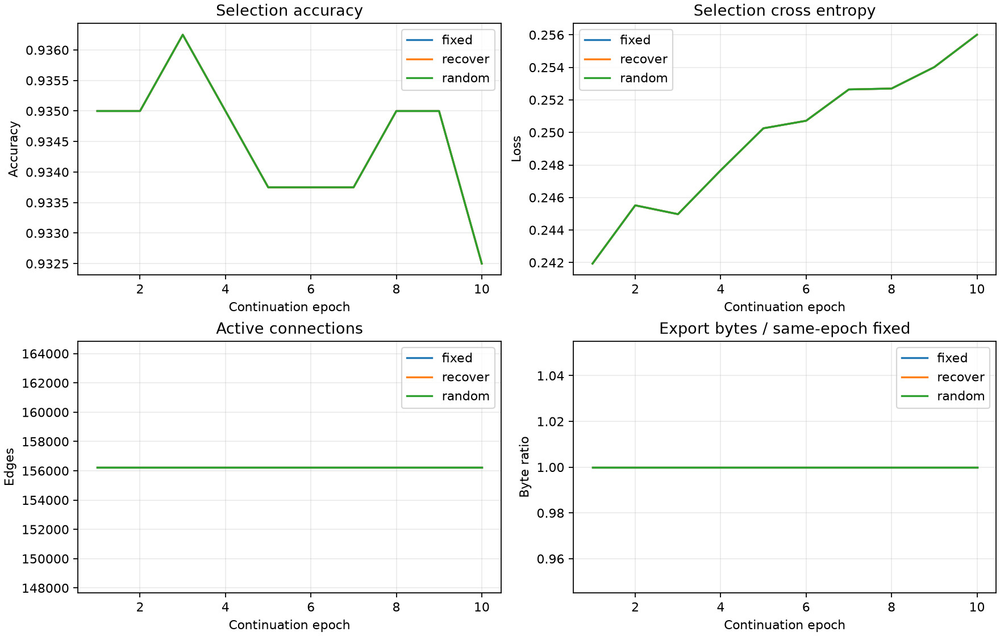

# H1边恢复延续实验：实际报告

20261008；全部指标来自已完成运行与保存logits。实现提交：`d4dd810748b306046e930b7094d94dbe3f417f21`，来源为启动前training_commit.json，不使用生成报告时HEAD。

[完整JSON](h1_recovery_v1_mnist_static_20261008.json)保存真实曲线、事件、混淆矩阵、成本与文件哈希。

## 任务与机制边界

fixed/recover/random从`history/ann_stages_20261008/experiments/runs/pruning_v1/mnist_static/prune/resume.pt`相同末态延续图、权重、Adam及RNG。模型根11、数据根20261004，延续各10轮，固定784→512→256→10及两层ReLU。原25轮成本不计作本阶段新增成本。

本阶段仅使用3200拟合/800选择；1000旧control已经提供前轮探索反馈，本次全部末轮冻结后再作探索记录，不是独立确认。官方测试未访问，其他封存ID提取0；未新增种子或扩大原ID范围。

普通49批拟合平均损失>0.02连续2轮作为触发代理。它不能判断真正表达能力不足，也不能排除优化困难。recover按inactive边展开梯度EMA(g²)排序，恢复identity连接、theta初始0、新槽Adam矩清零；一批适应后用选择集评价。未实现节点增删或线性无关组简化。

每层候选至多原始边数0.50%，累计至多起始活跃边数10%；至多10slots。候选须满足同轮fixed的1pp/0.05容差，并相对自身候选前改善，且准确率不下降、损失不增加。恢复允许文件增长，不能以单步压缩判断成功。

拒绝先完整回退图、权重、Adam、梯度统计与RNG，再对原图同批适应；额外候选尝试成本保留。random无条件匹配recover的接受时序和逐层恢复数，仅随机恢复身份；主拒绝slot也先适应回退再fallback。随机臂的选择集成绩不决定接受，比较的是连接身份而非独立随机搜索。

## 实际任务性能

| 臂 | 集合 | 样本 | 准确率 | 交叉熵 |
| --- | --- | --- | --- | --- |
| fixed | 拟合 | 3200 | 100.0000% | 0.007536 |
| fixed | 结构选择 | 800 | 93.2500% | 0.256008 |
| fixed | 重复探索 | 1000 | 93.8000% | 0.218983 |
| recover | 拟合 | 3200 | 100.0000% | 0.007536 |
| recover | 结构选择 | 800 | 93.2500% | 0.256008 |
| recover | 重复探索 | 1000 | 93.8000% | 0.218983 |
| random | 拟合 | 3200 | 100.0000% | 0.007536 |
| random | 结构选择 | 800 | 93.2500% | 0.256008 |
| random | 重复探索 | 1000 | 93.8000% | 0.218983 |

采用登记末轮，未用探索集挑选最佳轮；保存预测的准确率、损失、混淆矩阵已与summary核对。

## 逐层结构与增长代价

| 臂 | 层 | 输入→输出节点 | 起始活跃边 | 末态活跃边 | 新增边 | 非零边 | 活跃密度 | 自由参数含偏置 | 分配槽 |
| --- | --- | --- | --- | --- | --- | --- | --- | --- | --- |
| fixed | 1 | 784→512 | 117213 | 117213 | 0 | 117213 | 29.2005% | 117725 | 401920 |
| fixed | 2 | 512→256 | 38279 | 38279 | 0 | 38279 | 29.2046% | 38535 | 131328 |
| fixed | 3 | 256→10 | 755 | 755 | 0 | 755 | 29.4922% | 765 | 2570 |
| recover | 1 | 784→512 | 117213 | 117213 | 0 | 117213 | 29.2005% | 117725 | 401920 |
| recover | 2 | 512→256 | 38279 | 38279 | 0 | 38279 | 29.2046% | 38535 | 131328 |
| recover | 3 | 256→10 | 755 | 755 | 0 | 755 | 29.4922% | 765 | 2570 |
| random | 1 | 784→512 | 117213 | 117213 | 0 | 117213 | 29.2005% | 117725 | 401920 |
| random | 2 | 512→256 | 38279 | 38279 | 0 | 38279 | 29.2046% | 38535 | 131328 |
| random | 3 | 256→10 | 755 | 755 | 0 | 755 | 29.4922% | 765 | 2570 |

自由参数由活跃独立权重与偏置计数；新增但仍为零的边单独反映在非零边统计。隐藏节点、输出节点及总计算节点均保持768/10/778；本轮只恢复边，不能称物理删节点。

| 臂 | 新增边总数 | 相对起始边增长 | 实际文件字节 | 相对源文件增减字节 | 相对fixed增减字节 | 臂计时秒 |
| --- | --- | --- | --- | --- | --- | --- |
| fixed | 0 | 0.000% | 626816 | +516 | +0 | 30.275 |
| recover | 0 | 0.000% | 626816 | +516 | +0 | 29.903 |
| random | 0 | 0.000% | 626816 | +516 | +0 | 29.737 |

源末态活跃边156247，源实际文件626300字节。文件同为FP32无损编码，包含映射、索引、数值与全部元数据；字节变化也受参数数值与压缩影响，不能全归因于新增边。theta和Adam仍分配原535818槽并执行稠密gather矩阵乘，不称推断加速、内存节约、卷积复用或实测能耗改善。



准确率、损失、活跃边与对应轮fixed字节比均来自本阶段真实记录，延续轮从1计数，不混入父实验25轮。

## 实际更新、评价与容量代理

| 臂 | 优化前向/反传样本 | 尝试更新 | 候选适应 | 回退 | fallback | 净更新 | 超正常预算尝试 | 评价调用/样本 |
| --- | --- | --- | --- | --- | --- | --- | --- | --- |
| fixed | 32000/32000 | 500 | 0 | 0 | 0 | 500 | 0 | 12/12200 |
| recover | 32000/32000 | 500 | 0 | 0 | 0 | 500 | 0 | 12/12200 |
| random | 32000/32000 | 500 | 0 | 0 | 0 | 500 | 0 | 12/12200 |

合计新增优化前向/反传96000/96000样本，尝试1500，回退0，fallback 0，净更新1500；各臂正常预算500净更新。额外候选尝试与回退不从实际成本删除。

| 臂 | 恢复slots | 接受数 | 实际理由计数 |
| --- | --- | --- | --- |
| fixed | 0 | 0 | 无恢复候选 |
| recover | 0 | 0 | 无恢复候选 |
| random | 0 | 0 | 无恢复候选 |

完整JSON保留每轮普通拟合平均损失、容量代理连续计数、候选前后成绩及拒绝原因。未触发或未接受均是实际结果，不能写成恢复机制有效；候选前后的改善还包含一批适应本身，必须结合fixed/random差异判断。

| 臂 | 评价用途 | 调用次数 | 样本 |
| --- | --- | --- | --- |
| fixed | epoch_select | 10 | 8000 |
| fixed | frozen_fit | 1 | 3200 |
| fixed | repeated_exploration | 1 | 1000 |
| recover | epoch_select | 10 | 8000 |
| recover | frozen_fit | 1 | 3200 |
| recover | repeated_exploration | 1 | 1000 |
| random | epoch_select | 10 | 8000 |
| random | frozen_fit | 1 | 3200 |
| random | repeated_exploration | 1 | 1000 |

本次启动成本前向0、反传0、更新0；复用既有同尺寸启动证据，未重跑8样本GPU检查。报告生成也没有模型前向、GPU诊断或恢复重放。

设备cuda，PyTorch 2.13.0+cu130，FP32，batch=64，评价batch=512，CPU线程2；CUDA整次峰值分配173610496字节。

实际完整本次会话墙钟120.859秒。臂计时覆盖每轮普通训练、候选事务/评价及编码，排除checkpoint/预测写入、末态拟合及探索评价；不是完整端到端推断计时。事务计时仅按真实候选事件字段保留在JSON，未分项计时的开销不得归因具体瓶颈。若经历多个恢复会话，该字段只表示完成时会话，不冒称跨会话总耗时。

runtime_ratio不是本阶段接受或成功门槛，较长搜索时间按成本记录。阶段墙钟预算与停止记录以实际登记为准，不以旧3倍门槛否决新机制。

## 效果增量与谨慎判定

| 臂 | 集合 | 相对fixed准确率变化（百分点） | 相对fixed交叉熵变化 |
| --- | --- | --- | --- |
| fixed | 拟合 | +0.0000 | +0.000000 |
| fixed | 结构选择 | +0.0000 | +0.000000 |
| fixed | 重复探索 | +0.0000 | +0.000000 |
| recover | 拟合 | +0.0000 | +0.000000 |
| recover | 结构选择 | +0.0000 | +0.000000 |
| recover | 重复探索 | +0.0000 | +0.000000 |
| random | 拟合 | +0.0000 | +0.000000 |
| random | 结构选择 | +0.0000 | +0.000000 |
| random | 重复探索 | +0.0000 | +0.000000 |

| 集合 | recover−random准确率（百分点） | recover−random交叉熵 |
| --- | --- | --- |
| 拟合 | +0.0000 | +0.000000 |
| 结构选择 | +0.0000 | +0.000000 |
| 重复探索 | +0.0000 | +0.000000 |

本轮未触发恢复候选，不能据此检验恢复边效果或断言容量充足；本次主要是已有剪枝图继续训练的证据。

选择集反复用于候选决策，旧control也已提供探索反馈；唯一根11不支持统计显著性、稳健性或普适性结论。不声称发现卷积、节点基组或能耗改善。

## 证据与恢复

[重要证据索引](h1_recovery_v1_mnist_static_20261008_evidence/README.md)保存真实模型、三类最终预测、training_commit、registration、复用启动记录、freeze、数据清单和父summary。文件哈希见完整JSON。

原完整轮恢复checkpoint、日志及逐轮预测保留于`E:\project\brain-grow\experiments\runs\h1_recovery_v1\mnist_static`；大型resume.pt未复制进报告证据。源码与配置哈希一致时可恢复；已完成入口不会重复训练或确认。

```powershell
.venv/Scripts/python.exe -u -B -m tools.train_recovery --resume
```

## 混淆矩阵

### fixed：拟合

| 真值\预测 | 0 | 1 | 2 | 3 | 4 | 5 | 6 | 7 | 8 | 9 |
| --- | --- | --- | --- | --- | --- | --- | --- | --- | --- | --- |
| 0 | 320 | 0 | 0 | 0 | 0 | 0 | 0 | 0 | 0 | 0 |
| 1 | 0 | 320 | 0 | 0 | 0 | 0 | 0 | 0 | 0 | 0 |
| 2 | 0 | 0 | 320 | 0 | 0 | 0 | 0 | 0 | 0 | 0 |
| 3 | 0 | 0 | 0 | 320 | 0 | 0 | 0 | 0 | 0 | 0 |
| 4 | 0 | 0 | 0 | 0 | 320 | 0 | 0 | 0 | 0 | 0 |
| 5 | 0 | 0 | 0 | 0 | 0 | 320 | 0 | 0 | 0 | 0 |
| 6 | 0 | 0 | 0 | 0 | 0 | 0 | 320 | 0 | 0 | 0 |
| 7 | 0 | 0 | 0 | 0 | 0 | 0 | 0 | 320 | 0 | 0 |
| 8 | 0 | 0 | 0 | 0 | 0 | 0 | 0 | 0 | 320 | 0 |
| 9 | 0 | 0 | 0 | 0 | 0 | 0 | 0 | 0 | 0 | 320 |

### fixed：结构选择

| 真值\预测 | 0 | 1 | 2 | 3 | 4 | 5 | 6 | 7 | 8 | 9 |
| --- | --- | --- | --- | --- | --- | --- | --- | --- | --- | --- |
| 0 | 77 | 0 | 0 | 0 | 0 | 1 | 0 | 0 | 2 | 0 |
| 1 | 0 | 80 | 0 | 0 | 0 | 0 | 0 | 0 | 0 | 0 |
| 2 | 0 | 0 | 78 | 0 | 1 | 0 | 0 | 0 | 1 | 0 |
| 3 | 0 | 1 | 2 | 72 | 0 | 4 | 1 | 0 | 0 | 0 |
| 4 | 1 | 0 | 0 | 0 | 74 | 0 | 1 | 0 | 0 | 4 |
| 5 | 1 | 0 | 1 | 2 | 0 | 74 | 2 | 0 | 0 | 0 |
| 6 | 3 | 0 | 0 | 0 | 0 | 2 | 71 | 0 | 4 | 0 |
| 7 | 0 | 0 | 0 | 0 | 0 | 1 | 0 | 76 | 1 | 2 |
| 8 | 0 | 1 | 0 | 1 | 2 | 1 | 0 | 0 | 73 | 2 |
| 9 | 0 | 0 | 0 | 2 | 4 | 2 | 1 | 0 | 0 | 71 |

### fixed：重复探索

| 真值\预测 | 0 | 1 | 2 | 3 | 4 | 5 | 6 | 7 | 8 | 9 |
| --- | --- | --- | --- | --- | --- | --- | --- | --- | --- | --- |
| 0 | 98 | 0 | 1 | 0 | 0 | 0 | 1 | 0 | 0 | 0 |
| 1 | 0 | 98 | 0 | 0 | 1 | 0 | 1 | 0 | 0 | 0 |
| 2 | 1 | 0 | 94 | 2 | 0 | 0 | 2 | 0 | 1 | 0 |
| 3 | 0 | 0 | 1 | 89 | 0 | 5 | 0 | 0 | 4 | 1 |
| 4 | 0 | 0 | 0 | 0 | 93 | 0 | 1 | 0 | 0 | 6 |
| 5 | 0 | 0 | 0 | 1 | 0 | 93 | 3 | 1 | 0 | 2 |
| 6 | 2 | 0 | 1 | 0 | 0 | 2 | 95 | 0 | 0 | 0 |
| 7 | 1 | 0 | 3 | 0 | 0 | 0 | 0 | 95 | 0 | 1 |
| 8 | 0 | 1 | 0 | 1 | 1 | 3 | 0 | 1 | 92 | 1 |
| 9 | 1 | 0 | 0 | 0 | 4 | 0 | 0 | 3 | 1 | 91 |

### recover：拟合

| 真值\预测 | 0 | 1 | 2 | 3 | 4 | 5 | 6 | 7 | 8 | 9 |
| --- | --- | --- | --- | --- | --- | --- | --- | --- | --- | --- |
| 0 | 320 | 0 | 0 | 0 | 0 | 0 | 0 | 0 | 0 | 0 |
| 1 | 0 | 320 | 0 | 0 | 0 | 0 | 0 | 0 | 0 | 0 |
| 2 | 0 | 0 | 320 | 0 | 0 | 0 | 0 | 0 | 0 | 0 |
| 3 | 0 | 0 | 0 | 320 | 0 | 0 | 0 | 0 | 0 | 0 |
| 4 | 0 | 0 | 0 | 0 | 320 | 0 | 0 | 0 | 0 | 0 |
| 5 | 0 | 0 | 0 | 0 | 0 | 320 | 0 | 0 | 0 | 0 |
| 6 | 0 | 0 | 0 | 0 | 0 | 0 | 320 | 0 | 0 | 0 |
| 7 | 0 | 0 | 0 | 0 | 0 | 0 | 0 | 320 | 0 | 0 |
| 8 | 0 | 0 | 0 | 0 | 0 | 0 | 0 | 0 | 320 | 0 |
| 9 | 0 | 0 | 0 | 0 | 0 | 0 | 0 | 0 | 0 | 320 |

### recover：结构选择

| 真值\预测 | 0 | 1 | 2 | 3 | 4 | 5 | 6 | 7 | 8 | 9 |
| --- | --- | --- | --- | --- | --- | --- | --- | --- | --- | --- |
| 0 | 77 | 0 | 0 | 0 | 0 | 1 | 0 | 0 | 2 | 0 |
| 1 | 0 | 80 | 0 | 0 | 0 | 0 | 0 | 0 | 0 | 0 |
| 2 | 0 | 0 | 78 | 0 | 1 | 0 | 0 | 0 | 1 | 0 |
| 3 | 0 | 1 | 2 | 72 | 0 | 4 | 1 | 0 | 0 | 0 |
| 4 | 1 | 0 | 0 | 0 | 74 | 0 | 1 | 0 | 0 | 4 |
| 5 | 1 | 0 | 1 | 2 | 0 | 74 | 2 | 0 | 0 | 0 |
| 6 | 3 | 0 | 0 | 0 | 0 | 2 | 71 | 0 | 4 | 0 |
| 7 | 0 | 0 | 0 | 0 | 0 | 1 | 0 | 76 | 1 | 2 |
| 8 | 0 | 1 | 0 | 1 | 2 | 1 | 0 | 0 | 73 | 2 |
| 9 | 0 | 0 | 0 | 2 | 4 | 2 | 1 | 0 | 0 | 71 |

### recover：重复探索

| 真值\预测 | 0 | 1 | 2 | 3 | 4 | 5 | 6 | 7 | 8 | 9 |
| --- | --- | --- | --- | --- | --- | --- | --- | --- | --- | --- |
| 0 | 98 | 0 | 1 | 0 | 0 | 0 | 1 | 0 | 0 | 0 |
| 1 | 0 | 98 | 0 | 0 | 1 | 0 | 1 | 0 | 0 | 0 |
| 2 | 1 | 0 | 94 | 2 | 0 | 0 | 2 | 0 | 1 | 0 |
| 3 | 0 | 0 | 1 | 89 | 0 | 5 | 0 | 0 | 4 | 1 |
| 4 | 0 | 0 | 0 | 0 | 93 | 0 | 1 | 0 | 0 | 6 |
| 5 | 0 | 0 | 0 | 1 | 0 | 93 | 3 | 1 | 0 | 2 |
| 6 | 2 | 0 | 1 | 0 | 0 | 2 | 95 | 0 | 0 | 0 |
| 7 | 1 | 0 | 3 | 0 | 0 | 0 | 0 | 95 | 0 | 1 |
| 8 | 0 | 1 | 0 | 1 | 1 | 3 | 0 | 1 | 92 | 1 |
| 9 | 1 | 0 | 0 | 0 | 4 | 0 | 0 | 3 | 1 | 91 |

### random：拟合

| 真值\预测 | 0 | 1 | 2 | 3 | 4 | 5 | 6 | 7 | 8 | 9 |
| --- | --- | --- | --- | --- | --- | --- | --- | --- | --- | --- |
| 0 | 320 | 0 | 0 | 0 | 0 | 0 | 0 | 0 | 0 | 0 |
| 1 | 0 | 320 | 0 | 0 | 0 | 0 | 0 | 0 | 0 | 0 |
| 2 | 0 | 0 | 320 | 0 | 0 | 0 | 0 | 0 | 0 | 0 |
| 3 | 0 | 0 | 0 | 320 | 0 | 0 | 0 | 0 | 0 | 0 |
| 4 | 0 | 0 | 0 | 0 | 320 | 0 | 0 | 0 | 0 | 0 |
| 5 | 0 | 0 | 0 | 0 | 0 | 320 | 0 | 0 | 0 | 0 |
| 6 | 0 | 0 | 0 | 0 | 0 | 0 | 320 | 0 | 0 | 0 |
| 7 | 0 | 0 | 0 | 0 | 0 | 0 | 0 | 320 | 0 | 0 |
| 8 | 0 | 0 | 0 | 0 | 0 | 0 | 0 | 0 | 320 | 0 |
| 9 | 0 | 0 | 0 | 0 | 0 | 0 | 0 | 0 | 0 | 320 |

### random：结构选择

| 真值\预测 | 0 | 1 | 2 | 3 | 4 | 5 | 6 | 7 | 8 | 9 |
| --- | --- | --- | --- | --- | --- | --- | --- | --- | --- | --- |
| 0 | 77 | 0 | 0 | 0 | 0 | 1 | 0 | 0 | 2 | 0 |
| 1 | 0 | 80 | 0 | 0 | 0 | 0 | 0 | 0 | 0 | 0 |
| 2 | 0 | 0 | 78 | 0 | 1 | 0 | 0 | 0 | 1 | 0 |
| 3 | 0 | 1 | 2 | 72 | 0 | 4 | 1 | 0 | 0 | 0 |
| 4 | 1 | 0 | 0 | 0 | 74 | 0 | 1 | 0 | 0 | 4 |
| 5 | 1 | 0 | 1 | 2 | 0 | 74 | 2 | 0 | 0 | 0 |
| 6 | 3 | 0 | 0 | 0 | 0 | 2 | 71 | 0 | 4 | 0 |
| 7 | 0 | 0 | 0 | 0 | 0 | 1 | 0 | 76 | 1 | 2 |
| 8 | 0 | 1 | 0 | 1 | 2 | 1 | 0 | 0 | 73 | 2 |
| 9 | 0 | 0 | 0 | 2 | 4 | 2 | 1 | 0 | 0 | 71 |

### random：重复探索

| 真值\预测 | 0 | 1 | 2 | 3 | 4 | 5 | 6 | 7 | 8 | 9 |
| --- | --- | --- | --- | --- | --- | --- | --- | --- | --- | --- |
| 0 | 98 | 0 | 1 | 0 | 0 | 0 | 1 | 0 | 0 | 0 |
| 1 | 0 | 98 | 0 | 0 | 1 | 0 | 1 | 0 | 0 | 0 |
| 2 | 1 | 0 | 94 | 2 | 0 | 0 | 2 | 0 | 1 | 0 |
| 3 | 0 | 0 | 1 | 89 | 0 | 5 | 0 | 0 | 4 | 1 |
| 4 | 0 | 0 | 0 | 0 | 93 | 0 | 1 | 0 | 0 | 6 |
| 5 | 0 | 0 | 0 | 1 | 0 | 93 | 3 | 1 | 0 | 2 |
| 6 | 2 | 0 | 1 | 0 | 0 | 2 | 95 | 0 | 0 | 0 |
| 7 | 1 | 0 | 3 | 0 | 0 | 0 | 0 | 95 | 0 | 1 |
| 8 | 0 | 1 | 0 | 1 | 1 | 3 | 0 | 1 | 92 | 1 |
| 9 | 1 | 0 | 0 | 0 | 4 | 0 | 0 | 3 | 1 | 91 |
