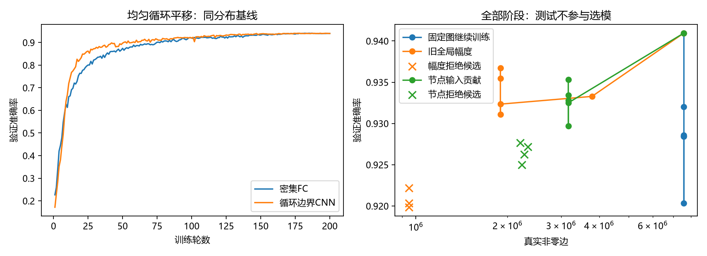
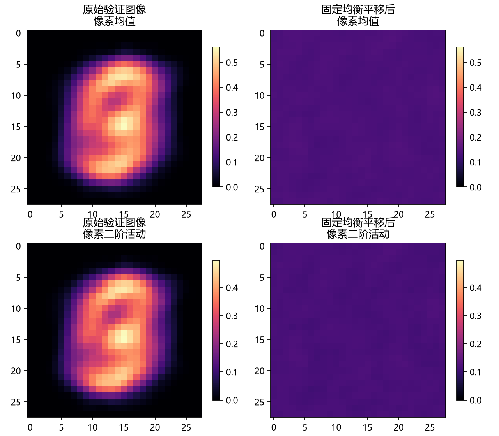

# 位置均衡MNIST与节点贡献剪边实际报告

运行状态：`completed`；单模型根11、数据根20261004。全体位移循环边界是诊断假设，不代表自然图像。

## 冻结结果

| 模型/机制 | 验证准确率 | 验证CE | 历史探索性测试准确率 | 真实展开边 | 导出字节 |
| --- | ---: | ---: | ---: | ---: | ---: |
| 密集FC | 94.094% | 0.228529 | 93.500% | 7577856 | 31278431 |
| 循环边界CNN | 94.078% | 0.206740 | 94.250% | 456000 | 830577 |
| 固定图继续训练 | 94.094% | 0.228529 | 93.500% | 7577856 | 31278431 |
| 旧全局幅度 | 93.672% | 0.237759 | 93.200% | 1894464 | 8544859 |
| 节点输入贡献 | 93.531% | 0.242727 | 92.988% | 3166655 | 13633625 |
| 第5槽拒绝随机候选（非最终同规模对照） | 92.594% | 0.249612 | 92.325% | 2201775 | 9774104 |

FC物理节点始终3136/1568/128/10，未缩点/清理；CNN节点相同，循环输入展开456000边、1.2倍547200只作外评。FC执行仍为dense零mask，没有测推断加速或能耗。

## 位置覆盖与评价

验证800原ID×8固定互异位置，全784位移频数最小8、最大9；位置版本有关联，不能视为6400独立样本。训练每轮每ID随机位置，实际累计覆盖如下。

随机候选只跟随节点冻结所选槽stage5，并非与回退后的节点最终模型同规模；该槽主候选是否接受为False。若拒绝，应比较该槽两种候选，不把随机候选与回退模型作边身份因果对照。

当前结果：旧幅度在位置活动已均衡的任务上仍减少75%边，验证较密集FC只降约0.422pp；因此旧成功并非只能在固定中部信息条件出现。但幅度1,894,464边约CNN4.155倍，节点3,166,655边约6.944倍，均未达1.2倍外评目标。节点机制本轮最终压缩弱于旧幅度。第一槽节点93.250%对随机90.156%（+3.094pp）支持该槽边身份有用；后续槽没有稳定随机优势，不能泛称方法全面优越。

- 密集FC：累计640000训练样本位移，覆盖784/784，格频数736—914。
- 密集FC冻结后训练ID固定1位移准确率96.938%；非全部训练位移成绩。
- 循环边界CNN：累计640000训练样本位移，覆盖784/784，格频数736—914。
- 循环边界CNN冻结后训练ID固定1位移准确率94.906%；非全部训练位移成绩。
- 固定图继续训练：累计128000训练样本位移，覆盖784/784，格频数128—204。
- 固定图继续训练冻结后训练ID固定1位移准确率96.938%；非全部训练位移成绩。
- 旧全局幅度：累计204800训练样本位移，覆盖784/784，格频数198—325。
- 旧全局幅度冻结后训练ID固定1位移准确率96.625%；非全部训练位移成绩。
- 节点输入贡献：累计230400训练样本位移，覆盖784/784，格频数227—362。
- 节点输入贡献冻结后训练ID固定1位移准确率95.969%；非全部训练位移成绩。
- 第5槽拒绝随机候选（非最终同规模对照）：累计25600训练样本位移，覆盖784/784，格频数16—50。
- 第5槽拒绝随机候选（非最终同规模对照）冻结后训练ID固定1位移准确率95.438%；非全部训练位移成绩。

按原ID的各位置预测表、逐类混淆矩阵、位置清单/来源哈希保存在机器报告和证据目录。官方测试及剩余封存数据访问0；历史探索性测试仅所有机制冻结后访问，不能称全新独立测试。

## 全部剪边阶段

| 机制/阶段 | 真实边 | 验证准确率 | 验证CE | 接受 |
| --- | ---: | ---: | ---: | --- |
| 固定图继续训练 / 0 | 7577856 | 94.094% | 0.228529 | True |
| 固定图继续训练 / 1 | 7577856 | 93.203% | 0.252422 | True |
| 固定图继续训练 / 2 | 7577856 | 92.844% | 0.253598 | True |
| 固定图继续训练 / 3 | 7577856 | 92.031% | 0.279239 | True |
| 固定图继续训练 / 4 | 7577856 | 92.859% | 0.276641 | True |
| 固定图继续训练 / 5 | 7577856 | 92.844% | 0.268716 | True |
| 旧全局幅度 / 0 | 7577856 | 94.094% | 0.228529 | True |
| 旧全局幅度 / 1 | 3788928 | 93.328% | 0.241378 | True |
| 旧全局幅度 / 2 | 1894464 | 93.234% | 0.233091 | True |
| 旧全局幅度 / 3 | 1894464 | 93.109% | 0.244078 | False |
| 旧全局幅度 / 4 | 1894464 | 93.547% | 0.240667 | False |
| 旧全局幅度 / 5 | 1894464 | 93.672% | 0.237759 | False |
| 节点输入贡献 / 0 | 7577856 | 94.094% | 0.228529 | True |
| 节点输入贡献 / 1 | 3166655 | 93.250% | 0.233143 | True |
| 节点输入贡献 / 2 | 3166655 | 93.344% | 0.232607 | False |
| 节点输入贡献 / 3 | 3166655 | 92.969% | 0.257220 | False |
| 节点输入贡献 / 4 | 3166655 | 93.281% | 0.248171 | False |
| 节点输入贡献 / 5 | 3166655 | 93.531% | 0.242727 | False |

固定图继续训练按统一验证功能/最少边规则冻结stage0；40净轮末态stage5验证92.844%。两者分开报告，不把继续训练末态换成起点。

旧全局幅度按统一验证功能/最少边规则冻结stage5；40净轮末态stage5验证93.672%。两者分开报告，不把继续训练末态换成起点。
- 拒绝候选stage3：947232边，验证91.984%/CE0.259539；已完整回退，随后普通恢复另计成本。
- 拒绝候选stage4：947232边，验证92.031%/CE0.266794；已完整回退，随后普通恢复另计成本。
- 拒绝候选stage5：947232边，验证92.219%/CE0.261291；已完整回退，随后普通恢复另计成本。

节点输入贡献按统一验证功能/最少边规则冻结stage5；40净轮末态stage5验证93.531%。两者分开报告，不把继续训练末态换成起点。
- 拒绝候选stage2：2332323边，验证92.719%/CE0.238540；已完整回退，随后普通恢复另计成本。
- 拒绝候选stage3：2267834边，验证92.625%/CE0.252846；已完整回退，随后普通恢复另计成本。
- 拒绝候选stage4：2231336边，验证92.500%/CE0.256812；已完整回退，随后普通恢复另计成本。
- 拒绝候选stage5：2201775边，验证92.766%/CE0.246971；已完整回退，随后普通恢复另计成本。

完整删除身份/大模型留本地run并登记SHA；逐row删量、校准激活和完整阶段预测纳入证据，重要最终稀疏BGM仅≤4MiB时复制。

## 验证图像实际信息分布

仅读取授权800验证ID缓存和冻结位移清单，未新增模型前向；原缓存SHA一致。位移频数本身不能保证有限样本像素活动完全均匀，因此另统计像素均值/二阶活动。

- original_validation：中央14×14占总像素二阶能量68.163%（面积25%）；全784位置二阶活动变异系数1.27917。
- translated_validation：中央14×14占总像素二阶能量24.963%（面积25%）；全784位置二阶活动变异系数0.02582。

## 节点贡献与同父随机候选

节点评分abs(w)×训练输入RMS，每节点低分前缀贡献能量预算0.05，不指定固定删率；同时保护排序尾部及最大权重边。评分忽略输入相关项，因此能量预算不保证联删无损。以下扰动用固定剪前层输入测量，最终接受由8轮恢复后的验证功能决定。

- 阶段1：逐层删[1099883, 3147456, 162870, 992]；线性输入相对RMS扰动[0.074, 0.1075, 0.0901, 0.1231]；主候选验证93.250%、接受True；同父/逐row同删量随机验证90.156%。
- 阶段2：逐层删[293405, 531433, 9426, 68]；线性输入相对RMS扰动[0.092, 0.1026, 0.1077, 0.1291]；主候选验证92.719%、接受False；同父/逐row同删量随机验证92.563%。
- 阶段3：逐层删[327330, 560937, 10483, 71]；线性输入相对RMS扰动[0.0958, 0.1043, 0.1076, 0.142]；主候选验证92.625%、接受False；同父/逐row同删量随机验证92.859%。
- 阶段4：逐层删[348521, 576186, 10540, 72]；线性输入相对RMS扰动[0.0965, 0.1071, 0.1065, 0.1423]；主候选验证92.500%、接受False；同父/逐row同删量随机验证92.609%。
- 阶段5：逐层删[363408, 590617, 10779, 76]；线性输入相对RMS扰动[0.0962, 0.1083, 0.1019, 0.1301]；主候选验证92.766%、接受False；同父/逐row同删量随机验证92.594%。

随机各阶段独立从节点主臂该槽剪前图、Adam/RNG开始；这是候选边身份比较，不是连续随机训练臂。全部分支保留，本报告不据随机或测试成绩挑阶段。

## 实际成本及边界

全会话1199.745秒；设备NVIDIA GeForce RTX 5080 Laptop GPU，FP32、batch64/评价512、CPU2线程、TF32关闭。训练/剪边搜索/随机分支/验证/导出/快照成本和CUDA峰见机器报告。

训练前冻结提交c866d83。CNN第10轮保存progress时Windows文件替换被拒绝，完整checkpoint已保存；第一次恢复因Windows默认GBK读取UTF8中文账本失败，未训练。第二次设置进程PYTHONUTF8=1后按同一锁定源/config恢复，FC200轮不重训，总预算从既有progress/failure最大耗时累计。恢复入口：PowerShell先`$env:PYTHONUTF8='1'`再`.venv/Scripts/python.exe -B -m tools.train_translated_edges --resume`。

CNN40轮又遇文件替换拒绝，从41轮以`-X utf8`接续；工程包装器另登记并提交8554c84，是否实际使用以engineering_io日志为准。会话Budget从各次模型会话创建后累计到结束，包含候选拒绝、随机分支及文件等待，不含解释器初始化、Budget创建前GBK启动失败或人工恢复间隔；不能称完整日历端到端成本。各臂wall_seconds只记录最后接续段，跨恢复训练/评价成本应汇总逐epoch秒数，完整总成本以累计Budget为准。

工程包装器本轮仅备用，实际启用0次、包装重试0次、包装等待0秒；第三次标准-X utf8恢复顺利完成。

- 密集FC：主训练账本10000尝试更新、640000优化样本；CUDA峰268443648字节。
- 循环边界CNN：主训练账本10000尝试更新、640000优化样本；CUDA峰129659904字节。
- 固定图继续训练：主训练账本2000尝试更新、128000优化样本；CUDA峰283308032字节。
- 旧全局幅度：主训练账本3200尝试更新、204800优化样本；CUDA峰329696256字节。
- 节点输入贡献：主训练账本3600尝试更新、230400优化样本；CUDA峰372585472字节。
- 第5槽拒绝随机候选（非最终同规模对照）：主训练账本400尝试更新、25600优化样本；CUDA峰见所属节点臂字节。
全部5个随机分支额外2000更新/128000优化样本（汇总表随机只显示末槽，不能当全部搜索成本）；所有主臂与全部随机合计30800尝试更新。节点每槽训练校准3200输入及联合扰动3200输入另计，共各16000输入。随机最终训练ID固定1位置评价3200样本在原随机ledger未加计，此处明确补充，其他完整账本保留原记录。

单种子、重复验证反馈和历史测试范围限制结论；是否胜过旧幅度/随机、是否达到连接外评目标应根据完整表判断，不由单个准确率或边数推出。未验证跨任务、卷积发现、严格共享或实际加速。

