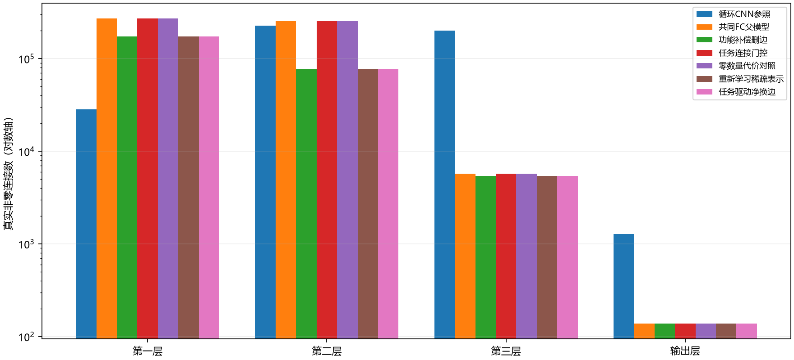

# H1功能补偿与任务门控：完成结果

2026-10-09。以下仅汇总已完成分支，运行状态及未完成机制以[状态](../../../status.md)为准。实验协议见[执行预登记](../../../h1_functional_edges_v1_execution.md)，完整机器证据见[result.json](result.json)。

## 性能与连接

| 分支 | 第一层边 | 第二层边 | 总边 | 验证准确率 | 验证CE | 功能合格 | 首层达标且净省边 | 端到端秒 |
| --- | --- | --- | --- | --- | --- | --- | --- | --- |
| 共同父 | 271,888 | 252,735 | 530,455 | 93.2344% | 0.221395 | 是 | 否 | 历史成本另计 |
| 功能补偿删边 | 172,936 | 77,376 | 255,837 | 93.1250% | 0.228783 | 是 | 否 | 439.03 |
| 任务连接门控 | 271,888 | 252,735 | 530,455 | 93.2344% | 0.221395 | 是 | 否 | 80.88 |
| 零数量代价对照 | 271,888 | 252,735 | 530,455 | 93.2344% | 0.221395 | 是 | 否 | 80.28 |
| 重新学习稀疏表示 | 172,936 | 77,376 | 255,837 | 93.1250% | 0.228783 | 是 | 否 | 132.96 |
| 任务驱动净换边 | 172,936 | 77,376 | 255,837 | 93.1250% | 0.228783 | 是 | 否 | 252.37 |

第一层≤56448只是外部评价；功能门槛固定93.09375%/CE≤0.28852926。循环CNN节点与FC逐层对齐，四层展开边`[28224, 225792, 200704, 1280]`，总456000；不要与静态CNN433680混用。节点固定4842，无物理删点，没有严格参数共享。



## 本轮结论

补偿接受首槽，第二槽三次尝试全部平台失败。损伤预算5%→2.5%→1.25%仍由50%操作上限先截断，删边集合及验证轨迹相同；后两次是重复成本，不能算额外有效证据。门控32/56/80轮硬化均未跨过关闭阈值；80轮预期开启约99.405%，实际净删边为0。零数量代价对照也没有删边。

净换边三槽虽保持功能，最终新增大于删除，全部回退。重新学习32/56轮硬结构在恢复预算内仍改善，记优化未完成；80轮硬结构恢复48轮最终验证约70.4063%/CE0.925036，不合格，保留旧父。重初始化使用物理层完整fan-in，未按稀疏入度重标定，且第40轮确实在线改变支持；本轮不能证明该掩码容量不足。

最终最小合格模型来自补偿首槽，共255837边（较共同父减少51.77%），第一层仍172936、为循环CNN约6.13倍；本轮第一层目标未达到。按用户授权继续[跨节点激活功能迁移](../../../h1_activation_migration_v1_execution.md)，该新机制状态见项目状态页。

入口端到端986.149秒，含首次数据准备、所有对照与失败搜索。累计尝试更新50400次，其中补偿首槽实际保留1200次新增更新；其他分支最终回退，不能把尝试总量称为最终参数保留更新。设备NVIDIA GeForce RTX 5080 Laptop GPU，Torch 2.13.0+cu130，batch64/评价512，FP32任务权重/FP64重构、CPU2线程、稠密掩码执行；总体峰来自补偿2131899392字节，约2.0GiB，各阶段均未触及8GiB工程限制。

## 分支与成本

### 功能补偿删边

各层真实非零边：`[172936, 77376, 5387, 138]`。前两层为循环CNN的6.127/0.343倍。BGM导出字节：1990349；独立参数：260679。

运行与恢复记录：

```json
{
  "stop": "completed_failure",
  "selected_full_checkpoint": "experiments\\runs\\h1_functional_edges_v1\\mnist_circular\\compensation\\slot_1_attempt_1_resume.pt",
  "costs": {
    "solve_seconds": 302.2575310000684,
    "training_seconds": 47.70859539997764,
    "validation_seconds": 0.9494667001417838,
    "save_seconds": 42.21047910023481,
    "closure_seconds": 0.018040299997664988,
    "failure_search_seconds": 221.80681879998883,
    "data_setup_seconds": 17.511095400026534
  },
  "peak_cuda_memory_bytes": 2131899392,
  "ledger_measured": {
    "attempted_updates": 12000,
    "optimization_samples": 768000,
    "evaluation_calls": 92,
    "evaluation_samples": 393600,
    "rollbacks": 3
  }
}
```

固定单位置训练准确率94.6875%、CE0.161376。训练与验证混淆矩阵保存在完整结果JSON；不称为所有循环位置的训练总体性能。

| 层 | 平均入度 | 无入边物理节点 | 入度分位（0/10/25/50/75/90/100%） |
| --- | --- | --- | --- |
| 1 | 55.145 | 679 | `[0.0, 0.0, 23.0, 56.0, 80.0, 109.0, 196.0]` |
| 2 | 49.347 | 914 | `[0.0, 0.0, 0.0, 0.0, 75.0, 179.0, 500.0]` |
| 3 | 42.086 | 58 | `[0.0, 0.0, 0.0, 9.5, 93.0, 118.0, 150.0]` |
| 4 | 13.800 | 0 | `[11.0, 11.0, 12.25, 13.5, 14.75, 17.1, 18.0]` |


首候选共同24轮比较（匹配原父、数据序列与Adam重置）：

| 分支 | 准确率 | CE |
| --- | --- | --- |
| 补偿 | 93.1250% | 0.228783 |
| 同删除集合无补偿 | 92.9531% | 0.236766 |
| 不删边继续训练 | 93.7500% | 0.211677 |

差别为单种子旧验证观察，不作显著性或跨任务优势判断。

首候选直接删除`[89562, 175358, 307, 0]`，闭合另删`[9390, 1, 0, 0]`。拟合/诊断补偿前后误差及被删权重分位保存在事件JSON。首候选保留1200次任务更新；其余失败和对照更新均计入尝试成本。

同删除集合无补偿：运行48轮，最终验证92.9219%/CE0.234316；全部共同验证点见[同删除集合无补偿记录](uncompensated_result.json)。应在共同轮次比较，不能用48轮对照与提前接受候选的末态直接归因。

不删边继续训练：运行48轮，最终验证93.5781%/CE0.211922；全部共同验证点见[不删边继续训练记录](continue_training_result.json)。应在共同轮次比较，不能用48轮对照与提前接受候选的末态直接归因。

候选、硬化和失败记录见[功能补偿删边事件](compensation_events.json)。

### 任务连接门控

各层真实非零边：`[271888, 252735, 5694, 138]`。前两层为循环CNN的9.633/1.119倍。BGM导出字节：3088822；独立参数：535297。

运行与恢复记录：

```json
{
  "stop": "gate_epochs_completed",
  "selected_full_checkpoint": "experiments/runs/h1_adaptive_edges_v1/mnist_circular/magnitude_adaptive/model_full.pt",
  "costs": {
    "solve_seconds": 0.0,
    "training_seconds": 41.054426499817055,
    "validation_seconds": 0.11073189997114241,
    "save_seconds": 29.174386000202503,
    "closure_seconds": 0.01229160005459562,
    "failure_search_seconds": 0.0,
    "data_setup_seconds": 0.0
  },
  "peak_cuda_memory_bytes": 556400128,
  "paired_wall_seconds": 161.0609813000192,
  "paired_costs": {
    "solve_seconds": 0.0,
    "training_seconds": 82.06053889991017,
    "validation_seconds": 0.2240462001063861,
    "save_seconds": 58.12321200000588,
    "closure_seconds": 0.022365599987097085,
    "failure_search_seconds": 0.0,
    "data_setup_seconds": 0.0
  },
  "ledger_measured": {
    "attempted_updates": 5200,
    "optimization_samples": 332800,
    "evaluation_calls": 11,
    "evaluation_samples": 48000,
    "rollbacks": 0
  }
}
```

固定单位置训练准确率94.7187%、CE0.145644。训练与验证混淆矩阵保存在完整结果JSON；不称为所有循环位置的训练总体性能。

| 层 | 平均入度 | 无入边物理节点 | 入度分位（0/10/25/50/75/90/100%） |
| --- | --- | --- | --- |
| 1 | 86.699 | 158 | `[0.0, 21.0, 64.0, 90.0, 114.0, 137.0, 216.0]` |
| 2 | 161.183 | 826 | `[0.0, 0.0, 0.0, 0.0, 371.0, 477.29999999999995, 722.0]` |
| 3 | 44.484 | 58 | `[0.0, 0.0, 0.0, 10.5, 95.5, 123.3, 154.0]` |
| 4 | 13.800 | 0 | `[11.0, 11.0, 12.25, 13.5, 14.75, 17.1, 18.0]` |


候选、硬化和失败记录见[任务连接门控事件](gates_events.json)。

### 零数量代价对照

各层真实非零边：`[271888, 252735, 5694, 138]`。前两层为循环CNN的9.633/1.119倍。BGM导出字节：3088822；独立参数：535297。

运行与恢复记录：

```json
{
  "stop": "gate_epochs_completed",
  "selected_full_checkpoint": "experiments/runs/h1_adaptive_edges_v1/mnist_circular/magnitude_adaptive/model_full.pt",
  "costs": {
    "solve_seconds": 0.0,
    "training_seconds": 41.006112400093116,
    "validation_seconds": 0.11331430013524368,
    "save_seconds": 28.948825999803375,
    "closure_seconds": 0.010073999932501465,
    "failure_search_seconds": 0.0,
    "data_setup_seconds": 0.0
  },
  "peak_cuda_memory_bytes": 556591104,
  "ledger_measured": {
    "attempted_updates": 5200,
    "optimization_samples": 332800,
    "evaluation_calls": 11,
    "evaluation_samples": 48000,
    "rollbacks": 0
  }
}
```

固定单位置训练准确率94.7187%、CE0.145644。训练与验证混淆矩阵保存在完整结果JSON；不称为所有循环位置的训练总体性能。

| 层 | 平均入度 | 无入边物理节点 | 入度分位（0/10/25/50/75/90/100%） |
| --- | --- | --- | --- |
| 1 | 86.699 | 158 | `[0.0, 21.0, 64.0, 90.0, 114.0, 137.0, 216.0]` |
| 2 | 161.183 | 826 | `[0.0, 0.0, 0.0, 0.0, 371.0, 477.29999999999995, 722.0]` |
| 3 | 44.484 | 58 | `[0.0, 0.0, 0.0, 10.5, 95.5, 123.3, 154.0]` |
| 4 | 13.800 | 0 | `[11.0, 11.0, 12.25, 13.5, 14.75, 17.1, 18.0]` |


候选、硬化和失败记录见[零数量代价对照事件](gates_control_events.json)。

### 重新学习稀疏表示

各层真实非零边：`[172936, 77376, 5387, 138]`。前两层为循环CNN的6.127/0.343倍。BGM导出字节：1990349；独立参数：260679。

运行与恢复记录：

```json
{
  "stop": "structure_slots_completed",
  "selected_full_checkpoint": "experiments\\runs\\h1_functional_edges_v1\\mnist_circular\\relearn\\model_full.pt",
  "costs": {
    "solve_seconds": 0.0,
    "training_seconds": 64.02856609976152,
    "validation_seconds": 0.5919802000862546,
    "save_seconds": 48.056411100085825,
    "closure_seconds": 0.015933800023049116,
    "failure_search_seconds": 0.0,
    "data_setup_seconds": 0.0
  },
  "peak_cuda_memory_bytes": 685500416,
  "ledger_measured": {
    "attempted_updates": 11200,
    "optimization_samples": 716800,
    "evaluation_calls": 58,
    "evaluation_samples": 249600,
    "rollbacks": 0
  },
  "maximum_slot_gate_peak_bytes": 685500416
}
```

固定单位置训练准确率94.6875%、CE0.161376。训练与验证混淆矩阵保存在完整结果JSON；不称为所有循环位置的训练总体性能。

| 层 | 平均入度 | 无入边物理节点 | 入度分位（0/10/25/50/75/90/100%） |
| --- | --- | --- | --- |
| 1 | 55.145 | 679 | `[0.0, 0.0, 23.0, 56.0, 80.0, 109.0, 196.0]` |
| 2 | 49.347 | 914 | `[0.0, 0.0, 0.0, 0.0, 75.0, 179.0, 500.0]` |
| 3 | 42.086 | 58 | `[0.0, 0.0, 0.0, 9.5, 93.0, 118.0, 150.0]` |
| 4 | 13.800 | 0 | `[11.0, 11.0, 12.25, 13.5, 14.75, 17.1, 18.0]` |


候选、硬化和失败记录见[重新学习稀疏表示事件](relearn_events.json)。

### 任务驱动净换边

各层真实非零边：`[172936, 77376, 5387, 138]`。前两层为循环CNN的6.127/0.343倍。BGM导出字节：1990349；独立参数：260679。

运行与恢复记录：

```json
{
  "stop": "structure_slots_completed",
  "selected_full_checkpoint": "experiments\\runs\\h1_functional_edges_v1\\mnist_circular\\rewire\\model_full.pt",
  "costs": {
    "solve_seconds": 0.0,
    "training_seconds": 127.80193999985931,
    "validation_seconds": 0.44507949997205287,
    "save_seconds": 90.34294980060076,
    "closure_seconds": 0.03501090005738661,
    "failure_search_seconds": 0.0,
    "data_setup_seconds": 0.0
  },
  "peak_cuda_memory_bytes": 650061312,
  "ledger_measured": {
    "attempted_updates": 16800,
    "optimization_samples": 1075200,
    "evaluation_calls": 44,
    "evaluation_samples": 192000,
    "rollbacks": 0
  },
  "maximum_slot_gate_peak_bytes": 650061312
}
```

固定单位置训练准确率94.6875%、CE0.161376。训练与验证混淆矩阵保存在完整结果JSON；不称为所有循环位置的训练总体性能。

| 层 | 平均入度 | 无入边物理节点 | 入度分位（0/10/25/50/75/90/100%） |
| --- | --- | --- | --- |
| 1 | 55.145 | 679 | `[0.0, 0.0, 23.0, 56.0, 80.0, 109.0, 196.0]` |
| 2 | 49.347 | 914 | `[0.0, 0.0, 0.0, 0.0, 75.0, 179.0, 500.0]` |
| 3 | 42.086 | 58 | `[0.0, 0.0, 0.0, 9.5, 93.0, 118.0, 150.0]` |
| 4 | 13.800 | 0 | `[11.0, 11.0, 12.25, 13.5, 14.75, 17.1, 18.0]` |


候选、硬化和失败记录见[任务驱动净换边事件](rewire_events.json)。


## 证据范围

只使用既有3200训练/800验证原始ID，验证各ID8位置不是6400独立笔迹。验证用于结构接受与选模，官方测试、历史探索测试和其余封存ID关闭。没有独立泛化验证，不称全局最优或自然稀疏极限。训练采用稠密掩码执行，真实边/导出字节变化不代表实测加速或能耗。

补偿拟合和诊断样本均来自训练ID；诊断不参与候选排序，端到端任务训练使用全部3200。软门开启概率仅为优化量，实际结构以硬化及闭合后的真实非零边计数。对照、失败及恢复成本由各分支保存的事件和成本记录说明，不隐藏回退尝试。

旧基础ledger中的`net_updates`和`teacher_samples`在本入口未维护，零值不是测量结果；报告不引用这些字段作为保留更新或蒸馏样本数。使用尝试更新和具体联合/适应轮次解释成本。失败搜索秒是其他求解/训练/验证/保存成本的重叠子集，不能再次相加；分项未覆盖的读取/快照等成本保留在端到端残差。设备、精度、批量和完整来源见运行登记。

同一runner的对照/嵌套ledger可能累计之前分支，不能逐文件直接求和。升级嵌套slot在无接受时的`selected_full_checkpoint`标记沿用最初530455父路径，实际fallback是传入的补偿父；该来源标记不准确，恢复使用各臂实际`model_full.pt`及其SHA256。升级顶层显存字段是末槽门控peak；上文另列所有slot的门控峰最大值，不冒称该字段单独覆盖全部升级过程。
