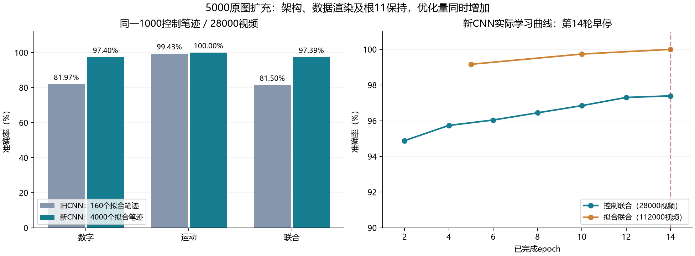

# 5000原始笔迹的8帧CNN：泛化明显改善

2026-10-05。按[启动前登记](../docs/cnn_5000_execution.md)完成实际数据生成、审计、GPU诊断、训练及冻结后共同评估。用户指定只训练8帧CNN：总5000原图按80/20分为4000拟合/1000控制，每数字400/100；原100验证笔迹保持。模型与旧v6 CNN架构相同、根11从头初始化、无预训练，同v6运动参数、AdamW及控制损失反馈，累计上限25轮。

## 在同一批视频上的结果

新旧两模型均冻结各自控制最佳检查点；新模型复用已保存控制预测，旧模型只读评价同样的28000控制视频，没有更新或重训。

| 同一1000控制笔迹、28000视频 | 旧CNN：160拟合笔迹 | 新CNN：4000拟合笔迹 | 变化（百分点） |
| --- | ---: | ---: | ---: |
| 数字准确率 | 81.9714% | 97.3964% | +15.4250 |
| 运动准确率 | 99.4286% | 99.9964% | +0.5679 |
| 联合准确率 | 81.4964% | 97.3929% | +15.8964 |
| 双任务交叉熵 | 1.05291 | 0.18421 | −0.86869 |

原40控制笔迹（1120视频）单列：旧84.1071%/98.9286%/83.1250%，新97.1429%/100%/97.1429%（数字/运动/联合）。这部分原像素与旧v6逐像素一致，旧模型重算三项准确率与用户已完成成绩完全相同。新增960控制笔迹（26880视频）：旧81.8824%/99.4494%/81.4286%，新97.4070%/99.9963%/97.4033%；收益并不限于原40个已反复查看的笔迹。

冻结后同一原100验证笔迹、1400视频，各模型只评价一次：

| 原验证视频 | 旧CNN | 新CNN |
| --- | ---: | ---: |
| 数字准确率 | 82.4286% | 97.5714% |
| 运动准确率 | 99.4286% | 100% |
| 联合准确率 | 82.1429% | 97.5714% |

原验证不参与本次CNN学习、降率、早停或选模，但历史曾用于SNN探索，因此称冻结后的探索性确认；最终测试没有解封。扩大后的控制仍参与降率、早停和检查点选择，其结果不是独立测试成绩。

## 拟合差距与训练过程

旧CNN实际24轮早停、最佳第22轮；新CNN14轮早停、最佳第14轮。新模型控制损失第4轮达到0.14784，之后未达到有效相对改善1%的门槛；第8/12轮评价后，下一轮lr分别降到0.0005/0.00025。第14轮连续5次控制损失无有效改善，按事前规则结束，而非扩大到25轮或追加调参。控制准确率继续上升而交叉熵变差，说明损失与准确率反映不同情况，不把早停称为已经收敛。

冻结最佳的拟合数字/运动/联合：旧99.9330%/99.9777%/99.9107%，新99.9991%/100%/99.9991%（112000拟合视频仅1个数字错误）。以共同扩展控制集计算，联合拟合－控制差距从18.4143个百分点降至2.6063；拟合能力没有下降。这支持扩大训练数据后本架构的泛化改善。

每轮拟合视频4480→112000，扩大25倍；实际正式训练107520→1568000视频次，优化更新840→12250，约14.58倍。因独立笔迹和优化量同时增加，这不是等更新数的纯笔迹数量消融；本轮支持“更大的训练覆盖与预算显著改善CNN”的结论，不能量化各因素的独立贡献，也不能推断尚未运行的扩大数据SNN成绩。架构、运动渲染、初始化根与反馈规则保持，未训练另外两个ANN或SNN。

## 实际数据、成本和核对

数据生成4个CPU工作进程、128.07秒，1263032次生成参考渲染调用。140000视频/1120000帧标签、位姿/运动、原始ID隔离、空帧及可见度全量检查通过；空帧0、裁切135311帧、最大裁切14.99965%。旧200笔迹5600视频逐像素/标签一致，20个固定新增笔迹的4480帧使用独立68×68参考画布逐像素通过；审计7.29秒。扩充明确重划4800个此前封存的MNIST训练池ID，剩余54900与官方测试继续封存，原100验证归属保持。完整划分、数据哈希与审计已冻结。

RTX 5080 Laptop GPU、本地.venv，PyTorch 2.13.0+cu130，FP32确定性执行。新CNN训练含诊断墙钟128.32秒，其中优化103.03秒；峰值GPU分配3,675,488,768字节（约3.42GiB）、进程峰值工作集4,257,832,960字节（约3.97GiB）。这些是本次墙钟和内存观察，不是实测能耗。

| 本轮新CNN实际工作 | 视频次或次数 |
| --- | ---: |
| 正式训练前向/反传 | 各1,568,000 |
| 正式优化更新 | 12,250 |
| 控制评价 | 7次 / 196,000视频次 |
| 常规及末态拟合评价 | 3次 / 336,000视频次 |
| 最佳冻结后拟合 | 1次 / 112,000视频次 |
| GPU启动诊断 | 160前向 / 96反传 / 3更新含重放，全部撤回 |
| 旧CNN冻结后扩展控制 | 1次 / 28,000前向 |
| 冻结后原验证确认 | 旧/新各1次1400前向，共2800 |

冻结后共同评价与报告核对墙钟18.19秒，0反传/更新。全部保存预测复算数字、运动、联合准确率与数字/运动/联合70类混淆矩阵；逐批成本累计与最终result、resume、所有Adam参数步数逐项吻合，额外训练重放0，OOM或更换种子0。启动诊断的模型/优化器/NumPy/Torch/CUDA更新重放完全一致，视频批次隔离/帧序敏感通过。ANN没有LIF/Fire，静态卷积共享参数与逻辑激活位置沿用模型资源记录；不将激活位置冒称LIF单元。

新旧最佳模型、恢复检查点和配置在冻结评价前后SHA256相同，所有训练源码哈希通过；旧v5/v6、用户其他实验未修改。报告复用保存预测，不重新消耗新模型控制前向。后续报告重复调用只核对重要证据哈希，不重新评价。

## 证据与恢复

[完整JSON](cnn_5000_20261005.json)保存共同控制/子集/原验证的完整混淆矩阵、指标、成本与来源；[重要证据目录](cnn_5000_20261005_evidence/)保存配对预测、划分/审计、双方配置/结果、逐轮记录、逐批成本账（gzip无损压缩）和文件哈希。压缩成本账解压后与项目原账本逐字节一致。主数据与训练检查点留项目，生成物不全部加入Git。实现登记提交`01e6ff8`、数据审计提交`5a5da2f`。

新模型位于`experiments/runs/cnn_5000_v6/stacked_cnn/best.pt`（第14轮）；同目录`resume.pt`含最后完整状态、优化器、调度器/早停及随机流。已早停，不因再次运行增加轮数；恢复入口`python -u -B -m tools.train_cnn_5000 --resume --epochs 25`。实际训练进程已退出，本轮不追加预算。原CNN和其检查点完整保留。
