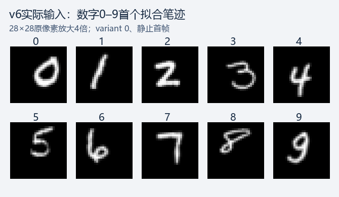
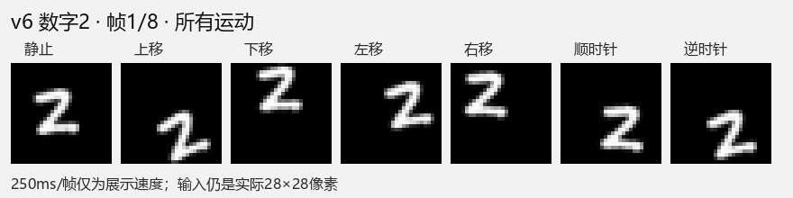
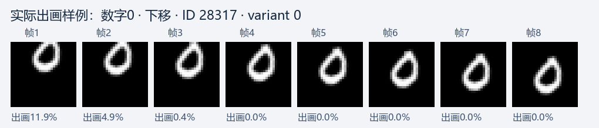

# v6数据集调整完成

用户要求先调整数据并展示样例，最终指定平移8–10像素、旋转总幅度60–90°。本轮只生成与核对数据，没有训练模型或更改原模型权重。

| 设置 | v6 |
|---|---|
| 来源 | 原MNIST同一批笔迹，直接从原前景一次仿射渲染 |
| 输入 | 28×28灰度float32[0,1]，784维，8帧 |
| 前景大小 | 对角线18–20.7像素，保持笔迹宽高比 |
| 初始角 | 全部运动[-15°,15°) |
| 平移 | 上/下/左/右净距离8–10像素 |
| 旋转 | 顺/逆净角幅度60–90°，逐轨迹独立采样 |
| 有限出画 | 每帧最多损失15%参考画布的笔画灰度总量 |
| 根种子 | 20261004；版本6独立运动子流，未换根 |
| 标签 | 原数字身份10类＋运动7类；不因出画或旋转改数字标签 |

原160拟合/40控制/100验证笔迹保持隔离，视频4480/1120/1400，总7000视频、56000帧。只提取许可300个原始ID，余下59700原ID继续封存；生成验证视频不等于执行模型验证。预览只使用拟合集，没有展示控制或验证样本。原v5缓存与清单均已核对保持原哈希。

## 实际样例

以下均从实际缓存导出，最近邻放大4倍。数字总览按每类首个拟合笔迹、variant0、静止首帧选取。

数字2的7种运动动画，从左到右为静止、上、下、左、右、顺时针、逆时针。

[数字2全部8帧](data_v6_samples/digit_2_frames.png)、[数字5全部8帧](data_v6_samples/digit_5_frames.png)、[数字9全部8帧](data_v6_samples/digit_9_frames.png)；[数字5动画](data_v6_samples/digit_5_motions.gif)、[数字9动画](data_v6_samples/digit_9_motions.gif)。GIF250ms/帧只是展示速度，数据不规定物理帧率或神经仿真时间。

出画样例是按缓存顺序首个至少一帧裁切≥10%的拟合视频，不代表全数据出画分布；百分比是笔画灰度质量损失。

## 完整核对

- 56000帧与更大的68×68独立参考画布逐像素一致，参考边缘无笔画；每帧可见度按独立完整参考重新计算，标签与原MNIST许可ID逐项核对。
- 空帧0；6417帧有实际笔画损失（11.46%），其中385帧损失>10%。最少保留85.005602%，最大损失14.994398%。
- 实际平移8.000073–9.999946像素、旋转幅度60.003566–89.976881°；初始角±15°范围有效，静止8帧完全相同，相反方向未发现完全像素反序对，顺/逆首帧完全相同对0。
- 拟合/控制加载器的4480/1120标签和原始ID顺序与旧隔离证据完全相同。真实笔迹确定性、独立可见度、损坏/不完整缓存拒绝、封存ID拒绝四项相关检查通过；首次系统临时目录不可写的fixture错误另行披露，改用项目内独立临时目录后全部通过，未改环境。
- 所有PNG/GIF样例回读后，28×28像素与缓存逐位相同；GIF8帧，未使用绘制示意数字或重新抽样。

每条运动最多64候选，实际7000接受轨迹用了7841候选、最多9次；生成参考渲染62728帧次、审计参考渲染56000帧次。生成墙钟27.44秒、审计40.01秒；均为CPU数据处理，不是模型训练时间或能耗。模型前向/反传/更新0，准确率/Fire/模型生长不适用于本任务。

裁切比例不能保证数字可识别；可见度拒绝仍可能形成位置线索，尚未进行新模型性能实验。v6与旧v5任务难度不同，旧模型分数不是新版本成绩。

## 文件与入口

实际缓存`data/dynamic_v6.npz`、完整清单`data/manifest_v6.json`留在项目data目录，哈希在[审计JSON](data_v6_evidence.json)中；[重要协议、标签/位姿元数据](data_v6_evidence/)、[样例选取清单](data_v6_samples/preview_manifest.json)已显式保存。原MNIST源文件与v5保持。

项目根目录：`python -m tools.prepare_data --version v6`准备/校验；`python -m tools.audit_dynamic_v6`完整审计；`python -m tools.preview_data --version v6 --output <新目录>`导出实际样例；`python -m tools.summarize_data_v6`只读汇总。使用项目.venv。默认准备和预览已指向v6，旧版本可明确指定v5。

历史训练入口仍锁定v5与原配置，不自动改为v6；后续训练应显式接入新模块的`training_data()`，另登记训练预算。完整[协议与实施记录](../docs/data_v6_execution.md)。
