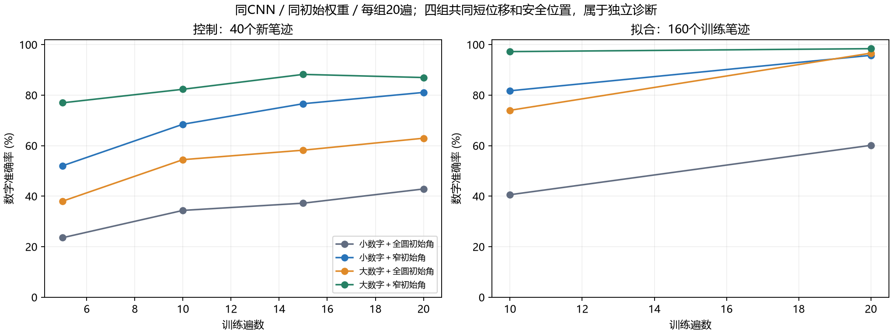
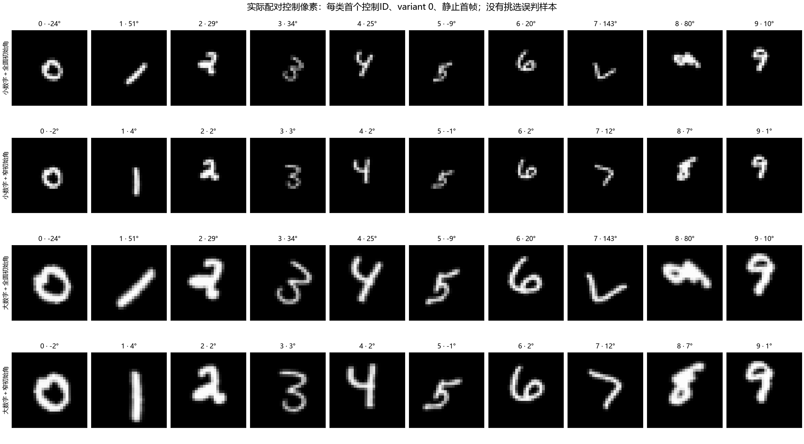

# 数字数据轻量诊断：尺寸×初始角

四组已完成相同20遍预算；同CNN1,704,945参数、同种子11初始权重、同160拟合/40控制笔迹，模型读取28×28×8原灰度。训练目标为数字CE＋运动CE，AdamW、恒lr0.001、批量128。没有预训练或新笔迹。

四组共同短位移4.1–4.4像素、按大前景确定的相同安全中心；净旋转仍±105°。窄初始角±15°只限制起始姿态。尺寸和角度各自逐项配对，原v5缓存/模型保持。原14像素平移任务的绝对成绩不能与本轮直接比较。

## 相同20遍末态

| 组 | 拟合数字/运动/联合 | 控制数字/运动/联合 | 控制数字第15/20遍均值 |
|---|---|---|---:|
| 小数字＋全圆初始角 | 60.13%/99.98%/60.11% | 42.86%/98.93%/41.96% | 40.04% |
| 小数字＋窄初始角 | 95.76%/99.53%/95.29% | 81.07%/98.57%/80.27% | 78.84% |
| 大数字＋全圆初始角 | 96.63%/99.89%/96.54% | 62.95%/98.84%/62.23% | 60.58% |
| 大数字＋窄初始角 | 98.39%/100.00%/98.39% | 86.96%/99.29%/86.34% | 87.59% |

本轮有限20遍下，初始角范围收窄与数字放大都通过预设收益门槛；初始角收窄的增益更大。支持小尺寸和全圆初始姿态是当前CNN学习的重要障碍，不能据此认定v5渲染损坏或排除模型因素。小数字全圆组拟合仍仅60.13%，因此比较同时反映有限预算下的可学习性，不能当作收敛性能上限。

## 预登记因素对比

均值增益≥5个百分点且末态同向才称初步支持；控制参与判读，非独立测试，不作显著性结论。

| 因素 | 第15/20遍平均增益（百分点） | 末态增益 | 控制笔迹改善/持平/下降 | 预设门槛 |
|---|---:|---:|---|---|
| 窄角收益_小数字 | +38.79 | +38.21 | 30/4/6 | 通过 |
| 窄角收益_大数字 | +27.01 | +24.02 | 31/3/6 | 通过 |
| 放大收益_全圆 | +20.54 | +20.09 | 31/5/4 | 通过 |
| 放大收益_窄角 | +8.75 | +5.89 | 22/4/14 | 通过 |

交互项（窄角放大收益−全圆放大收益）：-11.79个百分点。只描述这四个有限预算探针，不是总体因果贡献比例。
低分组拟合低于70%时，未见收益不能排除该因素。没有扩大训练、挑选最佳检查点或换种子。本轮没有增加独立笔迹，不能确定更多笔迹的增益；CNN探针结果不能直接视为原SNN在新数据上的成绩，也未证明理论准确率上限。

## 实际配对像素

每类同一首个控制ID、variant0、静止首帧，未按模型错误选图。保持共同中心可直接看到尺度与角度差异。

## 审计、成本与恢复

原v5小样本560帧逐像素复现；四组2240帧与独立大画布逐像素比较、画布外无前景；全量179200帧非空、几何边距≥1像素且纯因素配对有效。几何审计不证明无视觉歧义或捷径。准备阶段只读图像缓冲区错误已修复，失败发生在训练前，另计58次渲染调用；正式审计另计5040次渲染调用。
真实32视频诊断通过梯度、视频隔离与模型/优化器/RNG更新重放，随后撤回全部更新。正式每组检查点的Adam步数均700，末态NumPy RNG与同根20次相同4480样本置乱相符；预测、三种混淆矩阵与成本日志复算相符。
正式总优化前向/反传358400/358400、2800更新；控制17920视频/16次、拟合35840视频/8次；共同诊断另计160前向/96反传/3更新含重放。GPU阶段墙钟60.5秒，数据生成20.1秒；没有新验证或封存测试前向。报告生成0模型前向/0反传/0更新。

| 组 | 模型阶段墙钟（秒） | 优化墙钟（秒） | GPU分配峰值（MiB） | 进程工作集峰值（MiB） |
|---|---:|---:|---:|---:|
| 小数字＋全圆初始角 | 8.4 | 7.1 | 287.3 | 1824.0 |
| 小数字＋窄初始角 | 9.5 | 8.0 | 287.3 | 1829.6 |
| 大数字＋全圆初始角 | 9.7 | 8.1 | 287.3 | 1836.4 |
| 大数字＋窄初始角 | 9.7 | 8.1 | 287.3 | 1836.4 |

设备RTX 5080 Laptop GPU，PyTorch版本见JSON；FP32确定性、TF32关闭。固定非LIF网络的Fire、神经仿真与生长不适用；未测能耗。每视频逻辑激活位置按原CNN配置披露，位置数不等于SNN物理单元。进程峰值包含同会话之前的数据准备/诊断，不能视为各模型独占内存。

[完整JSON](digit_data_diagnostic_20261005.json)、[重要配置和预测证据](digit_data_diagnostic_20261005_evidence/)、[70类联合混淆矩阵](digit_data_diagnostic_20261005_joint_confusions.npz)、[事前登记](../docs/digit_data_diagnostic_execution.md)。数字/运动混淆矩阵保存在每份评价JSON，联合类按digit×7＋motion。
全部缓存、源快照、初始模型、按遍恢复检查点/优化器/RNG与成本日志留在`experiments/runs/digit_data_diagnostic_v1/`。恢复命令：项目根目录`.venv\Scripts\python.exe -u -B -m tools.train_digit_data_diagnostic --resume`；已完成20遍会跳过训练。复核报告：`.venv\Scripts\python.exe -B -m tools.report_digit_data_diagnostic`。
