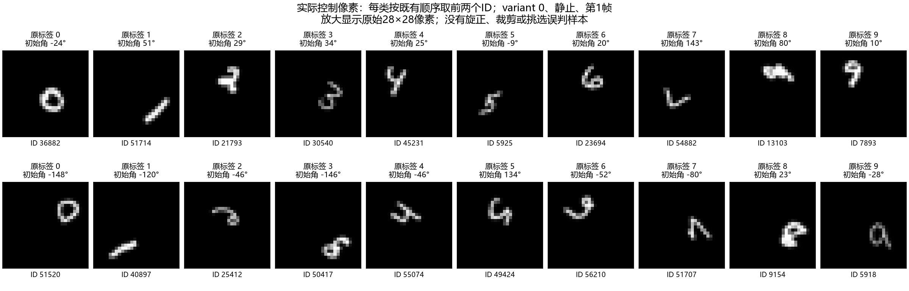

# CNN与SNN数字识别困难：已有证据分析

本报告只在CPU读取既有预测、训练缓存中的控制像素与已有报告；0模型前向、0反传、0更新。后台GPU任务未操作，验证和最终封存数据未读取。

## 主要判断

最强证据指向跨笔迹泛化不足，并叠加小尺寸和全圆姿态的表征难度。第10遍CNN还有明显欠拟合；后期固定视频模型能够记住训练视频，却没有取得相近控制准确率。不能把共同低准确率唯一归于LIF或Fire。

## 实际数据难度

4480拟合视频来自160个原始笔迹，每类仅16个；每ID的4轨迹×7运动不等于28个新笔迹。控制1120视频仅40个笔迹，每类4个，同ID视频相关。每帧28×28画布中的前景对角线仅10–11.5像素，起始角在全圆均匀抽取；6/9原标签不随旋转改变。

控制ID的160条轨迹：旋转前前景宽/高中位数6.69/8.33像素。静止视频首帧160张中，灰度>0.1的像素数中位数为33；这不是信息量测量，也不代表不可识别。

## 6/9不是全部解释

| 保存模型 | 数字准确率 | 排除真实6/9后八类准确率 | 单纯6↔9互认 / 所有数字错误 |
|---|---:|---:|---:|
| SNN第10遍 | 32.05% | 38.73% | 12 / 761 |
| CNN第10遍 | 27.95% | 34.15% | 2 / 807 |
| CNN第75遍 | 41.16% | 46.88% | 39 / 659 |
| CNN第100遍 | 40.71% | 46.43% | 36 / 664 |
| SNN第75遍 | 36.25% | 42.30% | 36 / 714 |

6/9倒置存在任务定义上的歧义风险，但数据未证明两类分布完全相同；不能据此宣称不可学或给出上限。即使排除这两类，其余类仍弱，错误并非主要只发生在6和9之间。

## 训练能力与泛化分开判断

CNN第10遍数字拟合33.82%、控制27.95%，存在训练不足；第100遍数字拟合100%、控制40.71%，此时固定视频的主要差距是泛化。CNN第75遍同权重数字拟合99.62%、控制41.16%。SNN第10遍数字拟合79.31%、控制32.05%；旧基线第70遍完整拟合100%、第75遍控制36.25%，这两项是相邻但不同检查点，不能拼成同权重差距。

已有同起点同6轮SNN实验：固定视频控制数字36.964%，刷新轨迹42.411%，刷新加平滑42.500%；轨迹多样性确有探索性收益。每轮刷新仍只有原160笔迹；最终平滑第12轮动态拟合数字56.607%、控制43.750%，说明新轨迹仍有拟合不足，剩余问题不能全部称过拟合。

## 结构机制：依据源码的解释与尚未验证的假设

CNN局部权重共享有利于在不同位置复用图形，但当前实现没有显式旋转等变/不变机制；flatten＋全连接读出仍可依赖绝对位置。两次2倍池化累计4倍降采样，10–11.5像素前景对角线只相当于末级网格约2.5–2.9个间距，可能削弱细笔画；卷积通道也能保留信息，尚未证明池化是主要损失原因。8帧通道直接联合处理，没有显式把笔迹身份与运动位姿分离。

SNN全连接输入没有预置空间权重共享，须从有限笔迹学习位置/方向泛化；LIF阈值与脉冲可能影响弱细节，但没有隔离这一因素的对照。后期拟合能力和非SNN同样低的控制数字准确率，都不支持仅凭当前结果断言LIF学习失败或容量不足。

运动标签能利用大幅14.1–14.4像素净平移的方向/端点，数字标签则要识别小图的细笔画并跨任意姿态和新笔迹。运动98%不等于已经学会稳健数字表征；端点捷径仍未排除。两个任务共享隐藏层且交叉熵相加，是否存在梯度竞争需要同数据数字单任务对照，目前没有证据判定。

## 下一步最有区分力的诊断（尚未运行）

1. 固定原始ID、根种子和模型，成对限制初始旋转，判断全圆姿态与身份歧义的贡献；改变任务难度，须另登记为诊断协议。
2. 单独降低CNN降采样，或在另行登记的诊断中放大前景，判断细节损失；放大前景需同步调整14像素平移以避免裁切，不能把合并改动当单变量证据。
3. 同原始ID和视频数比较固定轨迹与在线刷新，区分轨迹记忆；已有SNN证据，CNN还未做。
4. 同数据、同预算比较数字单任务，判断共享任务竞争。
扩大独立笔迹需要重新登记可比较的数据协议与隔离划分，不直接解封当前验证/最终测试。优先前述小诊断，不继续用增加层宽或重复训练代替原因区分。

## 复核与来源

数字混淆矩阵、按运动/角度/原始ID的描述性统计、哈希和成本在[JSON](digit_difficulty_20261005.json)。角度分组未控制其他变量，不能视为角度的因果影响。
依据[数据协议](../docs/data_protocol.md)、[渲染源码](../src/braingrow/data/moving_mnist_v5.py)、[CNN源码](../src/braingrow/network/ann_controls.py)、[对照报告](ann_comparison_20261005.md)、[旧SNN训练报告](large_lif_baseline_training_20261005.md)和[最新SNN泛化报告](lif_generalization_tuning_20261005.md)。
复现入口：项目根目录运行 `.venv\Scripts\python.exe -B -m tools.report_digit_difficulty`。无需GPU，不读取检查点，不启动训练。
