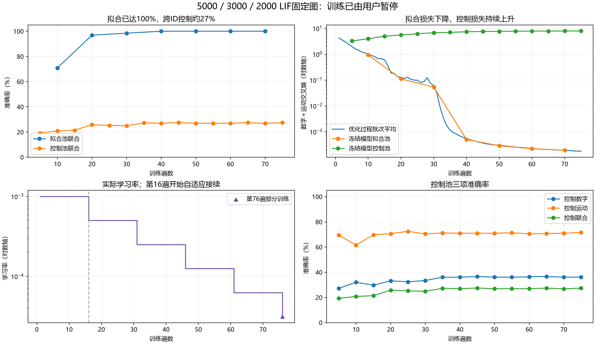

# 大容量三层LIF基线训练报告

生成时间：2026-10-05T09:45:23+08:00。

## 1. 训练状态与主要结论

用户已安全暂停，已完成75遍；第76遍额外完成512/4480视频（4个有效批次）。原预算100遍未跑满，停止原因是用户中断，不是预算结束或自动收敛。没有活动训练进程。

拟合数据已完全学会，跨原始ID表现明显较差。第40遍起完整拟合评估的数字、运动、联合准确率均为100%；控制池联合最高27.50%，最近27.41%。这次结果支持主要瓶颈是泛化差距，不能将低控制准确率简单归因于隐藏节点不足。完全拟合当前有限数据也不证明模型已形成正确的任务表征。

## 2. 准确率与损失

| 评估 | 遍数 | 数字 | 运动 | 联合 | 数字＋运动损失 |
|---|---:|---:|---:|---:|---:|
| 降率前控制 | 15 | 29.732% | 69.732% | 21.429% | 4.962140 |
| 控制联合最高 | 45 | 36.607% | 70.982% | 27.500% | 7.546384 |
| 最近完整控制 | 75 | 36.250% | 71.607% | 27.411% | 7.929280 |
| 最近完整拟合 | 70 | 100.000% | 100.000% | 100.000% | 0.000192 |

拟合池4480视频/160原始ID；控制池1120视频/40不同原始ID。控制池用于学习率与检查点选择，结果属于探索反馈，不能称独立验证或最终测试成绩。

程序的best.pt按数字＋运动＋联合准确率之和选择，实际选择第75遍；联合单项最高在第45遍。两个标准须区分。当前resume.pt在第76遍又更新了4批，未重新评价；表中第75遍成绩对应最近完成的控制评价，不冒称暂停瞬间权重的精确成绩。

从第35遍之后，控制联合约在27%附近平台，而控制交叉熵持续上升到7.929。这符合明显过拟合的表现。未进行跨种子复现或机制消融，不能把泛化问题唯一归因于Fire、LIF、时间表达或模型容量。

## 3. 学习率变化

| 生效遍数 | 原学习率 | 新学习率 |
|---:|---:|---:|
| 16 | 0.001 | 0.0005 |
| 31 | 0.0005 | 0.00025 |
| 46 | 0.00025 | 0.000125 |
| 61 | 0.000125 | 6.25e-05 |
| 76 | 6.25e-05 | 3.125e-05 |

每5遍完整控制评估；损失相对历史有效最好值改善超过1%才重置平台，连续2次未改善则减半，冷却1次评价，下限1e-5。第76遍已按3.125e-5实际更新4批。下降机制确实执行，但没有同预算固定学习率对照，不能把后续改善全部归因于它。

## 4. 模型规模与实际发放

三层始终5000/3000/2000 LIF，总10000隐藏LIF；17输出为不Fire、不leak的累积单元，总计算单元10017。24,954,000相邻层边权保持全连接，输入3,920,000、内部21,000,000、输出34,000，密度均1。只训练边权；泄漏exp(-5/20)、阈值0.5固定，未生长、拆分或删减。每视频8帧，每帧4个5ms神经步，共32步/160ms；实际视频播放时长未规定。视频边界全部状态清零。

以下活动统计来自第75遍完整控制池；静默指该池全部视频均无Fire，不是永久失能。

| 隐藏层 | LIF总数 | 完全静默 | 至少Fire一次 | 每LIF每步Fire率 |
|---|---:|---:|---:|---:|
| 1 | 5000 | 0 | 5000 | 2.78061% |
| 2 | 3000 | 65 | 2935 | 5.35400% |
| 3 | 2000 | 375 | 1625 | 2.29003% |

完整控制池实际Fire共12,380,964次，平均每视频11054.43、每帧1381.80；输出Fire为0。Fire与连接数是资源代理，没有实测能耗。

## 5. 错误分布

第75遍各数字召回率：

| 数字 | 0 | 1 | 2 | 3 | 4 | 5 | 6 | 7 | 8 | 9 |
|---|---:|---:|---:|---:|---:|---:|---:|---:|---:|---:|
| 召回率 | 72.32% | 72.32% | 28.57% | 21.43% | 40.18% | 24.11% | 17.86% | 40.18% | 39.29% | 6.25% |

| 运动 | 召回率 |
|---|---:|
| 静止 | 26.875% |
| 上移 | 98.125% |
| 下移 | 96.250% |
| 左移 | 96.875% |
| 右移 | 95.625% |
| 顺时针 | 44.375% |
| 逆时针 | 43.125% |

完整数字、运动与70类联合混淆矩阵在复核JSON中。70类联合按数字×7＋运动编号。标签与输出均来自已保存的评估证据，本次报告没有新模型前向。

## 6. 实际成本与保存位置

实际优化器更新2,629次＝75×35＋4；有效批量128，微批量32，AdamW、FP32、梯度范数裁剪1。模型唯一根11、数据根20261004、v5数据与原始ID划分保持。

| 工作 | 前向视频次 | 反传视频次 |
|---|---:|---:|
| 参数优化 | 336,512 | 336,512 |
| 初始无标签校准 | 32 | 0 |
| 初始梯度诊断 | 32 | 32 |
| 控制评估（15次） | 16,800 | 0 |
| 拟合评估（7次） | 31,360 | 0 |

训练两会话墙钟合计9.554小时：原会话0.755小时，接续8.799小时。含共享GPU及第65→66遍约5小时日志推进间隔，原因未由日志确认，不等同于纯计算时间。初始化校准/诊断墙钟另计约20.88秒，继承核对与报告复算另计工程工作。

设备RTX 5080 Laptop GPU；训练记录GPU分配峰值882,267,136字节（841.40 MiB），进程工作集峰值2,942,144,512字节。没有OOM重试或数值错误，stderr为空。未修改ONN环境。

原运行：experiments/runs/large_lif_baseline_v1/；续训：experiments/runs/large_lif_baseline_adaptive_v1/。resume.pt保存第76遍512视频后的完整状态，best.pt保存第75遍选择模型，checkpoints/epoch_045_model.pt保存联合最高模型。报告JSON记录源哈希、检查点SHA256、完整曲线、混淆矩阵、活动与成本。

## 7. 复核与结论范围

读取最终检查点，四组Adam步数与实际视频账相符；全部75遍记录连续。保存的最佳联合控制、最新控制与最新拟合预测，复算损失、三项准确率及数字/运动混淆矩阵全部一致，并生成联合混淆矩阵。拟合与控制原始ID无交集，训练源码哈希吻合。报告生成新增模型前向/反传/优化更新均0；原验证与封存测试未读取。

当前应优先处理跨ID泛化、训练原始笔迹覆盖与表征形成，再决定是否扩容或剪减。160个拟合原始ID生成的4480视频不能替代更多独立笔迹。该结果不支持将大规模删减本身当作成功，也不足以证明某一种LIF机制必然失败。用户已暂停，本报告不追加训练。

完整复核：[JSON证据](large_lif_baseline_training_20261005.json)。
