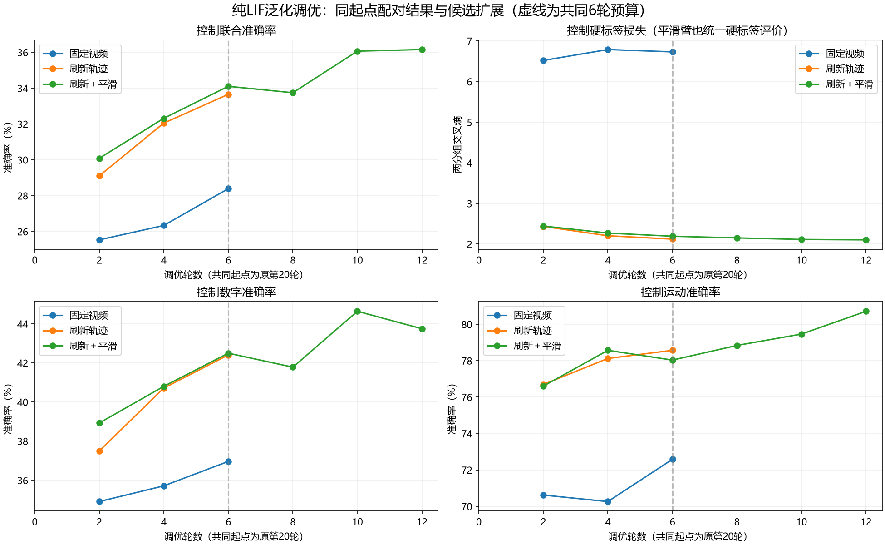

# 纯LIF泛化调优报告

状态：complete_registered_round；阶段：complete。
已按登记规则结束本轮，轮数与停止原因见各臂汇总；轮次结束不等于问题已解决。

5000/3000/2000隐藏LIF、17累积输出、24954000边权；共同原第20轮权重，新AdamW、初始lr=0.0003。
每视频状态清零；8帧各4步、每步5ms，神经时间32步/160ms。生成运动用8个归一化时间点0–1，未定义物理帧率，160ms不是视频播放时长。
仅160拟合ID优化；40控制ID选择。增强不增加独立笔迹；每轮更新原v5轨迹，平滑系数0.1。

## 已保存的控制结果

| 臂 | 完成轮 | 最佳控制轮 | 数字 | 运动 | 联合 |
|---|---:|---:|---:|---:|---:|
| 固定视频 | 6 | 6 | 36.964% | 72.589% | 28.393% |
| 刷新轨迹 | 6 | 6 | 42.411% | 78.571% | 33.661% |
| 刷新＋平滑 | 12 | 12 | 43.750% | 80.714% | 36.161% |

各臂结束/进展：固定视频=pilot_budget；刷新轨迹=pilot_budget；刷新＋平滑=extension_budget。

## 同轮原固定拟合与控制

这里的拟合是原固定4480视频，不是增强臂每轮新轨迹。两侧采用同一轮相同权重，评价均为硬标签；不能将不同轮最佳控制与末轮拟合拼成差距。

| 臂 | 调优轮 | 原固定拟合数字/运动/联合 | 控制数字/运动/联合 | 联合差距（百分点） | 原固定拟合/控制损失 |
|---|---:|---|---|---:|---|
| 固定视频 | 6 | 100.00%/100.00%/100.00% | 36.96%/72.59%/28.39% | 71.61 | 0.0022/6.7331 |
| 刷新轨迹 | 6 | 90.71%/95.09%/86.16% | 42.41%/78.57%/33.66% | 52.50 | 0.7034/2.1234 |
| 刷新＋平滑 | 6 | 88.48%/94.60%/83.55% | 42.50%/78.04%/34.11% | 49.44 | 0.9691/2.1940 |
| 刷新＋平滑 | 12 | 84.75%/90.16%/76.85% | 43.75%/80.71%/36.16% | 40.69 | 1.0432/2.1049 |

## 预登记配对比较

比较第4/6轮控制均值，联合须提高≥2个百分点、两单项各下降≤1个百分点、硬标签损失不升。

| 臂 | 数字 | 运动 | 联合 | 损失 |
|---|---:|---:|---:|---:|
| 固定视频 | 36.339% | 71.429% | 27.366% | 6.7617 |
| 刷新轨迹 | 41.562% | 78.348% | 32.857% | 2.1646 |
| 刷新＋平滑 | 41.652% | 78.304% | 33.214% | 2.2330 |

通过：['refresh_smooth', 'refresh']；继续候选：refresh_smooth。

## 冻结后探索性验证

该验证池历史曾被探索；本轮先冻结后确认，结果不参与回头调优。候选获得额外训练预算，冻结验证可能不是同轮预算比较；等预算机制比较见第4/6轮控制均值。

- 固定视频（冻结调优第6轮）：数字35.214%、运动69.643%、联合24.714%，损失7.2735。
- 刷新＋平滑（冻结调优第12轮）：数字41.571%、运动80.643%、联合33.643%，损失2.1741。

## 冻结后当轮动态拟合诊断

此项在整轮/冻结确认完成后单独登记，只描述冻结候选在同轮实际优化视频上的表现，不参与选择或延长训练。新增4480训练池前向，0反传/0更新/0新渲染。

冻结第12轮真实优化轨迹：数字56.607%、运动84.308%、联合47.790%，硬标签损失1.7170。
同轮控制联合36.161%，动态拟合－控制联合差距11.629个百分点。
原固定拟合率与动态拟合率分列。新轨迹上的拟合能力仍弱，有欠拟合信号；剩余低准确率不能全部归于过拟合，容量、优化和表征原因尚未区分。

## 第6轮误判时的自信程度

对保存电位做softmax并取最大值；下表仅对误判视频求平均，是描述性诊断，不等同于已验证的概率校准。

| 臂 | 数字误判平均自信度 | 运动误判平均自信度 |
|---|---:|---:|
| 固定视频 | 79.53% | 83.98% |
| 刷新轨迹 | 41.38% | 53.30% |
| 刷新＋平滑 | 34.65% | 45.22% |

## 成本和复核

本轮各臂成本汇总与最后完整账目一致。
本轮新增优化前向/反传107520/107520视频次、840更新；控制12次/13440视频，拟合5次/22400视频，验证2次/2800视频。
共同诊断前向/反传16/16视频；增强渲染12轮/53760视频，视频渲染/压缩/哈希墙钟71.4秒（逐轮metadata写入在计时后）。OOM重试0。
保存预测复算损失、三项准确率及三种混淆矩阵；Fire汇总复核吻合。该报告不运行模型、不更新参数。最终测试未读取。
起点以来墙钟包含等待/中断可能性；按臂本会话墙钟、GPU/进程峰值及逐层Fire见JSON，不称真实能耗。

完整[证据](lif_generalization_tuning_20261005.json)；[预登记](../docs/generalization_tuning_execution.md)。
所有模型/优化器/随机状态、逐帧/逐视频Fire和逐LIF统计保留在运行目录；恢复使用python -u -B -m tools.train_generalization_tuning --resume。

共同起点使用旧基线第20轮权重，其原累计优化前向/反传为89600/89600视频次。该历史前缀属于旧基线已计成本，本轮新增成本单列；本轮属于暖启动调优。
